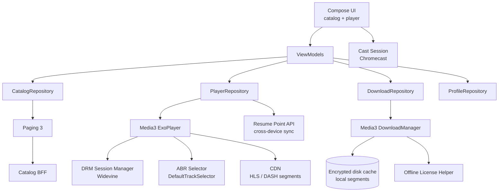
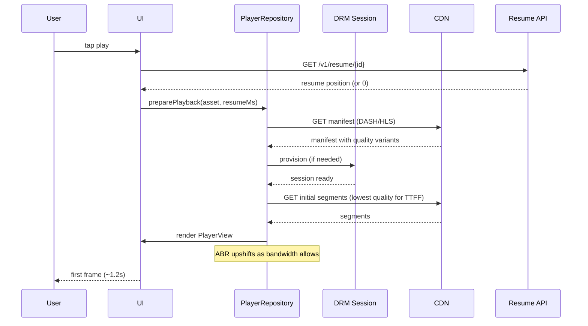
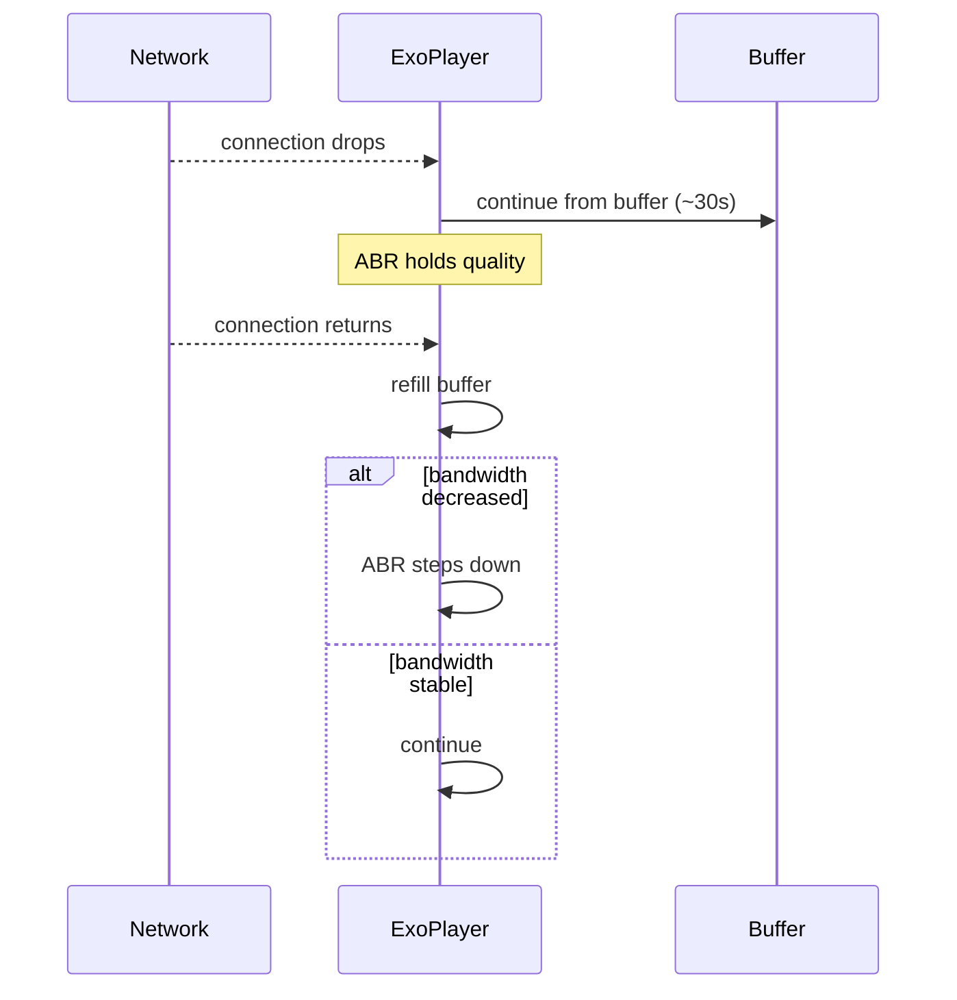
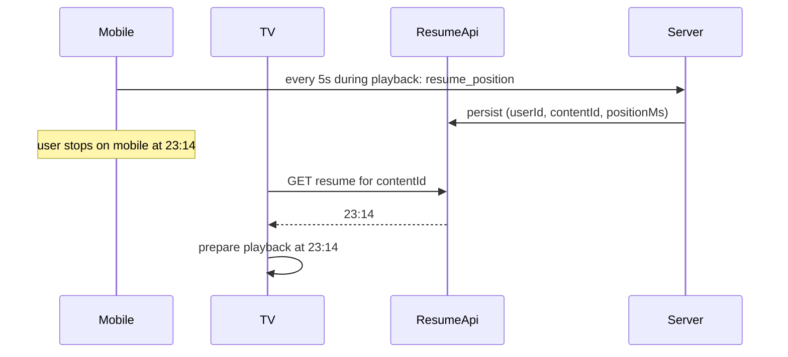

# Video Streaming App — Reference Architecture

> The settled blueprint for a long-form video streaming client (Netflix, YouTube, Prime Video, Disney+, HBO Max). The defining trade-off: **playback quality and time-to-first-frame dominate**. Adaptive bitrate, DRM, offline downloads, multi-screen casting, and cross-device resume are the architectural axes. Everything else — catalog browsing, search, recommendations — exists to feed the player.

---

## Requirements

### Functional

- Browse catalog (home, categories, search, recommendations).
- Play long-form video (movies, episodes) with quality adaptation.
- DRM-protected playback (Widevine L1 for HD/4K, L3 fallback for SD).
- Subtitle / closed-caption rendering with system preference support.
- Audio-track switching (multiple languages).
- Resume playback across devices (TV ↔ mobile ↔ web).
- Offline downloads for paid subscribers (per-region availability).
- Casting to TVs (Chromecast, AirPlay-via-shim).
- Picture-in-picture and background audio mode.
- User profiles per account (multi-profile household).
- Parental controls, ratings, watchlist.

### Non-Functional

- **Time-to-first-frame (TTFF) < 1.5s** on a stable connection. The startup loading spinner is the most-watched screen in the app.
- **No rebuffering** mid-playback on a stable connection. ABR adapts before the buffer drains.
- **Battery-aware playback.** Hardware codec usage where available; software fallback gracefully degrades.
- **Cellular-friendly defaults.** SD on cellular by default; user can opt in to HD with explicit data-usage warning.
- **DRM session continuity** across short network drops.
- **Offline download durability.** A user who downloads on Wi-Fi and travels can watch on the plane. License validity tracked per content.
- **Multi-device.** Resume points sync across devices within seconds.

---

## Architecture



The defining property: **the player module is a first-class citizen on par with the entire rest of the app**. ExoPlayer is not a UI widget; it's a service-layer concern with its own threading, DRM session lifecycle, ABR state, and surface lifecycle.

---

## Modules

### Catalog (Browse / Search / Recommendations)

- Standard Paging 3 + RemoteMediator pattern; cursor-paginated.
- Recommendations server-driven (ML black box); client receives sorted lists.
- Search delegates to a search BFF with typeahead.
- Image-heavy: poster art, hero images, episode thumbnails. Coil 3 with bounded memory cache.

### PlayerRepository (the heart)

Wraps ExoPlayer with the app's playback policy:

- DRM session setup (Widevine).
- Track selection: video, audio, subtitle.
- Resume point sync (load on play; save on pause/seek/exit at 5s granularity).
- Bandwidth estimator integration with ABR.
- Buffering policies tuned for TTFF vs rebuffer trade-off.
- Surface lifecycle (Compose `AndroidView` for `PlayerView`).

```kotlin
class PlayerRepository @Inject constructor(
    private val playerFactory: ExoPlayerFactory,
    private val drmSessionManager: DefaultDrmSessionManager,
    private val resumePointApi: ResumePointApi,
) {
    fun preparePlayback(asset: Asset, resumeMs: Long?): ExoPlayer {
        val mediaSource = HlsMediaSource.Factory(httpDataSourceFactory)
            .setDrmSessionManagerProvider { drmSessionManager }
            .createMediaSource(MediaItem.fromUri(asset.manifestUrl))
        val player = playerFactory.create()
        player.setMediaSource(mediaSource, /* startPositionMs = */ resumeMs ?: 0L)
        player.prepare()
        return player
    }
}
```

See [`mobile-system-design/youtube-video-streaming.md`](../mobile-system-design/youtube-video-streaming.md) for the reasoning exercise.

### DRM Session Manager

- Widevine session lifecycle.
- Online provisioning on first use; offline license fetch for downloaded content.
- Session reuse across content from the same DRM scope to avoid re-provisioning cost.
- Graceful degradation: L1 → L3 if hardware path unavailable; SD-only on L3.

### ABR (Adaptive Bitrate)

- `DefaultTrackSelector` with `Parameters.Builder()`:
  - `setMaxVideoSizeSd()` on cellular (configurable).
  - `setForceHighestSupportedBitrate(false)` to allow downshifts.
  - `setMaxAudioBitrate(...)` per quality tier.
- Bandwidth estimator (`DefaultBandwidthMeter`) feeds the selector.
- User-overridable from settings (Auto / Best / Data Saver).
- Pre-roll buffer 2-3s; ongoing 30s ahead; rebuffer detection at < 0.5s.

### DownloadRepository (Offline)

- `androidx.media3.exoplayer.offline.DownloadManager` orchestrates segment downloads.
- Stores in app-private encrypted disk cache (`SimpleCache` over an encrypted backing store).
- Offline license obtained via `OfflineLicenseHelper`; persisted with the content.
- Per-content metadata in Room (`download_state`, `bytes_downloaded`, `expires_at`).
- Constraints: Wi-Fi-only by default; user can opt into cellular download with bandwidth warning.
- Periodic license refresh (most subscriptions require renewal every N days).

### Resume Sync

- Local resume position written to Room every 5s during playback.
- Synced to server at pause / app background / 30s interval.
- On play of any content: query `/v1/resume/<contentId>` and use as start position if more recent than local.
- Cross-device convergence within ~5s.

### Cast Session

- Google Cast SDK integration.
- Cast button in player UI; when active, ExoPlayer pauses and casts.
- Mini-controller persistent on app surface.
- Bidirectional remote control while casting.

---

## Data Flow

### Cold Start to First Frame



The TTFF chain has several parallelizable steps (resume fetch, manifest fetch, DRM provision). The implementation parallelizes them; the user sees the first frame in 1-2s.

### Mid-Playback Network Drop



The 30s pre-buffered window is the resilience against typical network blips. Anything longer than 30s does cause a rebuffer pause; the player surfaces this clearly ("Buffering…").

### Cross-Device Resume



---

## Offline Strategy

| Subsystem | Offline behavior |
|---|---|
| **Catalog browsing** | Cached recent screens render from Room; new browsing blocked. |
| **Search** | Cached recents; new queries blocked. |
| **Online playback** | Blocked offline; clear UX directs to "Downloads" tab. |
| **Offline downloads playback** | Fully functional; license validated locally; subtitle / audio track switching works. |
| **Resume points** | Local writes queue; sync on reconnect. |
| **Profile changes** | Queue; sync on reconnect. |
| **Cast** | Requires Wi-Fi (Cast is a LAN protocol). |
| **License renewal** | Done in background while online; downloaded content unlocked until expiry. |

The downloads-for-offline subsystem is the largest engineering investment relative to its surface area. Worth it — for paid subscribers, offline travel-time playback is one of the top retention drivers.

---

## Security

- **DRM is the entire security model for content.** Widevine sessions; license server-side; HDCP enforcement on output paths.
- **L1 hardware DRM** required for HD / 4K. Devices without L1 are SD-locked. Implement gracefully ("HD not available on this device").
- **No screen capture** during playback. `FLAG_SECURE` on the player surface (and HDCP downstream).
- **TLS 1.3 + cert pinning** at the BFF and the DRM license server. See [`security/certificate-pinning.md`](../security/certificate-pinning.md).
- **Encrypted offline cache.** Segments stored in encrypted form (SimpleCache + custom Cipher provider); license also encrypted at rest.
- **OAuth tokens** in `EncryptedSharedPreferences`. PSP tokens for subscription billing similarly protected.
- **Multi-profile privacy.** Per-profile watchlists, watch history, recommendations are isolated server-side. Kids profiles enforce parental controls server-validated.

---

## Observability

- **Quality of Experience (QoE) metrics.** TTFF, rebuffer rate, rebuffer duration, average bitrate, dropped frames. These ARE the SLIs.
- **Per-content cohort.** A bitrate ladder bug affecting one show is invisible in aggregate; per-content slicing surfaces it.
- **Per-device-class cohort.** A codec issue on a specific chipset family.
- **DRM session failure rate.** Licensing edge cases.
- **Bandwidth distribution.** Drives ABR ladder design and CDN provisioning.
- **Offline download success rate.** Network class, device storage, license fetch outcomes.
- **Resume-point sync latency.** Cross-device freshness.
- **App-level crash-free users > 99.5%**; player-specific crash gate tighter (a player crash interrupts the user's evening).

See [`observability/slis.md`](../observability/slis.md), [`observability/dashboards.md`](../observability/dashboards.md).

---

## Failure Modes

**TTFF exceeds 3s consistently.** *Mitigation:* parallelize manifest, license, and initial segments; lower initial ABR rung; pre-warm DRM session.

**Mid-playback rebuffer on a stable network.** *Mitigation:* ABR misjudged bandwidth; tune bandwidth estimator hysteresis; investigate CDN throttling.

**DRM session expires during long episode.** *Mitigation:* session refresh in background before expiry; if expired, smooth re-license flow without UI flicker.

**Offline license expired while user is traveling.** *Mitigation:* warn user 7 days before expiry; license renewal in background when reconnecting; clear UX showing remaining offline validity.

**Cast disconnects mid-playback.** *Mitigation:* fall back to local playback at the same resume point; explain disconnection.

**HDR / 4K not supported on this device but UI shows the option.** *Mitigation:* device capability check at app start; UI hides unsupported quality options.

**App killed during playback; user expects to resume seamlessly.** *Mitigation:* resume point persisted at 5s granularity; on relaunch, "Continue watching X from 23:14" prompt.

**Disk full mid-download.** *Mitigation:* check `StatFs.getAvailableBytes()` before download start; pause if disk drops below threshold; clear UX.

**Codec missing on a specific Android version.** *Mitigation:* `MediaCodecList` capability check at playback start; fallback to a supported variant or graceful "not supported" message.

---

## Scaling

### Catalog scaling

- Server-side ranking and personalization.
- Per-region content rights management (a movie available in US may not be available in EU).

### Playback scaling

- CDN-served segments at edge.
- ABR ladder tuned per content (live sports differ from prestige drama).
- DRM license server scaling: stateless; per-region.

### Offline downloads

- License fetch is the bottleneck. Per-region license caches.
- Segment downloads are CDN-served; scale infinitely.

### Multi-device scaling

- Resume sync is high-frequency, low-payload. Optimized for write throughput.

### Casting / Living-room scaling

- Cast protocol is LAN; server-side has minimal involvement except for content authorization.

---

## Release Strategy

- **Conservative staged rollout.** Player crashes ruin user experience disproportionately; rollout 1% → 5% → 25% → 100% over 1-2 weeks.
- **Per-region staged rollouts.** Content licensing varies by region; bugs in regional code paths contained.
- **Strict crash-rate gating.** Player module crash-free target ≥ 99.9%. See [`release-engineering/crash-rate-gating.md`](../release-engineering/crash-rate-gating.md).
- **Kill switches** for every DRM provider, every codec path, every recommendation surface. See [`release-engineering/kill-switches.md`](../release-engineering/kill-switches.md).
- **Manual QA on critical content** (new high-profile launches) — at least sanity-check that the new release plays the marquee titles.
- **Long support tail.** TVs and connected devices have long lifecycles. Mobile app support floor is typically Android 7+ to match TV / set-top expectations.

---

## Summary of Technologies

| Layer | Choice | Why |
|---|---|---|
| UI | Jetpack Compose + Media3 `PlayerView` (AndroidView) | Modern; specialized player surface |
| State | ViewModel + StateFlow | Standard |
| Catalog pagination | Paging 3 | Cursor pagination |
| Images | Coil 3 | Poster art, episode thumbnails |
| Player | Media3 / ExoPlayer | Industry standard ABR + DRM |
| DRM | Widevine via Media3 | L1 for HD/4K, L3 fallback |
| ABR | Media3 `DefaultTrackSelector` | Configurable bandwidth-based |
| Offline | Media3 `DownloadManager` + `OfflineLicenseHelper` | License + segments durably stored |
| Network | OkHttp + Retrofit + Cronet (where used) | Standard plus QUIC support for streaming |
| Tokens | EncryptedSharedPreferences | Subscription auth |
| DI | Hilt | Standard |
| Background | WorkManager | License refresh, download orchestration |
| Push | FCM | Episode availability, new content alerts |
| Cast | Google Cast SDK | TV handoff |
| Picture-in-Picture | Android native (`enterPictureInPictureMode`) | OS-native PiP |

---

## Related

- [`mobile-system-design/youtube-video-streaming.md`](../mobile-system-design/youtube-video-streaming.md) — playback + ABR reasoning exercise.
- [`mobile-system-design/file-downloader.md`](../mobile-system-design/file-downloader.md) — patterns reusable for offline downloads.
- [`mobile-system-design/notification-system.md`](../mobile-system-design/notification-system.md) — episode availability pings.
- [`mobile-system-design/payment-flow.md`](../mobile-system-design/payment-flow.md) — subscription billing.
- [`mobile-system-design/performance.md`](../mobile-system-design/performance.md) — TTFF + decoder optimization.
- [`security/secure-storage-on-android.md`](../security/secure-storage-on-android.md) — encrypted offline cache.
- [`consumer-app.md`](consumer-app.md) — sibling blueprint with similar catalog patterns.

---

> **In short:** Video streaming optimizes for TTFF and uninterrupted playback. ExoPlayer is the architectural centerpiece; DRM, ABR, and offline downloads are first-class subsystems with their own lifecycles. Where social media optimizes for scroll smoothness, video streaming optimizes for the first frame and the next 90 minutes of buffer-free playback. The catalog exists to feed the player.
