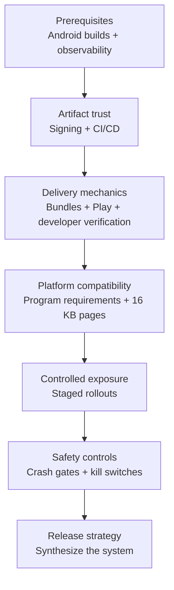

# Release Engineering

## Purpose

How code safely reaches users. Owns the canonical treatment of app bundles and release strategy.

## Why It Matters

Mobile release engineering is harder than web — you can't roll back instantly, and your users live with whatever you shipped until they update. The discipline is staged rollouts, kill switches, and crash gating.

## What This Folder Helps You Do

- Ship Android apps safely when rollback is slow, app updates are user-controlled, and bad releases can remain installed for weeks.
- Design staged rollouts, crash gates, kill switches, code signing, Play Store workflows, app bundles, and CI/CD checks as one release system.
- Decide when to halt, hotfix, remote-disable, force-upgrade, or continue rollout based on user impact and observability.
- Communicate release risk with product, support, backend, and leadership teams before a bad release becomes an incident.

## Guided Reading Sequence

Prerequisites: basic Android build knowledge and [Observability](observability.md) through SLIs/SLOs. Learn artifact trust and automation before rollout controls and policy.

Safe delivery begins by proving artifact identity, automates distribution and compatibility checks, limits exposure, and closes the loop with measurable halt and disable controls. Release strategy is read last because it coordinates every preceding mechanism.

1. [Code Signing](release-engineering/code-signing.md)
2. [CI/CD for Mobile](release-engineering/ci-cd-for-mobile.md)
3. [App Bundles & Dynamic Delivery](release-engineering/app-bundles.md) — canonical owner.
4. [Play Store Internals](release-engineering/play-store-internals.md)
5. [Android Developer Verification](release-engineering/android-developer-verification.md)
6. [Android Platform Compatibility Program](release-engineering/android-platform-compatibility.md)
7. [16 KB Page Sizes](release-engineering/16kb-page-sizes.md) — native-code compliance application.
8. [Staged Rollouts](release-engineering/staged-rollouts.md)
9. [Crash-Rate Gating](release-engineering/crash-rate-gating.md)
10. [Kill Switches](release-engineering/kill-switches.md)
11. [Release Strategy](release-engineering/release-strategy.md) — synthesis; read last.

**Next:** connect these controls to [Security](security.md) and [Platform Engineering](platform-engineering.md).
