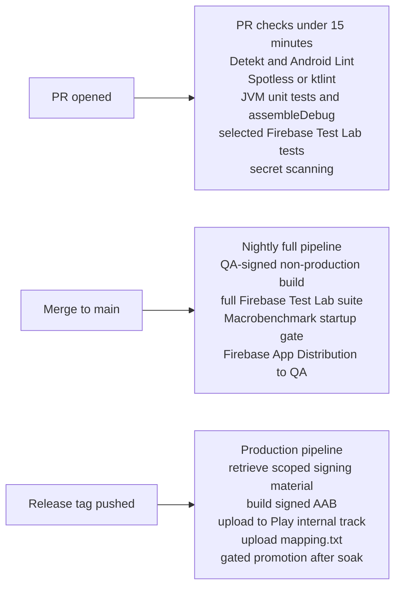

# Release Engineering: CI/CD for Mobile

> A working CI/CD pipeline for a multi-module Android app: GitHub Actions YAML, Gradle config, Firebase Test Lab for UI tests, and a secret-scoped release path. Pin the release inputs, measure cache effectiveness, and keep signing access centralized and auditable.

---

## 1. The Pipeline Shape



---

## 2. GitHub Actions Workflow — PR Checks

```yaml
# .github/workflows/pr.yml
name: PR Checks

on:
  pull_request:
    branches: [main]

concurrency:
  group: pr-${{ github.head_ref }}
  cancel-in-progress: true

jobs:
  static:
    runs-on: ubuntu-latest
    steps:
      - uses: actions/checkout@v4
        with:
          fetch-depth: 0   # for ktlint diff mode

      - uses: actions/setup-java@v4
        with:
          distribution: temurin
          java-version: 21

      - name: Setup Gradle
        uses: gradle/actions/setup-gradle@v3
        with:
          cache-read-only: ${{ github.event_name == 'pull_request' }}
          gradle-home-cache-cleanup: true

      - name: Secret scanning
        uses: gitleaks/gitleaks-action@v2
        env:
          GITHUB_TOKEN: ${{ secrets.GITHUB_TOKEN }}

      - name: Detekt
        run: ./gradlew detekt --no-daemon --build-cache

      - name: Android Lint
        run: ./gradlew lintDebug --no-daemon --build-cache

      - name: Spotless
        run: ./gradlew spotlessCheck --no-daemon --build-cache

  unit-tests:
    runs-on: ubuntu-latest
    needs: static
    steps:
      - uses: actions/checkout@v4
      - uses: actions/setup-java@v4
        with: { distribution: temurin, java-version: 21 }
      - uses: gradle/actions/setup-gradle@v3
        with:
          cache-read-only: ${{ github.event_name == 'pull_request' }}

      - name: Run JVM tests
        run: ./gradlew testDebugUnitTest --no-daemon --build-cache

      - name: Upload reports
        if: failure()
        uses: actions/upload-artifact@v4
        with:
          name: test-reports
          path: '**/build/reports/tests/'

  assemble:
    runs-on: ubuntu-latest
    needs: static
    steps:
      - uses: actions/checkout@v4
      - uses: actions/setup-java@v4
        with: { distribution: temurin, java-version: 21 }
      - uses: gradle/actions/setup-gradle@v3

      - name: Assemble debug
        run: ./gradlew :app:assembleDebug :app:assembleDebugAndroidTest --no-daemon --build-cache

      - name: Save APKs
        uses: actions/upload-artifact@v4
        with:
          name: debug-apks
          path: |
            app/build/outputs/apk/debug/*.apk
            app/build/outputs/apk/androidTest/debug/*.apk
          retention-days: 7

  instrumented:
    runs-on: ubuntu-latest
    needs: assemble
    if: ${{ github.event.pull_request.draft == false }}
    steps:
      - uses: actions/checkout@v4
      - uses: actions/download-artifact@v4
        with: { name: debug-apks, path: build/ }

      - id: gcp
        uses: google-github-actions/auth@v2
        with:
          credentials_json: ${{ secrets.GCP_FTL_SA_JSON }}

      - uses: google-github-actions/setup-gcloud@v2

      - name: Run on Firebase Test Lab
        run: |
          gcloud firebase test android run \
            --type instrumentation \
            --app build/app-debug.apk \
            --test build/app-debug-androidTest.apk \
            --device model=oriole,version=33,locale=en,orientation=portrait \
            --device model=Pixel2,version=28,locale=en,orientation=portrait \
            --timeout 30m \
            --results-bucket gs://${{ secrets.FTL_RESULTS_BUCKET }}
```

Key choices:
- `concurrency` cancels in-progress runs when a new push lands on the same PR — kills wasted CPU.
- `cache-read-only` on PRs prevents poisoning the cache from forked PRs.
- `setup-gradle@v3` handles Gradle config-cache, build-cache reads/writes, and dependency caching in one action.
- `assemble` and `unit-tests` parallel after `static`; the gate is fast feedback first.

---

## 3. Gradle Configuration For CI

```properties
# gradle.properties
org.gradle.jvmargs=-Xmx6g -XX:MaxMetaspaceSize=1g -XX:+HeapDumpOnOutOfMemoryError -XX:+UseG1GC -Dfile.encoding=UTF-8
org.gradle.parallel=true
org.gradle.caching=true
org.gradle.configuration-cache=true
org.gradle.workers.max=4

# Kotlin
kotlin.daemon.jvmargs=-Xmx3g
kotlin.incremental=true

# AndroidX
android.useAndroidX=true
android.enableJetifier=false
android.nonTransitiveRClass=true
android.nonFinalResIds=true

# Build features
android.defaults.buildfeatures.buildconfig=false
android.defaults.buildfeatures.aidl=false
android.defaults.buildfeatures.renderscript=false
android.defaults.buildfeatures.resvalues=false
android.defaults.buildfeatures.shaders=false
```

`org.gradle.jvmargs=-Xmx6g`: explicit, because adding RAM to the runner does nothing if the JVM heap cap is the default 1 GB.

`org.gradle.configuration-cache=true`: configuration is reused between builds. Saves 10-30 seconds per command on a moderately complex project.

`android.useAndroidX=true` + `android.enableJetifier=false`: forbids legacy support libraries. Modernizes the project and shrinks the build graph.

```kotlin
// gradle/libs.versions.toml — Version Catalog
[versions]
agp = "9.3.0"
compose-bom = "2026.06.00"
hilt = "2.55"
android-targetSdk = "36"

[libraries]
androidx-core = { module = "androidx.core:core-ktx", version = "1.15.0" }
compose-bom = { module = "androidx.compose:compose-bom", version.ref = "compose-bom" }
compose-ui = { module = "androidx.compose.ui:ui" }
hilt-android = { module = "com.google.dagger:hilt-android", version.ref = "hilt" }

[plugins]
android-application = { id = "com.android.application", version.ref = "agp" }
hilt = { id = "com.google.dagger.hilt.android", version.ref = "hilt" }
```

Every module reads from the catalog:

```kotlin
// app/build.gradle.kts
plugins {
    alias(libs.plugins.android.application)
    alias(libs.plugins.hilt)
}

dependencies {
    implementation(libs.androidx.core)
    implementation(platform(libs.compose.bom))
    implementation(libs.compose.ui)
    implementation(libs.hilt.android)
}
```

No version literals in `build.gradle.kts`. One source of truth.

---

## 4. Remote Build Cache (Gradle Enterprise / Develocity)

Develocity's remote build cache lets developers and CI reuse outputs for cacheable tasks when the task inputs match an available, non-evicted cache entry. Cache misses and non-cacheable tasks still execute, so measure hit rate and transfer cost on the real build; any clean-build improvement is workload-specific rather than an automatic 45-minute-to-3-minute transformation.

```kotlin
// settings.gradle.kts
plugins {
    id("com.gradle.develocity") version "4.5.0"
}

develocity {
    server.set("https://develocity.example.com")
    buildScan {
        publishing.onlyIf { System.getenv("CI") == "true" }
        termsOfUseAgree.set("yes")
        uploadInBackground.set(false)   // wait for upload in CI
    }
}

buildCache {
    local { isEnabled = true }
    remote(develocity.buildCache) {
        isEnabled = true
        isPush = System.getenv("GITHUB_REF") == "refs/heads/main"   // only main writes
    }
}
```

The contract: trusted `main` builds *write* eligible cached task outputs; PR builds *read* them. A narrowly scoped PR can reuse unaffected task outputs when all declared inputs match. Track hit rate, transfer time, and end-to-end duration rather than promising a fixed speedup.

Equivalent without Develocity: Gradle Build Cache Node or self-hosted backed by S3 (`gradle/build-cache-node` Docker image + your own bucket).

---

## 5. Release Workflow (Tag → Production)

```yaml
# .github/workflows/release.yml
name: Release

on:
  push:
    tags: ['v*.*.*']

permissions:
  contents: read
  id-token: write   # for GCP workload identity federation

jobs:
  release:
    runs-on: ubuntu-latest
    environment:
      name: production
      url: https://play.google.com/console
    steps:
      - uses: actions/checkout@v4
      - uses: actions/setup-java@v4
        with: { distribution: temurin, java-version: 21 }
      - uses: gradle/actions/setup-gradle@v3

      - id: gcp-auth
        uses: google-github-actions/auth@v2
        with:
          workload_identity_provider: ${{ secrets.GCP_WIF_PROVIDER }}
          service_account: ${{ secrets.GCP_RELEASE_SA }}

      - uses: google-github-actions/setup-gcloud@v2

      - name: Materialize upload keystore from Secret Manager
        run: |
          gcloud secrets versions access latest --secret=android-upload-keystore --format='get(payload.data)' \
            | base64 --decode > "$RUNNER_TEMP/upload-keystore.jks"

      - name: Build signed AAB
        env:
          KEYSTORE_PASSWORD: ${{ secrets.KEYSTORE_PASSWORD }}
          KEY_ALIAS: ${{ secrets.KEY_ALIAS }}
          KEY_PASSWORD: ${{ secrets.KEY_PASSWORD }}
        run: |
          ./gradlew :app:bundleRelease \
            -Pandroid.injected.signing.store.file="$RUNNER_TEMP/upload-keystore.jks" \
            -Pandroid.injected.signing.store.password=$KEYSTORE_PASSWORD \
            -Pandroid.injected.signing.key.alias=$KEY_ALIAS \
            -Pandroid.injected.signing.key.password=$KEY_PASSWORD

      - name: Remove temporary keystore
        if: always()
        run: rm -f "$RUNNER_TEMP/upload-keystore.jks"

      - name: Upload mapping to Crashlytics
        run: ./gradlew :app:uploadCrashlyticsMappingFileRelease

      - name: Publish to Play (Internal Track)
        env:
          PLAY_SERVICE_ACCOUNT: ${{ secrets.PLAY_PUBLISHER_SA_JSON }}
        run: ./gradlew :app:publishReleaseBundle --track=internal
```

This example stores an exportable keystore in Secret Manager and retrieves it with a short-lived workload-identity token. Removing the temporary file narrows exposure but does not prove secure physical erasure on a hosted runner. A Cloud KMS/HSM design is different: the private key remains non-exportable and requires signing-tool integration. In either design, restrict principal, secret, environment, log, and artifact access and verify the certificate before upload.

### Release evidence artifact

Every production candidate should publish one machine-readable evidence file before promotion:

```json
{
  "versionName": "4.12.1",
  "versionCode": 412010,
  "gitSha": "abc1234",
  "branch": "release/v4.12",
  "signedAabSha256": "f3...",
  "mappingUploaded": true,
  "baselineProfileIncluded": true,
  "unitTests": "passed",
  "instrumentedTests": "passed",
  "macrobenchmark": {
    "coldStartP95Ms": 1320,
    "scrollFrameP95Ms": 14
  },
  "releaseDecision": {
    "track": "internal",
    "nextTrack": "production",
    "allowed": true,
    "reason": "all gates passed"
  }
}
```

This artifact becomes the release manager's source of truth. It proves what was built, which commit produced it, whether mapping files were uploaded, whether startup/profile protections were present, and why CI allowed the next promotion.

---

## 6. Triple-T Play Publisher Plugin

```kotlin
// app/build.gradle.kts
plugins {
    id("com.github.triplet.play") version "3.11.0"
}

play {
    serviceAccountCredentials.set(file(System.getenv("PLAY_SERVICE_ACCOUNT") ?: "play-service-account.json"))
    defaultToAppBundles.set(true)
    track.set("internal")
    releaseStatus.set(ReleaseStatus.COMPLETED)
    updatePriority.set(2)
    resolutionStrategy.set(ResolutionStrategy.AUTO)
    artifactDir.set(file("build/outputs/bundle/release"))
}
```

Tasks the plugin contributes:
- `publishReleaseBundle` — upload the AAB and create a release.
- `promoteArtifact --from-track internal --to-track production --user-fraction 0.1` — staged rollout (see `staged-rollouts.md`).
- `publishListing` — push release notes and store listings.

---

## 7. UI Tests on Firebase Test Lab

```kotlin
// gradle/libs.versions.toml
flank = "23.10.1"

// app/build.gradle.kts (testing module)
plugins {
    id("flank") version libs.versions.flank.get()
}

fladle {
    serviceAccountCredentials = file("ftl-service-account.json")
    devices = listOf(
        mapOf("model" to "oriole", "version" to "33"),       // Pixel 6 / Android 13
        mapOf("model" to "redfin", "version" to "30"),       // Pixel 5 / Android 11
        mapOf("model" to "Pixel2", "version" to "28"),       // Old API floor smoke
    )
    timeoutMin = 30
    flakyTestAttempts = 1
    smartFlankGcsPath = "gs://${BuildConfig.FTL_BUCKET}/flank/results.xml"
    shardTime = 120   // 2-minute target shard
}
```

Flank can shard tests across the selected Firebase Test Lab matrix, and its historical timing data can improve balance. Wall time still includes provisioning, queueing, uneven tests, retries, and result collection; measure the actual matrix before setting a PR budget.

Why consider FTL alongside CI-runner emulators:
- Hosted-runner virtualization, emulator image, and hardware acceleration affect emulator performance and reliability.
- FTL offers both physical and virtual devices; select them according to the failure mode and required hardware fidelity.
- Side-by-side reports of video, Logcat, performance metrics.
- A managed matrix can improve device coverage, but flake rate is determined by the tests, app, devices, orchestration, and infrastructure. Track it per suite rather than assuming a universal percentage.

---

## 8. Reproducible Builds

```kotlin
// settings.gradle.kts
pluginManagement {
    repositories {
        google()
        mavenCentral()
        gradlePluginPortal()
    }
}

dependencyResolutionManagement {
    repositoriesMode.set(RepositoriesMode.FAIL_ON_PROJECT_REPOS)
    repositories {
        google()
        mavenCentral()
    }
}
```

```properties
# gradle/wrapper/gradle-wrapper.properties
distributionUrl=https\://services.gradle.org/distributions/gradle-9.5.0-bin.zip
distributionSha256Sum=553c78f50dafcd54d65b9a444649057857469edf836431389695608536d6b746
```

Rules:
- **No `+` in versions.** Anywhere.
- **`dependencyResolutionManagement` is FAIL_ON_PROJECT_REPOS** — modules can't add ad-hoc repositories.
- **Pin Gradle wrapper SHA-256.**
- **Pin Kotlin and AGP exact versions.**
- **Lock dependency versions:** `./gradlew dependencies --write-locks` and commit `gradle/dependency-locks/`.

Those controls are necessary but not sufficient for byte-for-byte reproducibility. Pin or record the JDK, AGP, Gradle, SDK/NDK packages, dependency repositories, environment, archive ordering/timestamps, and signing inputs; then compare independently produced artifacts. Define separately whether the goal is repeatable source inputs, identical unsigned outputs, or identical signed release bytes.

---

## 9. CI-Specific Memory Tuning

```yaml
# In the workflow when needed
env:
  GRADLE_OPTS: -Xmx6g
```

Do not disable the daemon by reflex. Ephemeral jobs cannot reuse a process across jobs, but multiple Gradle invocations inside one job can benefit from reuse. Even `--no-daemon` may start a single-use daemon to honor JVM settings. Compare wall time and peak memory for the actual workflow, then choose daemon policy explicitly.

Heap needs depend on module graph, worker count, Kotlin/AGP versions, and concurrent tools. Size the heap below runner memory so the OS, emulator, Kotlin compiler, and other processes retain headroom; use build scans, heap dumps, and runner metrics when CI fails but local builds pass.

---

## 10. Macrobenchmark Gate

```kotlin
// app-benchmark/build.gradle.kts
plugins {
    id("com.android.test")
    id("androidx.baselineprofile") version "1.4.1"
}

android {
    defaultConfig {
        minSdk = 28
        targetSdk = libs.versions.android.targetSdk.get().toInt()
    }
    testOptions {
        managedDevices {
            devices {
                create<ManagedVirtualDevice>("pixel6Api33") {
                    device = "Pixel 6"
                    apiLevel = 33
                    systemImageSource = "aosp"
                }
            }
        }
    }
}
```

```kotlin
// app-benchmark/src/main/kotlin/StartupBenchmark.kt
@RunWith(AndroidJUnit4::class)
@LargeTest
class StartupBenchmark {
    @get:Rule val rule = MacrobenchmarkRule()

    @Test
    fun coldStart() = rule.measureRepeated(
        packageName = "com.example.app",
        metrics = listOf(StartupTimingMetric()),
        iterations = 10,
        startupMode = StartupMode.COLD,
        compilationMode = CompilationMode.Partial(BaselineProfileMode.Require),
    ) {
        pressHome()
        startActivityAndWait()
    }
}
```

```yaml
# .github/workflows/nightly.yml
- name: Run startup benchmark
  run: ./gradlew :app-benchmark:pixel6Api33BenchmarkAndroidTest

- name: Gate on regression
  run: |
    python3 scripts/check_perf.py \
      app-benchmark/build/outputs/connected_android_test_additional_output/ \
      --baseline scripts/baselines/startup.json \
      --max-regression-percent 10
```

A nightly perf gate that diffs against a baseline. If cold-start regresses > 10%, the build fails and triggers an investigation.

---

## 11. Common Pitfalls

- **Using one daemon rule for every CI job.** Measure process reuse, wall time, and peak memory; an ephemeral job with several Gradle calls differs from a one-command job.
- **Cache poisoning from PRs.** Allowing untrusted PRs to write to remote cache lets a malicious actor replace cached artifacts. `cache-read-only: true` on PRs.
- **Uncontrolled signing-key copies.** CI is not inherently safer than a laptop. Centralize access, prefer non-exportable or tightly scoped material, require audited authorization, and minimize every local or runner copy.
- **Logging the keystore password.** A `set -x` in the workflow leaks it. Use GitHub Actions secrets and avoid printing.
- **Assuming `assembleRelease` proves release signing.** Without valid release credentials, output may be unsigned or the task may fail; assert the expected certificate on the artifact before publishing.
- **Floating dependency versions.** `1.2.+` resolves differently over time; reproducibility dies.
- **Skipping the build cache for "consistency."** A correctly configured cache *is* consistent — same inputs, same outputs. Distrust = symptom of bad config, not reason to disable.
- **Treating every UI-test environment as equivalent.** Use local/managed emulators for fast deterministic coverage and physical devices for hardware- or vendor-sensitive risks; measure flake and quarantine root causes in each lane.
- **No concurrency cancel.** Pushing twice to the same PR runs two full pipelines. `concurrency: cancel-in-progress: true`.
- **Tag pushes without environment protection.** Anyone with write can publish to Play. `environment: production` with required reviewers blocks accidental releases.

---

## 12. Further Reading

- [Gradle build cache](https://docs.gradle.org/current/userguide/build_cache.html) — official.
- [Gradle configuration cache](https://docs.gradle.org/current/userguide/configuration_cache.html) — what it caches and pitfalls.
- [Macrobenchmark](https://developer.android.com/topic/performance/benchmarking/macrobenchmark-overview) — CI startup/jank gates.
- [Firebase Test Lab](https://firebase.google.com/docs/test-lab) — managed physical and virtual Android device testing.
- [Triple-T Gradle Play Publisher](https://github.com/Triple-T/gradle-play-publisher) — Play upload automation.
- [Flank for FTL parallelism](https://github.com/Flank/flank) — sharding wrapper.

---

> **In short:** use CI orchestration, measured caching, a risk-based emulator/device matrix, automated Play publishing, scoped signing access, pinned release inputs, duplicate-run cancellation, and nightly performance gates. Keep the release decision encoded, reviewable, and backed by artifact evidence.
