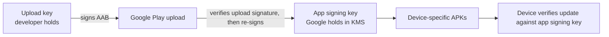

# Release Engineering: Code Signing & Play App Signing

> How Android cryptographically binds an APK to your team's identity, and how Play App Signing splits the responsibility so a leaked upload key isn't fatal.

---

## 1. What "Signing" Actually Does

Android's package manager won't install or update an APK unless the signing certificate matches the one already on the device for that package name. The certificate is a public key; the signing process produces a digest over the APK contents signed with the matching private key.

Modify any byte of a signed APK and the digest no longer matches. Sign with a different key and the update is rejected — the user has to uninstall and reinstall, losing all app data.

Three signing schemes co-exist:

| Scheme | Introduced | What it covers | When required |
|---|---|---|---|
| **v1 (JAR signing)** | Android 1.0 | Per-entry SHA-256 in `META-INF/` | Optional today |
| **v2** | Android 7.0 | APK Signing Block; whole-file digest | Required by Play |
| **v3** | Android 9.0 | Key rotation lineage | Required for rotation |
| **v4** | Android 11 | Streaming verification for incremental installs | Optional, build-time |

You ship signed with all four enabled. The signing block lives between the central directory and ZIP end — the platform validates it before any code runs.

---

## 2. Generating an Upload Key (Once)

```bash
keytool -genkey -v \
  -keystore upload-key.jks \
  -keyalg RSA \
  -keysize 4096 \
  -validity 25000 \
  -alias upload \
  -dname "CN=Example, O=Example Inc, L=City, S=State, C=US" \
  -storepass "$KS_PASS" \
  -keypass "$KEY_PASS"
```

Notes:
- **25,000 days ≈ 68 years.** Play requires a cert valid until at least 2033 (currently). Pick "longer than your career" — you cannot extend it later.
- **RSA 4096** or **EC P-256**. RSA is wider-compatible; EC is smaller.
- **Generate ONCE per app.** Generate on a freshly-imaged machine with no network, immediately upload to KMS, wipe the local file.
- **`-dname`** matters legally — Play associates this with your developer account.

Compute the SHA-256 fingerprint your service-account integrations will need:

```bash
keytool -list -v -keystore upload-key.jks -alias upload \
  | grep "SHA256:" \
  | awk '{print $2}'
```

Use this for:
- Firebase project SHA registration.
- Google Maps API key restrictions.
- Sign-In with Google client configuration.
- App Links Digital Asset Links file.

---

## 3. Play App Signing (The Standard Today)

When you create a new app on Play Console, Play takes ownership of the signing key:



Pros:
- App signing key is in Google KMS — you never touch it.
- Upload key compromise → request a reset, Play issues a new upload key, you continue.
- Multiple devs can hold separate upload keys (CI per environment).

Cons:
- You depend on Google to keep their KMS healthy.
- Changing developer accounts is hard.

Today, all new apps on Play **must** use Play App Signing. Older apps can still self-sign but Google strongly recommends migration.

---

## 4. Signing Configuration In Gradle

```kotlin
// app/build.gradle.kts
import org.gradle.api.tasks.bundling.Compression

android {
    namespace = "com.example.app"
    compileSdk = 35

    defaultConfig {
        applicationId = "com.example.app"
        minSdk = 26
        targetSdk = 35
        versionCode = readVersionCode()
        versionName = readVersionName()
    }

    signingConfigs {
        create("release") {
            // Resolved at build time; injected by CI from KMS
            val keystoreFile = System.getenv("KEYSTORE_PATH")?.let { file(it) }
            if (keystoreFile != null) {
                storeFile = keystoreFile
                storePassword = System.getenv("KEYSTORE_PASSWORD")
                keyAlias = System.getenv("KEY_ALIAS") ?: "upload"
                keyPassword = System.getenv("KEY_PASSWORD")
                enableV1Signing = false       // v1 no longer needed for API 26+
                enableV2Signing = true
                enableV3Signing = true
                enableV4Signing = true
            }
        }
    }

    buildTypes {
        release {
            isMinifyEnabled = true
            isShrinkResources = true
            proguardFiles(
                getDefaultProguardFile("proguard-android-optimize.txt"),
                "proguard-rules.pro"
            )
            signingConfig = signingConfigs.getByName("release")
        }
    }
}
```

The signing config is hydrated only when `KEYSTORE_PATH` is set — local dev builds without the keystore fall back to debug-signed APKs (`assembleDebug`), which is fine.

---

## 5. Inject Signing Secrets In CI (KMS-Backed)

Never commit the keystore. Never expose it through `local.properties`. Pull from Cloud KMS or Secret Manager at runtime, materialize in memory or temp file, delete on completion.

```yaml
# .github/workflows/release.yml
- id: gcp-auth
  uses: google-github-actions/auth@v2
  with:
    workload_identity_provider: ${{ secrets.GCP_WIF_PROVIDER }}
    service_account: ${{ secrets.GCP_RELEASE_SA }}

- name: Materialize upload keystore
  run: |
    KS_DIR="$RUNNER_TEMP/ks"
    mkdir -p "$KS_DIR"
    gcloud secrets versions access latest --secret=android-upload-keystore \
      | base64 --decode > "$KS_DIR/upload-key.jks"
    echo "KEYSTORE_PATH=$KS_DIR/upload-key.jks" >> "$GITHUB_ENV"
    echo "KEYSTORE_PASSWORD=$(gcloud secrets versions access latest --secret=android-keystore-password)" >> "$GITHUB_ENV"
    echo "KEY_PASSWORD=$(gcloud secrets versions access latest --secret=android-key-password)" >> "$GITHUB_ENV"
    echo "KEY_ALIAS=upload" >> "$GITHUB_ENV"

- name: Build signed AAB
  run: ./gradlew :app:bundleRelease

- name: Wipe keystore
  if: always()
  run: shred -u "$KEYSTORE_PATH" || rm -f "$KEYSTORE_PATH"
```

Workload Identity Federation: the GitHub Actions runner is issued a short-lived OIDC token; GCP exchanges it for a service-account token scoped to "read this one secret." No long-lived service-account JSON anywhere.

If you can't use WIF, the next best is a service-account JSON in GitHub Encrypted Secrets, rotated quarterly, with a single-scope role (`secretmanager.secretAccessor` on the keystore secret only).

---

## 6. Verifying The Signature (Local Sanity Check)

```bash
# Required: build-tools >= 28.0.3
$ANDROID_HOME/build-tools/35.0.0/apksigner verify --verbose --print-certs app-release.apk

Verifies
Verified using v1 scheme (JAR signing): false
Verified using v2 scheme (APK Signature Scheme v2): true
Verified using v3 scheme (APK Signature Scheme v3): true
Verified using v4 scheme (APK Signature Scheme v4): true
Number of signers: 1
Signer #1 certificate DN: CN=Example, O=Example Inc, L=City, S=State, C=US
Signer #1 certificate SHA-256 digest: 7HIpactkIAq2Y49orFOOQKurWxmmSFZhBCoQYcRhJ3Y=
```

The SHA-256 must match what's registered for your app in Play Console + your Firebase project + your Maps API restrictions. CI can grep this output as a post-build assertion.

For AABs (which can't be verified the same way), `bundletool` reproduces a universal APK and verifies:

```bash
bundletool build-apks --bundle=app-release.aab --output=universal.apks --mode=universal
unzip -p universal.apks universal.apk > universal.apk
apksigner verify --verbose universal.apk
```

---

## 7. Key Rotation (APK Signature Scheme v3)

If you suspect compromise, v3 lets you rotate without forcing a fresh install:

```bash
apksigner rotate \
  --in old-key-signed.apk \
  --out rotated.apk \
  --old-signer --ks old-key.jks --ks-key-alias old --ks-pass pass:$OLD_PASS --key-pass pass:$OLD_KEY_PASS \
  --new-signer --ks new-key.jks --ks-key-alias new --ks-pass pass:$NEW_PASS --key-pass pass:$NEW_KEY_PASS
```

What happens:
1. The new APK includes a **lineage** record: `old_key → new_key`, signed by the old key.
2. Devices accept the update because the old key signed off on the rotation.
3. After the rotated APK is installed, future updates can be signed by the new key alone.

Caveats:
- Only Android 9+ honors v3 lineage. Older devices stuck on the old key (which you now consider compromised).
- Play App Signing manages this for you — you ask Play Console, they issue a new upload key, and rotate downstream.

---

## 8. Debug Builds (Don't Confuse The User)

```kotlin
android {
    buildTypes {
        debug {
            applicationIdSuffix = ".debug"
            versionNameSuffix = "-DEBUG"
            isDebuggable = true
            resValue("string", "app_name", "Example (debug)")
        }
    }
}
```

Different `applicationId` means debug and release builds can coexist on a device — no confusion, no accidental wipes. The debug keystore is auto-generated by AGP at `~/.android/debug.keystore` and shared across all developers; it's expected to be public.

Critical: do not ever ship a release built with the debug keystore. Catch in CI:

```bash
# Post-build
apksigner verify --print-certs app-release.apk | grep -q "CN=Android Debug" && {
    echo "ERROR: release build was signed with debug key!"
    exit 1
}
```

---

## 9. The Compromise Playbook

If the upload key leaks:

1. **Immediately rotate Play Console upload key** (Play Console → Setup → App integrity → Upload key reset).
2. Revoke the leaked KMS secret (`gcloud secrets versions destroy`).
3. Audit which CI runs used the old key (CI logs + KMS access logs).
4. Roll all other secrets that lived alongside it (Firebase server key, FCM credentials, etc.).
5. Generate a new upload key in KMS.
6. Update CI secrets to point to the new key.
7. The next release is signed with the new upload key; Play re-signs with the unchanged app signing key. Users are unaffected.

If the app signing key leaks (Play App Signing): Google's KMS hardware needs to be compromised, which is several orders of magnitude harder. If it happens, contact Google.

If you self-host the app signing key and it leaks: catastrophic. You cannot ship updates that the existing user base accepts. The only recoveries are:
- Persuade users to uninstall + reinstall (loses all app data).
- Publish under a new package name.

This is why Play App Signing exists.

---

## 10. Common Pitfalls

- **Committing the keystore.** Once it touches GitHub, even briefly in history, treat it as public.
- **Storing passwords next to the keystore.** Defeats the purpose; rotate both.
- **Same keystore for debug and release.** Debug keystore is sharable by default; release must be Play App Signing or KMS-backed.
- **Skipping `apksigner verify`** in CI. Ship a debug-signed APK and discover it in production.
- **Forgetting `enableV2Signing = true` on AGP < 8.0 defaults**. Not strictly needed today, but verify your AGP version.
- **Reusing the upload key across apps.** A compromise blasts the whole portfolio. One key per package.
- **Not registering Play App Signing.** Self-signed leaves no recovery path. Migrate now if you haven't.
- **Lost keystore password.** No recovery. Treat the password as a Tier-1 secret with multi-region backup.
- **CI logs printing signing properties.** `set +x` before any `gradle -P android.injected.signing.*`. Validate by replaying a CI run with verbose logging and grepping.
- **Forgotten `minSdkVersion` drift.** v2 signing requires API 24+; if you support 21, you also need v1. Most apps no longer need v1.

---

## 11. Testing

```bash
# Sanity: verify SHA-256 fingerprint matches Firebase / Maps / Play registrations
expected_sha="7HIpactkIAq2Y49orFOOQKurWxmmSFZhBCoQYcRhJ3Y="
actual_sha=$(apksigner verify --print-certs app-release.apk \
              | grep "SHA-256 digest" \
              | awk '{print $NF}')

if [ "$expected_sha" != "$actual_sha" ]; then
    echo "ERROR: signing cert SHA mismatch"
    echo "  expected: $expected_sha"
    echo "  actual:   $actual_sha"
    exit 1
fi
```

```bash
# Sanity: confirm we're NOT debug-signed
if apksigner verify --print-certs app-release.apk | grep -q "Android Debug"; then
    echo "ERROR: debug-signed release"
    exit 1
fi
```

Wire these into the release workflow as `Verify signature` steps.

---

## 12. Further Reading

- [Android Developers — Sign your app](https://developer.android.com/studio/publish/app-signing) — official.
- [APK Signature Scheme v2](https://source.android.com/docs/security/features/apksigning/v2) — what it covers and why v2 supplanted v1.
- [APK Signature Scheme v3 — key rotation](https://source.android.com/docs/security/features/apksigning/v3) — lineage records.
- [Play App Signing](https://support.google.com/googleplay/android-developer/answer/9842756) — Google KMS-backed signing.
- [Workload Identity Federation for GitHub Actions](https://github.com/google-github-actions/auth) — short-lived GCP tokens from CI.

---

> **In short:** Play App Signing for the actual signing key; KMS-backed upload key in CI; v1/v2/v3 (and v4 if relevant) enabled in AGP; never commit; verify in CI; have a rotation plan written down.
