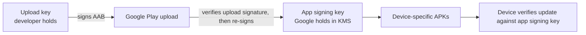

# Release Engineering: Code Signing & Play App Signing

> How Android cryptographically binds an APK to your team's identity, and how Play App Signing splits the responsibility so a leaked upload key isn't fatal.

---

## 1. What "Signing" Actually Does

Android's package manager won't install or update an APK unless the signing certificate matches the one already on the device for that package name. The certificate is a public key; the signing process produces a digest over the APK contents signed with the matching private key.

Modify any byte of a signed APK and the digest no longer matches. Sign with a different key and the update is rejected — the user has to uninstall and reinstall, losing all app data.

Four signing schemes coexist, but they do not all apply to every artifact or device:

| Scheme | Introduced | What it covers | When required |
|---|---|---|---|
| **v1 (JAR signing)** | Android 1.0 | Per-entry digests in `META-INF/` | Needed when supporting Android 6.0/API 23 or lower |
| **v2** | Android 7.0 | APK Signing Block; whole-file digest | Normal baseline for modern APKs |
| **v3** | Android 9.0 | Signing-certificate rotation lineage | Use when the distribution and device floor support rotation |
| **v4** | Android 11 | Separate `.idsig` data for incremental installation | Optional; not embedded as another APK signature block |

Choose schemes from the app's `minSdk`, distribution path, and rotation requirements, then verify the produced artifact. v2 and v3 data live in the APK Signing Block; v4 metadata is separate.

---

## 2. Generating an Upload Key (Once)

```bash
keytool -genkey -v \
  -keystore upload-key.jks \
  -keyalg RSA \
  -keysize 4096 \
  -validity 25000 \
  -alias upload \
  -dname "CN=Example, O=Example Inc, L=City, S=State, C=US" \
  -storepass "$KS_PASS" \
  -keypass "$KEY_PASS"
```

Notes:
- **25,000 days ≈ 68 years.** Play requires a cert valid until at least 2033 (currently). Pick "longer than your career" — you cannot extend it later.
- **RSA 4096** or **EC P-256**. RSA is wider-compatible; EC is smaller.
- **Use one upload certificate per app at a time.** Generate the private key in a controlled environment, protect it with an audited signing service or secret-management workflow, and retain a tested recovery path.
- **`-dname` identifies the certificate subject.** Choose an organization-controlled value, but do not treat it as legal proof of ownership.

Compute the upload-certificate fingerprint that Play uses to authenticate uploads:

```bash
keytool -list -v -keystore upload-key.jks -alias upload \
  | grep "SHA256:" \
  | awk '{print $2}'
```

Do not automatically reuse that fingerprint for runtime integrations. With Play App Signing there are distinct identities:

- **Upload certificate:** authenticates an AAB or APK submitted to Play.
- **App-signing certificate:** signs the APK installed from Play. Register this fingerprint with Firebase, Google Maps restrictions, OAuth/Sign-In configuration, and Digital Asset Links when those services identify the installed app.
- **Debug or internal-distribution certificates:** register separately only for the environments that use them.

Copy the app-signing fingerprint from Play Console's **App integrity** page rather than deriving it from the upload keystore.

---

## 3. Play App Signing (The Standard Today)

When you create a new app on Play Console, Play takes ownership of the signing key:



Pros:
- App signing key is in Google KMS — you never touch it.
- Upload key compromise → generate a replacement key and request an upload-key reset; the app-signing key stays unchanged.
- Several authorized people or services can use one controlled signing service, but Play normally recognizes one active upload certificate for an app at a time.

Cons:
- You depend on Google to keep their KMS healthy.
- Changing developer accounts is hard.

New Play apps distributed with Android App Bundles use Play App Signing. Existing apps should confirm their enrollment and migration options in Play Console rather than assuming their historical signing arrangement changed automatically.

---

## 4. Signing Configuration In Gradle

The aliases used below must exist in the version catalog:

```toml
# gradle/libs.versions.toml
[versions]
android-compileSdk = "36"
android-targetSdk = "36"
```

```kotlin
// app/build.gradle.kts

android {
    namespace = "com.example.app"
    compileSdk = libs.versions.android.compileSdk.get().toInt()

    defaultConfig {
        applicationId = "com.example.app"
        minSdk = 26
        targetSdk = libs.versions.android.targetSdk.get().toInt()
        versionCode = readVersionCode()
        versionName = readVersionName()
    }

    signingConfigs {
        create("release") {
            // Resolved at build time; injected by the CI secret workflow.
            val keystoreFile = System.getenv("KEYSTORE_PATH")?.let { file(it) }
            if (keystoreFile != null) {
                storeFile = keystoreFile
                storePassword = System.getenv("KEYSTORE_PASSWORD")
                keyAlias = System.getenv("KEY_ALIAS") ?: "upload"
                keyPassword = System.getenv("KEY_PASSWORD")
                enableV1Signing = false       // v1 no longer needed for API 26+
                enableV2Signing = true
                enableV3Signing = true
                enableV4Signing = true
            }
        }
    }

    buildTypes {
        release {
            isMinifyEnabled = true
            isShrinkResources = true
            proguardFiles(
                getDefaultProguardFile("proguard-android-optimize.txt"),
                "proguard-rules.pro"
            )
            signingConfig = signingConfigs.getByName("release")
        }
    }
}
```

The release signing config is hydrated only when `KEYSTORE_PATH` is set. `assembleDebug` uses the debug signing configuration; a release task without valid release credentials may produce an unsigned artifact or fail, depending on the task and configuration. Never infer the signer from the task name—assert the certificate before publishing.

---

## 5. Inject Signing Secrets In CI

Never commit the keystore or expose it through `local.properties`. The example stores an encrypted/base64 secret in Google Secret Manager and uses short-lived workload identity to retrieve it. A true Cloud KMS or HSM-backed design instead keeps the private key non-exportable and signs through a compatible service.

```yaml
# .github/workflows/release.yml
- id: gcp-auth
  uses: google-github-actions/auth@v2
  with:
    workload_identity_provider: ${{ secrets.GCP_WIF_PROVIDER }}
    service_account: ${{ secrets.GCP_RELEASE_SA }}

- name: Materialize upload keystore
  run: |
    KS_DIR="$RUNNER_TEMP/ks"
    mkdir -p "$KS_DIR"
    gcloud secrets versions access latest --secret=android-upload-keystore \
      | base64 --decode > "$KS_DIR/upload-key.jks"
    echo "KEYSTORE_PATH=$KS_DIR/upload-key.jks" >> "$GITHUB_ENV"
    KS_PASSWORD=$(gcloud secrets versions access latest --secret=android-keystore-password)
    KEY_PASSWORD=$(gcloud secrets versions access latest --secret=android-key-password)
    echo "::add-mask::$KS_PASSWORD"
    echo "::add-mask::$KEY_PASSWORD"
    echo "KEYSTORE_PASSWORD=$KS_PASSWORD" >> "$GITHUB_ENV"
    echo "KEY_PASSWORD=$KEY_PASSWORD" >> "$GITHUB_ENV"
    echo "KEY_ALIAS=upload" >> "$GITHUB_ENV"

- name: Build signed AAB
  run: ./gradlew :app:bundleRelease

- name: Remove temporary keystore
  if: always()
  run: rm -f "$KEYSTORE_PATH"
```

Workload Identity Federation: the GitHub Actions runner is issued a short-lived OIDC token; GCP exchanges it for a service-account token scoped to "read this one secret." No long-lived service-account JSON anywhere.

If WIF is unavailable, minimize the lifetime and scope of any long-lived credential, restrict it to the required secret, rotate it under your organization's policy, and plan migration to short-lived federation. Deleting the temporary file reduces exposure but does not prove physical erasure on an SSD or hosted runner.

---

## 6. Verifying The Signature (Local Sanity Check)

```bash
# apksigner was introduced in SDK Build Tools 24.0.3.
# Pin a validated Build Tools version in CI and expose its tools on PATH.
apksigner verify --verbose --print-certs app-release.apk

Verifies
Verified using v1 scheme (JAR signing): false
Verified using v2 scheme (APK Signature Scheme v2): true
Verified using v3 scheme (APK Signature Scheme v3): true
Verified using v4 scheme (APK Signature Scheme v4): false
Number of signers: 1
Signer #1 certificate DN: CN=Example, O=Example Inc, L=City, S=State, C=US
Signer #1 certificate SHA-256 digest: 7HIpactkIAq2Y49orFOOQKurWxmmSFZhBCoQYcRhJ3Y=
```

For an APK that you distribute directly, the SHA-256 must match the expected distribution certificate. For an upload artifact, it must match the upload certificate. An APK downloaded from Play must match the app-signing certificate used for that device/API range. Keep those expectations separate in CI.

An AAB is JAR-signed, not APK-signed. Verify the certificate on the actual upload artifact directly:

```bash
jarsigner -verify -verbose -certs app-release.aab
```

Use `bundletool build-apks` separately to test generated APK sets. Pass explicit signing arguments when the generated APK certificate matters; otherwise bundletool may use a debug key. Verifying a bundletool-generated APK does not verify which certificate signed the original AAB.

---

## 7. Key Rotation (APK Signature Scheme v3)

For APKs you sign and distribute outside Play, first create a lineage, then sign an unsigned APK with the new key and that lineage:

```bash
apksigner rotate \
  --out signing-lineage.bin \
  --old-signer --ks old-key.jks --ks-key-alias old --ks-pass pass:$OLD_PASS --key-pass pass:$OLD_KEY_PASS \
  --new-signer --ks new-key.jks --ks-key-alias new --ks-pass pass:$NEW_PASS --key-pass pass:$NEW_KEY_PASS

apksigner sign \
  --ks new-key.jks --ks-key-alias new \
  --ks-pass pass:$NEW_PASS --key-pass pass:$NEW_KEY_PASS \
  --lineage signing-lineage.bin \
  --out rotated.apk unsigned.apk
```

What happens:
1. The new APK includes a **lineage** record: `old_key → new_key`, signed by the old key.
2. Devices accept the update because the old key signed off on the rotation.
3. Future APKs remain signed by the new key with the appropriate lineage information for the device versions you support.

Caveats:
- Android 9+ understands the v3 proof-of-rotation lineage; older-device compatibility depends on how the rotated artifact is produced and distributed. Test every supported API range before rollout.
- With Play App Signing, distinguish two operations: **upload-key reset** changes who may upload but does not change users' signing identity; **app-signing-key upgrade** changes the delivery key under Play's supported device and platform rules. Follow the current App integrity workflow rather than running local `apksigner rotate` against Play-delivered APKs.

---

## 8. Debug Builds (Don't Confuse The User)

```kotlin
android {
    buildTypes {
        debug {
            applicationIdSuffix = ".debug"
            versionNameSuffix = "-DEBUG"
            isDebuggable = true
            resValue("string", "app_name", "Example (debug)")
        }
    }
}
```

Different `applicationId` means debug and release builds can coexist on a device — no confusion, no accidental wipes. The debug keystore is auto-generated by AGP at `~/.android/debug.keystore` and shared across all developers; it's expected to be public.

Critical: do not ever ship a release built with the debug keystore. Catch in CI:

```bash
# Post-build
apksigner verify --print-certs app-release.apk | grep -q "CN=Android Debug" && {
    echo "ERROR: release build was signed with debug key!"
    exit 1
}
```

---

## 9. The Compromise Playbook

If the upload key leaks:

1. Generate a new upload key and export its public certificate.
2. **Request an upload-key reset** (Play Console → Setup → App integrity) and submit the new certificate.
3. Disable access to the leaked secret material and preserve the evidence required for incident analysis.
4. Audit which CI runs and principals accessed the old key.
5. Rotate other credentials only when exposure analysis shows they shared the affected boundary.
6. Update CI to use the replacement key after Play confirms the reset.
7. The next accepted upload uses the new upload key; Play still signs delivered APKs with the app-signing key, so the installed-app identity is unchanged.

If a Play-managed app-signing key is suspected of compromise, treat it as a security incident and use Play Console/support to evaluate an app-signing-key upgrade. Eligibility, frequency, and which Android versions receive the upgraded key are Play policy—not assumptions to encode in the incident runbook.

If you self-host the app-signing key, recovery depends on whether a valid proof-of-rotation lineage was prepared, the Android versions in the fleet, and the distribution channel. Without a supported lineage or channel-assisted upgrade, affected devices may require reinstalling or migrating to a new package identity. Document and test this path before an incident.

This is why Play App Signing exists.

---

## 10. Common Pitfalls

- **Committing the keystore.** Once it touches GitHub, even briefly in history, treat it as public.
- **Storing passwords next to the keystore.** Defeats the purpose; rotate both.
- **Same keystore for debug and release.** Debug certificates are expected to be non-secret; release signing material needs a controlled distribution or signing-service design.
- **Skipping `apksigner verify`** in CI. Ship a debug-signed APK and discover it in production.
- **Forgetting `enableV2Signing = true` on AGP < 8.0 defaults**. Not strictly needed today, but verify your AGP version.
- **Reusing the upload key across apps.** A compromise blasts the whole portfolio. One key per package.
- **Assuming self-signing has no rotation path.** v3 lineage can help on supported devices, while Play App Signing provides channel-managed reset/upgrade workflows. Select and test the path for your fleet.
- **Lost keystore password.** No recovery. Treat the password as a Tier-1 secret with multi-region backup.
- **CI logs printing signing properties.** `set +x` before any `gradle -P android.injected.signing.*`. Validate by replaying a CI run with verbose logging and grepping.
- **Forgotten `minSdkVersion` drift.** Devices on API 23 and lower require v1 verification; do not disable it merely because modern devices use v2/v3.

---

## 11. Testing

```bash
# Sanity: verify this APK against the expected certificate for its distribution channel
expected_sha="7HIpactkIAq2Y49orFOOQKurWxmmSFZhBCoQYcRhJ3Y="
actual_sha=$(apksigner verify --print-certs app-release.apk \
              | grep "SHA-256 digest" \
              | awk '{print $NF}')

if [ "$expected_sha" != "$actual_sha" ]; then
    echo "ERROR: signing cert SHA mismatch"
    echo "  expected: $expected_sha"
    echo "  actual:   $actual_sha"
    exit 1
fi
```

```bash
# Sanity: confirm we're NOT debug-signed
if apksigner verify --print-certs app-release.apk | grep -q "Android Debug"; then
    echo "ERROR: debug-signed release"
    exit 1
fi
```

Wire these into the release workflow as `Verify signature` steps.

---

## 12. Further Reading

- [Android Developers — Sign your app](https://developer.android.com/studio/publish/app-signing) — official.
- [APK Signature Scheme v2](https://source.android.com/docs/security/features/apksigning/v2) — what it covers and why v2 supplanted v1.
- [apksigner](https://developer.android.com/tools/apksigner) — verification, signing, and rotation-lineage commands.
- [APK Signature Scheme v3 — key rotation](https://source.android.com/docs/security/features/apksigning/v3) — lineage records.
- [Play App Signing](https://support.google.com/googleplay/android-developer/answer/9842756) — Google KMS-backed signing.
- [Workload Identity Federation for GitHub Actions](https://github.com/google-github-actions/auth) — short-lived GCP tokens from CI.

---

> **In short:** distinguish the upload certificate from the app-signing certificate; centralize and audit access to signing material; enable only the schemes required by the supported fleet; verify the actual APK and AAB artifacts in CI; and document upload-key reset separately from app-signing-key rotation.
