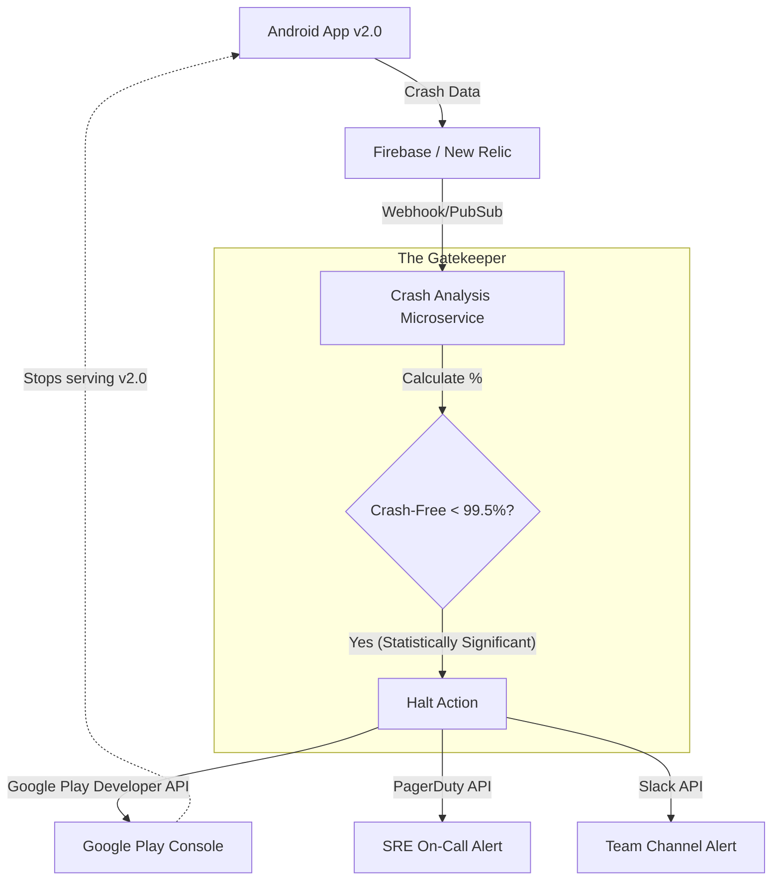

# Release Engineering: Crash Rate Gating (Automated Rollback)

## The Prompt

*"Your company releases a new version of the Android app every week. The Release Manager manually checks Firebase Crashlytics every 6 hours during a Staged Rollout to see if the app is crashing. Last week, the Release Manager was asleep, and a fatal crash reached 20% of users. Design an automated system to prevent this."*

## 1. Requirements & Clarification (RADIO Framework)

### Functional Requirements
- Monitor crash rates in real-time during a Staged Rollout.
- Automatically halt the rollout if the crash rate exceeds a defined threshold.
- Alert the engineering team instantly.

### Non-Functional Requirements (NFRs)
- **Speed:** The system must detect a spike and halt the rollout in minutes, not hours.
- **Accuracy (Priority 0):** The system must not trigger false positives (e.g., halting the rollout because 5 users out of 10 had a crash in the first 30 seconds of the release). It requires statistical significance.

## 2. High-Level Architecture (The Feedback Loop)

A Junior engineer relies on human vigilance.
A Staff engineer builds a **Closed-Loop Automation System**. The Telemetry pipeline feeds directly back into the CD (Continuous Deployment) pipeline.

## 3. The Core Flows (Deep Dive)

### Flow 1: Calculating the Threshold (Statistical Volume)
*Interviewer:* "You release v2.0. Within the first 2 minutes, 10 users download it. 1 user crashes. Your crash rate is 10%. Your system automatically halts the release. The engineering team is paged at 2 AM. But it was just 1 user with a rooted phone. How do you prevent this false alarm?"

**Staff Answer:**
"We must define a **Minimum Threshold of Significance**.
The automated system must evaluate two variables simultaneously:
1.  **The Rate:** Crash-Free Users drops below 99.5% (or whatever the SLA is).
2.  **The Volume (N):** The system completely ignores the rate until at least 10,000 users (or a statistically significant sample size for the app's MAU) have opened v2.0.
Until `N >= 10,000`, the system is in 'Observation Mode' and will not trigger an automated halt, preventing noisy false positives from small sample sizes."

### Flow 2: The Google Play Developer API (The Kill Command)
*Interviewer:* "Your system detects a massive crash spike. 50,000 users are crashing. How does a backend microservice actually stop Google Play from distributing the app?"

**Staff Answer:**
"The system uses the **Google Play Custom Publishing API**.
1. The microservice securely authenticates with Google using a Service Account JSON key.
2. It executes a `GET` request to retrieve the current Edit transaction.
3. It executes an `UPDATE` request against the `tracks` endpoint. It finds the `production` track and changes the `userFraction` of the current release to `0.0`, or changes the status from `inProgress` to `halted`.
4. It `COMMITS` the Edit transaction.
Within seconds, Google Play's global servers stop offering the v2.0 APK/AAB to users. The blast radius is instantly contained without human intervention."

### Flow 3: The Fatal vs Non-Fatal Distinction
*Interviewer:* "Your app has a known, minor bug where a non-fatal exception is logged in the background (e.g., `Failed to load avatar image`). This happens 100,000 times a day. Will your crash rate gate halt the release for this?"

**Staff Answer:**
"No. The Telemetry SDK and the Monitoring Microservice must strictly differentiate between **Fatal Crashes** (the app died and the OS closed it) and **Non-Fatal Exceptions** (handled errors logged manually via `Crashlytics.logException()`).
The primary automated Halt threshold is strictly tied to *Fatal Crash-Free Users*.
However, a sophisticated system will have a secondary alert (a Slack notification, not a hard Halt) if Non-Fatals spike by > 500%, as this might indicate a severe silent failure, like a broken API endpoint that is caught in a `try/catch` but preventing users from checking out."

## 4. Failure Modes & Bottlenecks

### Bottleneck: The Delayed Metric (Data Processing Latency)
*Interviewer:* "Firebase Crashlytics can sometimes take 15 to 30 minutes to process and display crash data on their dashboard. If your app is pushing to 10% (1 Million users), 15 minutes is enough time to crash 50,000 devices. How do you speed this up?"

**Staff Answer:**
"We cannot rely on the Firebase Dashboard UI or its standard batched webhooks for real-time gating.
**The Fix:** We export the raw crash events directly to **BigQuery** or a high-throughput streaming database. We write a custom cron job (or streaming pipeline) that queries the raw BigQuery table every 60 seconds. This bypasses the processing delays of the standard dashboard, allowing us to detect and halt a catastrophic failure in ~2 minutes."

### Bottleneck: ANRs vs Crashes
*Interviewer:* "The rollout reaches 50%. The Crash-Free Users metric is a perfect 99.9%. But Twitter is blowing up. Users are furious, saying the app is completely frozen. Your system didn't halt the rollout. Why?"

**Staff Answer:**
"The system was blind to **ANRs (Application Not Responding)**.
An ANR is not a crash. The JVM doesn't throw an Unhandled Exception. The Main Thread is just blocked for > 5 seconds, and the OS kills it. Standard crash reporting often misses this or categorizes it separately.
**The Fix:** The Automated Gate must evaluate a composite metric: `(Fatal Crashes + ANRs) / Total Users`. If the ANR rate exceeds the threshold (e.g., > 0.4%), the system must trigger the exact same Halt procedure."

## 5. Staff Engineer Thinking: The "Poison Pill" Metric

A Staff Engineer thinks about edge cases that completely break the math.

*The Scenario:* You release an update that instantly crashes on launch (a `RuntimeException` in `Application.onCreate()`).
*The Flaw:* If it crashes instantly, the Telemetry SDK (Firebase/New Relic) might not have enough time to initialize, connect to the network, and send the crash report before the OS kills the process. The server receives 0 crash reports.
*The Result:* The dashboard says "0 Crashes." The automated gate assumes the release is perfect. It rolls out to 100%.

**The Staff Solution (The 'Missing Sessions' Metric):**
We cannot just measure crashes. We must measure **Session Volume**.
If v1.0 usually generates 10,000 successful sessions per minute, and v2.0 is rolled out to 10%, we expect 1,000 successful sessions per minute from v2.0.
If the monitoring system sees *zero* successful sessions coming from v2.0 users, it must instantly trigger a 'Missing Data / Poison Pill' Alert. A sudden, massive drop in total successful sessions is a stronger indicator of an instant-death crash than the crash logs themselves.

## 6. Probing Questions (For Practice)

1.  Explain why human monitoring of a Staged Rollout is a critical point of failure and how a Closed-Loop Automation system solves it.
2.  Describe the two variables required to define a Minimum Threshold of Significance. Why must you wait for a specific volume (N) of users before trusting a 10% crash rate?
3.  Walk through the exact technical mechanism (Google Play Developer API) that allows a backend server to halt an Android app rollout.
4.  Why is it crucial to distinguish between Fatal Crashes and Non-Fatal Exceptions in an automated rollout gate?
5.  Explain the data processing latency issue with third-party dashboards (like Crashlytics) and how querying a raw database (like BigQuery) accelerates detection.
6.  Describe the difference between a Crash and an ANR, and why an automated gate must monitor both metrics simultaneously.
7.  What is the "Poison Pill" scenario (Crash on Launch)? Explain why standard crash reporting tools might fail to record this event.
8.  How does monitoring "Session Volume" act as a failsafe against the Poison Pill scenario?
9.  If an automated gate halts a rollout at 2 AM, what specific information should it include in the PagerDuty alert sent to the on-call engineer to minimize their time-to-resolution?
10. Describe the architectural relationship between a Feature Flag Kill Switch and a Crash Rate Rollout Gate. If a crash is traced to a specific feature flag, should the system halt the Play Store rollout or just flip the kill switch?

## Further Reading

- [`staged-rollouts.md`](staged-rollouts.md) — The fundamental phases of the Play Store release.
- [`telemetry-sdk.md`](../mobile-system-design/telemetry-sdk.md) — How the Crash and ANR data is physically collected on the device.
- [`anrs.md`](../android/performance/anrs.md) — Why ANRs happen and why they are harder to track than crashes.
