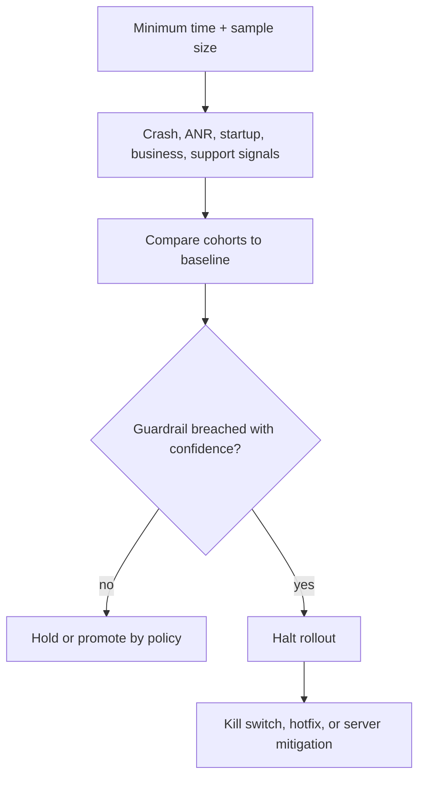

# Release Engineering: Crash-Rate Gating (Automated Holds and Halts)

> Automated checks that read crash + ANR metrics during a staged rollout and decide: promote, hold, or halt. The release manager isn't supposed to babysit Crashlytics at 3 AM.

---

## 1. The Metrics That Matter

| Metric | Source | Target |
|---|---|---|
| **Crash-free users** | Firebase Crashlytics, selected window/cohort | > 99.5% (example product target) |
| **Crash-free sessions** | Firebase Crashlytics | > 99.7% |
| **User-perceived ANR rate** | Android Vitals | < 0.47% of daily active users (Play overall threshold) |
| **User-perceived crash rate** | Android Vitals, daily active users | Below the declared internal gate; Play overall threshold is 1.09% |
| **Slow cold start rate** | Android Vitals | < 5% |
| **Slow rendering rate** | Android Vitals | < 5% |

Crashlytics crash-free users measures unique active installations without a fatal crash in the selected period. Play uses its own daily active-user population and user-perceived subset. Do not interchange the two. Targets here are example internal policy, not proof that every cohort is healthy.

Compare the same metric and eligible cohorts over comparable complete windows. Record version, source, measurement definition, freshness, sample size, and coverage. A small delta can be sampling noise; severe cohort harm can require action before an aggregate threshold is crossed.

---

## 2. Reading Android Vitals (Play Developer Reporting API)

Use the official [`vitals.crashrate`](https://developers.google.com/play/developer/reporting/reference/rest/v1beta1/vitals.crashrate) and [`vitals.anrrate`](https://developers.google.com/play/developer/reporting/reference/rest/v1beta1/vitals.anrrate) resource definitions. An adapter must:

- Select `userPerceivedCrashRate` or `userPerceivedAnrRate` when checking the corresponding Play stability threshold; `crashRate` and `anrRate` include broader outcomes.
- Verify the numeric encoding before enabling the gate. The resource reference calls these metrics percentages and uses `google.type.Decimal`, but the references checked here do not provide an explicit numeric response example establishing whether the payload uses 0–100 or 0–1. No live response was verified for this example. Require a documented, verified adapter setting for the exact metric/API version; do not infer the encoding from the value's magnitude. A rate is not an affected-user count to divide by `distinctUsers` again.
- Use `distinctUsers` as the reported normalisation population for that row, respecting its rounding. Do not sum overlapping distinct-user rows into a purported unique-user count for the whole window.
- Use supported aggregation/timezone combinations, filter by version and eligible cohorts, handle pagination, and check the resource's freshness information. Missing rows, incomplete periods, or an adapter error must hold promotion, not return 100% crash-free.

The following converter supports two explicitly selected assumptions. It returns unknown until the adapter's encoding has been verified. Neither branch is a claim about the actual Play payload:

```python
from decimal import Decimal, InvalidOperation

def play_rate_to_fraction(raw: str, *, verified_encoding: str | None = None) -> Decimal | None:
    if verified_encoding not in ("percent", "fraction"):
        return None
    try:
        value = Decimal(raw)
    except InvalidOperation:
        return None
    upper = Decimal(100) if verified_encoding == "percent" else Decimal(1)
    if not value.is_finite() or not Decimal(0) <= value <= upper:
        return None
    return value / Decimal(100) if verified_encoding == "percent" else value
```

For example, `"0.47"` maps to `0.0047` only under the percent assumption; it maps to `0.47` under the fraction assumption. Both are numerically plausible, so range checks cannot establish the encoding. Before setting `verified_encoding`, retain a redacted real response or explicit official encoding statement and verify it against the metric, API version, aggregation, and reported value. Without that evidence, keep the setting unset and hold promotion. The converter does not combine rows or establish complete coverage; preserve all source metadata.

---

## 3. Reading Firebase Crashlytics

[Crash-free users](https://firebase.google.com/docs/crashlytics/crash-free-metrics) requires both unique crash-affected users and **all eligible active users** in the same selected window/cohort. Counting installations only in crash-event rows excludes healthy users, so that query cannot produce the denominator. Counting crash reports also overcounts a user who crashes repeatedly.

For warehouse analysis, [enable Firebase sessions export](https://firebase.google.com/docs/crashlytics/bigquery-export), including streaming when the required freshness and plan support it. Verify the actual schemas, identifiers, version fields, and SDK coverage before joining sessions and fatal events. Deduplicate the population and affected-user sets under one identity definition; do not assume an installation identifier is a person across devices.

The warehouse contract is:

```text
eligible = distinct active installation IDs in the declared window and cohort
bad = distinct IDs in eligible with at least one qualifying fatal crash
crash_free_fraction = 1 - count(bad) / count(eligible)
```

This is an aggregation specification, not SQL against invented export columns. Empty population, missing session coverage, delayed export, or incompatible identity mappings yields unknown evidence. Crashlytics and Play offer complementary views; neither is a complete real-time census of every install.

---

## 4. The Auto-Halt Workflow

Feed validated observations into a policy evaluator. The following pure example handles fractions and exact decimal boundaries; it deliberately does not implement vendor access or Play mutations:

```python
from dataclasses import dataclass
from decimal import Decimal

@dataclass(frozen=True)
class GateSample:
    crash_free_fraction: Decimal | None
    users: int
    ready: bool  # adapter verified freshness, coverage, and complete window
    comparison_key: str  # source, metric, eligibility, cohort, and window definition

def evaluate_crash_gate(now: GateSample, baseline: GateSample, min_users: int) -> str:
    if min_users <= 0 or not now.comparison_key or now.comparison_key != baseline.comparison_key:
        return "hold"
    for sample in (now, baseline):
        value = sample.crash_free_fraction
        if (not sample.ready or sample.users < min_users or value is None or
                not value.is_finite() or not Decimal(0) <= value <= Decimal(1)):
            return "hold"
    delta = baseline.crash_free_fraction - now.crash_free_fraction
    if now.crash_free_fraction < Decimal("0.98"):
        return "halt-critical"
    if delta > Decimal("0.005"):
        return "halt-regression"
    if now.crash_free_fraction < Decimal("0.995") or delta > Decimal("0.001"):
        return "hold"
    return "promote-eligible"
```

These thresholds illustrate one release policy. They do not supply confidence intervals or account for every cohort. `ready` and `comparison_key` are trusted adapter outputs, not values to default to true or fill with a generic label. Version/time boundaries and cohort evidence must accompany the persisted decision.

The orchestrator's responsibilities are:

```text
read the active release version and fraction
fetch complete, fresh current/baseline evidence for comparable cohorts
on missing, invalid, stale, or insufficient evidence: HOLD and notify the owner
on a confirmed actionable guardrail breach: HALT that release and run mitigation
on promote-eligible: check all other signals, approval policy, and staffed release hours
before any mutation: re-read the release version/fraction and reject a stale decision
persist the evidence and applied action; make retries safe and auditable
```

`promote-eligible` is permission to consider promotion, not an automatic call to increase rollout. Handle obvious catastrophic failures through a separate emergency policy even when samples are small. Alerting failure or missing data must never silently advance a release.

---

## 5. Multi-Signal Release Gate



A gate combines adequate exposure with segmented evidence; tiny samples create noise, while global averages can hide a severe cohort regression.

A Staff-level gate never promotes on one metric alone. It asks: is the new version healthy, are the samples large enough, and is any important cohort burning?

| Signal | Promote | Hold | Halt |
|---|---|---|---|
| Crash-free users | Within 0.1 pp of baseline | 0.1-0.5 pp worse | > 0.5 pp worse or < 98% |
| User-perceived ANR | Within target | Trending upward, sample small | Crosses release floor |
| Cold start p95 | Within 10% of baseline | 10-20% regression | > 20% plus user complaints/vitals warning |
| Critical-flow success | Within target | Minor drop with fallback | Checkout/login/onboarding blocked |
| Top cohort health | No cohort worse than floor | One cohort noisy | Major OEM/API/country cohort below floor |
| Sample size | Meets minimum | Below minimum | N/A unless catastrophic failures are obvious |

The gate output is a decision object, not a boolean:

```json
{
  "versionCode": 412010,
  "fraction": 0.10,
  "decision": "hold",
  "primaryReason": "cold_start_p95_regression",
  "affectedCohorts": ["low_ram", "android_10"],
  "nextAction": "hold rollout; inspect startup trace; re-evaluate in 6h",
  "expiresAt": "2026-07-01T18:00:00Z"
}
```

Persist this as a CI artifact and post it to the release channel. Humans should be able to reconstruct why the system promoted, held, or halted without reading workflow logs.

---

## 6. Per-Cohort Crash Rates

A global rate can hide cohort harm. Define a cohort contract rather than assuming that every export has columns such as `ram_mb` or `device_manufacturer`:

| Example cohort | Adapter evidence required |
|---|---|
| Lower-memory devices in selected markets | Verified country and memory-tier mappings in that source, with matching eligible and crash-affected populations |
| Selected phone-model family | Reviewed set of actual source device-model identifiers, not an assumed SQL column or wildcard |
| Selected manufacturer/API group | Verified manufacturer/model and API-level mapping with sufficient fresh observations |

For each cohort, record its definition/version, source fields and mapping, population, measurement window, coverage, and baseline comparison. If required fields or sufficient observations are absent, return unknown and hold the cohort decision; do not silently broaden the selection.

A 96% crash-free result in a model family identifies an affected population, not proof that the OEM caused the bug. Investigate client/backend/version differences, then halt or apply a targeted kill switch under the declared policy.

---

## 7. Slack-Driven Manual Override

Auto-halt errs on caution. Sometimes a regression is acceptable (e.g., new feature has slightly worse baseline because it does more). Manual override pattern:

```python
# scripts/slack_promote_handler.py (Slack slash command)
# /release promote 0.10
def handle(user, command):
    if user not in RELENG_TEAM:
        return "Sorry, only releng can run this."
    if "promote" in command:
        fraction = float(command.split()[1])
        promote_production(fraction)
        return f"Promoted to {fraction}. Watching crash-free rate."
    if "halt" in command:
        halt_production()
        return "Halted. Run `/release resume` to undo."
```

Manual paths are audited (Slack channel + GitHub Actions log + Play Console history). No silent overrides.

---

## 8. Time Windows And Sample Size

A 6-hour window at 1% rollout might only have 5K active users. Crash-free rate is noisy at that scale. Rules:

| Rollout % | Min sample for decision | Window |
|---|---|---|
| 1% | 10K users | 12h |
| 5% | 50K users | 6h |
| 10% | 100K users | 4h |
| 25%+ | 1,000,000 × rollout fraction: 250K at 25%, 500K at 50%, 1M at 100% | 2h |

Don't promote prematurely just because the crash-free rate looks good with 200 users.

```python
def is_sample_sufficient(rollout_fraction: float, users_observed: int) -> bool:
    required = max(10_000, 1_000_000 * rollout_fraction)
    return users_observed >= required
```

---

## 9. ANR-Specific Gates

ANRs (Application Not Responding) have their own threshold:

Read `userPerceivedAnrRate` from `anrRateMetricSet` through a validated adapter. Use the same explicit encoding-verification requirement as section 2; no ANR response encoding was verified here. Retain window/population metadata. Missing or insufficient observations are unknown, never a zero ANR rate.

Play's overall bad-behavior threshold is a **user-perceived ANR rate of 0.47% of daily active users**, with an 8% per-phone-model threshold. Exceeding it can reduce discoverability; this is not a session rate or an automatic app-removal rule. A 0.30% release gate is an example internal target, not a second Play threshold.

Play currently counts input-dispatch timeouts in the user-perceived subset of ANRs. Use `userPerceivedAnrRate`, state the API's units, and compare cohorts/windows with sufficient fresh data; overall `anrRate` is a different numerator. See the canonical [SLO definitions](../observability/slos.md#mobile-implementation-android).

---

## 10. Common Pitfalls

- **Comparing to no baseline.** "99.6% is fine" — if previous was 99.95%, you've regressed.
- **Auto-promoting outside business hours.** If something breaks on auto-promote at 3 AM Sunday, no human is responding for hours.
- **Tiny sample sizes.** 100 users isn't enough to estimate a 99.5% crash-free rate.
- **Only looking at global rate.** Cohort regressions hide.
- **Promoting on green crashes while startup or checkout is red.** Release gates need multiple user-impact signals.
- **Halting without alerting.** Silent halts confuse the next release manager.
- **Decision rules in code, not in a docs runbook.** When CI halts at 3 AM, on-call needs to read why.
- **Ignoring slow-rendering / slow-start rates.** They're soft failures that erode trust over time.
- **Trusting Crashlytics for the gate.** Vitals is the source Play uses; align with it.
- **No "cooldown" after a halt.** Halt + resume in 5 minutes hides whether the fix worked.
- **Manual overrides without audit.** Someone presses resume and forgets to monitor.

---

## 11. Further Reading

- [Play Developer Reporting API](https://developers.google.com/play/developer/reporting) — Vitals access.
- [Crash-rate resource and units](https://developers.google.com/play/developer/reporting/reference/rest/v1beta1/vitals.crashrate)
- [ANR-rate resource and units](https://developers.google.com/play/developer/reporting/reference/rest/v1beta1/vitals.anrrate)
- [Crashlytics crash-free definitions](https://firebase.google.com/docs/crashlytics/crash-free-metrics)
- [Android Vitals — Crash rate & ANR](https://developer.android.com/topic/performance/vitals) — what Play measures.
- [Firebase Crashlytics BigQuery export](https://firebase.google.com/docs/crashlytics/bigquery-export) — historical cohort queries.
- [Play bad-behavior thresholds](https://developer.android.com/google/play/vitals) — user-perceived daily crash/ANR rates.
- [Site Reliability Engineering (SRE) ch. 33 — Lessons learned from other incidents](https://sre.google/sre-book/lessons-learned/) — incident discipline transferable to releases.

---

> A release decision needs comparable, fresh evidence and a safe mitigation path. Keep source definitions distinct, hold on unknown data, and record why a release was promoted, held, or halted.
