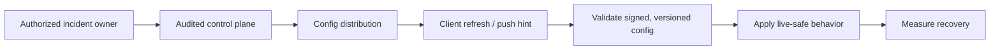

# Release Engineering: Kill Switches

> A server-controlled flag that disables a specific feature within minutes of flipping it. Built on top of `feature-flags-and-remote-config.md`'s infrastructure but with operational discipline: who flips, how fast, what's audited.

---

## 1. When To Use A Kill Switch

| Scenario | Kill Switch? |
|---|---|
| New feature has a critical bug on Samsung Galaxy A | Yes |
| Server backend overloaded by new feature traffic | Yes |
| Regulatory request to disable a feature in one country | Yes |
| Security vulnerability in a specific code path | Yes |
| New feature has lower engagement than expected | No — A/B test |
| Need to change a UI string | No — server config |
| Wallet UI is slow on low-end devices | Yes (gated kill switch) |

The rule: kill switches are emergency brakes. Use them sparingly so they retain operational authority.

---

## 2. The Kill-Switch Flag Pattern

```kotlin
object Flags {
    // Kill switches are boolean. Default is `true` (feature enabled).
    // Server flipping to `false` disables.
    val killVideoCalls = BooleanFlag(
        key = "kill_video_calls",
        default = true,                       // ← default-enabled; flip = disable
        applyPolicy = ApplyPolicy.LIVE,        // ← live, not next-session
        owners = listOf("video-calls@example.com"),
    )

    val killBackgroundSync = BooleanFlag(
        key = "kill_background_sync",
        default = true,
        applyPolicy = ApplyPolicy.LIVE,
        owners = listOf("sync@example.com"),
    )
}
```

```kotlin
@Composable
fun VideoCallButton(...) {
    val enabled by repo.videoCallsEnabled.collectAsStateWithLifecycle()
    if (!enabled) return     // feature gone; no entry point
    Button(onClick = startVideoCall) { Text("Video Call") }
}
```

Here `kill_<feature> = false` means disabled; this is a project naming convention. Choose a per-feature bootstrap and stale-policy response from risk. A refresh failure must not discard a previously accepted disabled state or automatically re-enable a vulnerable feature.

---

## 3. Live Apply Policy

Most flags use "next session" apply policy (see `mobile-system-design/feature-flags-and-remote-config.md`). Kill switches are the exception: they apply as soon as a validated policy is accepted, without waiting for the next session. Delivery can still be delayed.

```kotlin
enum class ApplyPolicy { LIVE, NEXT_SESSION }
data class FlagDefinition(val default: Boolean, val policy: ApplyPolicy)
data class AppliedFlags(val active: Map<String, Boolean>, val pending: Map<String, Boolean>)

fun applySnapshot(
    current: AppliedFlags,
    incoming: Map<String, Boolean>,
    definitions: Map<String, FlagDefinition>,
): AppliedFlags {
    val pending = definitions.mapValues { (key, definition) ->
        incoming[key] ?: current.pending[key] ?: current.active[key] ?: definition.default
    }
    val active = definitions.mapValues { (key, definition) ->
        if (definition.policy == ApplyPolicy.LIVE) pending.getValue(key)
        else current.active[key] ?: definition.default
    }
    return AppliedFlags(active, pending)
}
```

Missing keys preserve the last accepted pending value, falling back to the active value only when no pending value exists. This preserves both an already-disabled live switch and a next-session change waiting to apply. Defaults apply only to keys with no accepted value. Removing a key is not authorization to re-enable it; retirement needs an explicit versioned protocol. A fetch/validation failure leaves both maps unchanged. This pure boolean example handles newly introduced keys and applies **only** live-safe changes immediately. The repository must serialize refresh/commit, reject stale revisions and retired-account results, persist accepted snapshots atomically, then publish observable state. A live change must not swap the entire incoming snapshot into active state and activate next-session flags early.

---


## 4. Propagation Latency



A kill switch is an operational system: authorization, audit, propagation, safe client semantics, and recovery telemetry determine whether it works during an incident.

Measure propagation from control-plane publication to acknowledgement by eligible active clients. Polling cadence and push can improve the observed distribution, but neither bounds delivery to offline, suspended or force-stopped devices. Define freshness and fallback for clients that cannot fetch a policy. FCM is a best-effort invalidation hint, not a fifteen-second guarantee.

```kotlin
class FlagRefreshFcmService : FirebaseMessagingService() {
    override fun onMessageReceived(message: RemoteMessage) {
        if (message.data["type"] == "flags.refresh") {
            val work = OneTimeWorkRequestBuilder<RefreshFlagsWorker>()
                .setConstraints(Constraints.Builder()
                    .setRequiredNetworkType(NetworkType.CONNECTED).build())
                .build()
            WorkManager.getInstance(this).enqueueUniqueWork(
                "refresh-flags", ExistingWorkPolicy.APPEND_OR_REPLACE, work
            )
        }
    }
}
```

The worker performs a bounded authenticated fetch and applies the repository contract. APPEND_OR_REPLACE queues a fetch after unfinished work, so a hint received during an older fetch is not discarded. If a prerequisite is already failed/cancelled when enqueueing, this policy starts a new chain. A predecessor that fails or is cancelled **after** a child is appended can still fail/cancel that child. The worker must record an expected fetch/validation failure as a completed refresh attempt (leaving accepted flags unchanged), so subsequent queued hints can run; use bounded retries rather than an indefinitely retrying predecessor. Unexpected failures still require recovery through freshness/lifecycle refresh and monitoring. Bound retries and monitor backlog; scheduling constraints, backoff and delivery still prevent an immediate-effect guarantee. Refresh again on relevant lifecycle/freshness transitions. Do not launch an unowned coroutine from `onMessageReceived` and assume it survives the callback or process.

---


## 5. Who Can Flip (Authorization)

The same dashboard that flips experiments shouldn't flip kill switches with the same authority. Distinct paths:

```yaml
# flags.config.yaml
flags:
  kill_video_calls:
    default: true
    apply_policy: LIVE
    owners: ["video-calls@example.com"]
    required_approvers: ["releng@example.com"]   # second sign-off
    audit_required: true                          # log every flip
    review_after: 24h                            # reminder/escalation, not automatic re-enable
```

A flag flip:
1. Engineer submits a flip request in the dashboard.
2. Dashboard requires a reason ("Sev-1 incident #4242").
3. A second signer (releng on-call or feature owner) approves.
4. Flag changes server-side, audit log records (who, when, why, approvers).
5. Optional FCM push fires.
6. Escalate at the review deadline; re-enable only after the owner verifies mitigation and authorizes a staged recovery.

A review deadline prevents forgotten state. Automatically turning a vulnerable or crashing path back on after 24 hours can restart the incident.

---

## 6. Granular Kill Switches

Instead of one binary, use a gated kill switch for partial outages:

```kotlin
val killVideoCalls = VariantFlag(
    key = "kill_video_calls",
    default = "enabled",
    variants = listOf("enabled", "disabled_for_samsung_a", "disabled_for_low_ram", "disabled_globally"),
)

@Composable
fun VideoCallButton(...) {
    val mode by repo.videoCallsMode.collectAsStateWithLifecycle()
    val show = when (mode) {
        "disabled_globally" -> false
        "disabled_for_samsung_a" -> !DeviceInfo.isSamsungA()
        "disabled_for_low_ram" -> DeviceInfo.totalRamMb > 4000
        else -> true
    }
    if (!show) return
    Button(onClick = startVideoCall) { Text("Video Call") }
}
```

The cohort-specific kill is far less disruptive than a global kill. Always reach for cohort-specific first.

---

## 7. Server-Side Kill For Backend Features

Some features have a server-side counterpart you need to kill simultaneously (e.g., a new endpoint that's overloading a service):

```kotlin
// Server BFF
fun handleVideoCallStart(...): Response {
    if (configService.killVideoCallsActive()) {
        return Response(status = 503, body = "Feature temporarily unavailable")
    }
    return startVideoCall(...)
}
```

The client maps the documented unavailable response to UI state and honors any retry policy. Preserve coroutine cancellation; `runCatching` around suspending work catches cancellation unless it is explicitly rethrown outside the result conversion.


Server + client kill together. Client kill hides the entry point; server kill rejects any race-condition calls. Defense in depth.

### API compatibility behavior

An API kill switch must return a response shape every supported client can parse. Do not invent a new error payload during an incident.

| Situation | Server behavior | Client expectation |
|---|---|---|
| Optional feature disabled | Return a typed business error such as `FEATURE_TEMPORARILY_UNAVAILABLE` | Hide entry point or show retryable unavailable state |
| Expensive endpoint overload | Return cached/stale response, smaller page size, or `Retry-After` | Back off; do not spin retries |
| New response shape is broken | Downgrade by capability to the previous shape | Old and current clients parse successfully |
| Security issue | Fail closed with force-update or blocked action | User cannot continue the risky flow |

Default-enabled flags are right for most client UI kill switches, because a flag-fetch outage should not remove features accidentally. Server/API kill switches need a per-risk default. For overload protection, fail open can take the backend down; for non-critical UI, fail closed can create a user outage. Document the default in the flag definition, not in tribal memory.

---

## 8. Kill Switches During A Bad Release

In a mobile incident, a kill switch is often faster than a hotfix and more useful than a Play halt. Use it to protect users who already updated.

| Release failure | Kill-switch response |
|---|---|
| New checkout UI crashes | Hide new checkout entry point and route to legacy checkout |
| Feed response shape breaks old parser | Server downgrades response by capability |
| Heavy animation causes jank on low-end devices | Disable animation for device-tier cohort |
| Backend dependency overloads | Return cached/stale state or disable the expensive feature |
| Security-sensitive path is unsafe | Block the action and force update if needed |

Every kill switch used during release response needs an expiry owner. If the switch remains off after the incident, it becomes a silent fork of the product.

---

## 9. Local Override For Engineering

```kotlin
class FlagsOverridesStore @Inject constructor(
    @ApplicationContext private val context: Context,
) {
    private val prefs = context.getSharedPreferences("flag_overrides", Context.MODE_PRIVATE)

    fun set(key: String, value: String) {
        check(BuildConfig.DEBUG) { "overrides only allowed in debug builds" }
        prefs.edit().putString(key, value).apply()
    }

    fun get(key: String): String? = if (BuildConfig.DEBUG) prefs.getString(key, null) else null
}
```

`FlagSet.get()` checks the override store first; in release builds, the override returns `null` and is ignored. Engineers can simulate kill switches locally without server flips. Production users cannot.

---

## 10. Telemetry

Every kill-switch evaluation logs:

```kotlin
analytics.log("flag_evaluated", mapOf(
    "flag" to flagKey,
    "value" to evaluatedValue,
    "isLiveApply" to (policy == ApplyPolicy.LIVE),
    "source" to source,  // "remote", "default", "override"
))
```

Server-side telemetry monitors:
- **Kill switch flip frequency.** A flag flipped > 5x in a month signals an unstable feature.
- **Overdue reviews and re-enable events.** Record owner approval and recovery evidence.
- **Time from flag flip to deactivation rate plateau.** Did the kill actually take effect?

---

## 11. Common Pitfalls

- **One universal default.** Define bootstrap and stale-policy behavior per risk; preserve the last accepted emergency disablement when a fetch fails.
- **Assuming FCM delivery is bounded.** Use push to improve active-client response, plus freshness/lifecycle reconciliation and server enforcement.
- **Flipping experiments and kill switches through the same path.** Different stakes, different approvals.
- **No review deadline.** Assign an owner and escalation; do not automatically reactivate a dangerous path.
- **Forgetting client-side kill = no server protection.** A racing client still calls the endpoint. Server-side kill too.
- **Kill switch around a feature that's deep in code.** If kill = compile-time `#if`, the user must update. A runtime check applies once accepted configuration reaches that code path; existing work needs its own cancellation or safe-boundary policy.
- **No audit log.** "Who killed video calls last night?" answerable in 30 seconds, not 3 hours.
- **Engineer-only kill authority.** Releng / on-call needs to be able to kill features they didn't write at 3 AM.
- **Killing without a path to re-enable.** Once killed, the rollout to re-enable should be staged: 1% → 10% → 100% to confirm the fix.
- **No expiry owner after an incident.** A disabled feature can become permanent by accident unless someone owns the re-enable plan.
- **No documented kill-switch list.** "What kill switches do we have?" — a release runbook should answer this in seconds.

---

## 12. Testing

The pure refresh boundary retains both maps on transport failure. `fetchValidated` must return an accepted, validated snapshot or fail without committing it. Serialization, revision/account checks and atomic persistence remain repository responsibilities; this helper does not replace them. Unexpected errors and cancellation propagate rather than becoming a new accepted snapshot.

```kotlin
// Imports: java.io.IOException. The caller serializes refresh and commit.
suspend fun refreshSnapshot(
    current: AppliedFlags,
    definitions: Map<String, FlagDefinition>,
    fetchValidated: suspend () -> Map<String, Boolean>,
): AppliedFlags {
    val incoming = try {
        fetchValidated()
    } catch (failure: IOException) {
        return current
    }
    return applySnapshot(current, incoming, definitions)
}
```

These regression tests start with accepted state, not only bootstrap defaults:

```kotlin
@Test
fun killSwitch_failedFetch_keepsDisabledAndPendingState() = runTest {
    val definitions = mapOf(
        "kill_video_calls" to FlagDefinition(true, ApplyPolicy.LIVE),
        "next" to FlagDefinition(false, ApplyPolicy.NEXT_SESSION),
    )
    val disabled = AppliedFlags(
        active = mapOf("kill_video_calls" to false, "next" to false),
        pending = mapOf("kill_video_calls" to false, "next" to true),
    )
    var attempted = false
    val after = refreshSnapshot(disabled, definitions) {
        attempted = true
        throw IOException("offline")
    }
    assertTrue(attempted)
    assertSame(disabled, after)
    assertFalse(after.active.getValue("kill_video_calls"))
    assertTrue(after.pending.getValue("next"))
}

@Test
fun killSwitch_omittedKeys_keepDisabledAndPendingValues() {
    val definitions = mapOf(
        "kill_video_calls" to FlagDefinition(true, ApplyPolicy.LIVE),
        "next" to FlagDefinition(false, ApplyPolicy.NEXT_SESSION),
    )
    val disabled = AppliedFlags(
        active = mapOf("kill_video_calls" to false, "next" to false),
        pending = mapOf("kill_video_calls" to false, "next" to true),
    )
    val after = applySnapshot(disabled, emptyMap(), definitions)
    assertFalse(after.active.getValue("kill_video_calls"))
    assertFalse(after.pending.getValue("kill_video_calls"))
    assertFalse(after.active.getValue("next"))
    assertTrue(after.pending.getValue("next"))
}
```

The following UI tests are separate integration examples. The enabled bootstrap fallback is this feature's declared risk policy, not a universal kill-switch default.

```kotlin
@Test
fun killSwitch_disabled_hidesFeature() = runTest {
    val flagsRepo = FakeFlagsRepository().apply { set("kill_video_calls", "false") }
    composeRule.setContent { VideoCallButton(repo = flagsRepo) }
    composeRule.onNodeWithText("Video Call").assertDoesNotExist()
}

@Test
fun killSwitch_noAcceptedSnapshot_usesDeclaredEnabledDefault() = runTest {
    val flagsRepo = FailingFlagsRepository()
    composeRule.setContent { VideoCallButton(repo = flagsRepo) }
    composeRule.onNodeWithText("Video Call").assertExists()
}
```

End-to-end: flip a kill switch in the staging flag service; assert the production-build staging APK hides the feature within the propagation window.

---

## 13. Further Reading

- [WorkManager unique-work policies](https://developer.android.com/reference/androidx/work/ExistingWorkPolicy) and [constraints](https://developer.android.com/develop/background-work/background-tasks/persistent/getting-started/define-work).

- [Unique WorkManager work](https://developer.android.com/develop/background-work/background-tasks/persistent/how-to/manage-work).

- [FCM processing and delivery limits](https://firebase.google.com/docs/cloud-messaging/android/receive).

- [Martin Fowler — Feature Toggles taxonomy](https://martinfowler.com/articles/feature-toggles.html) — categorization: release, ops, experiment, permission.
- [GrowthBook](https://www.growthbook.io/) — open-source flag platform with kill-switch path.
- [LaunchDarkly — Kill switches](https://launchdarkly.com/blog/) — vendor patterns.
- [feature-flags-and-remote-config.md](../mobile-system-design/feature-flags-and-remote-config.md) — the underlying flag architecture.
- [push-notifications.md](../mobile-system-design/push-notifications.md) — FCM-driven flag refresh.

---

> **Operational contract:** per-risk defaults, observable live-safe application, best-effort push plus reconciliation, approval and review deadlines, and server enforcement for dangerous actions.
