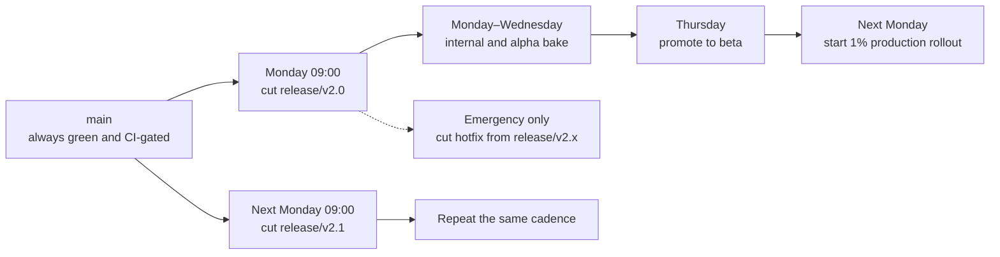
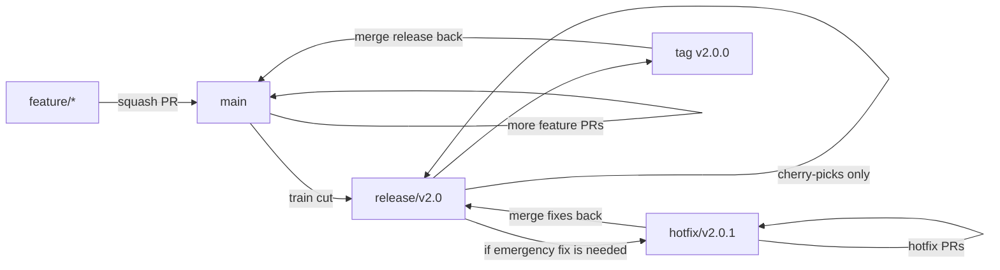
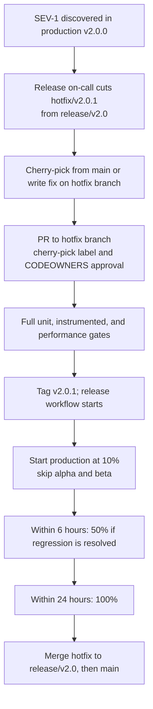
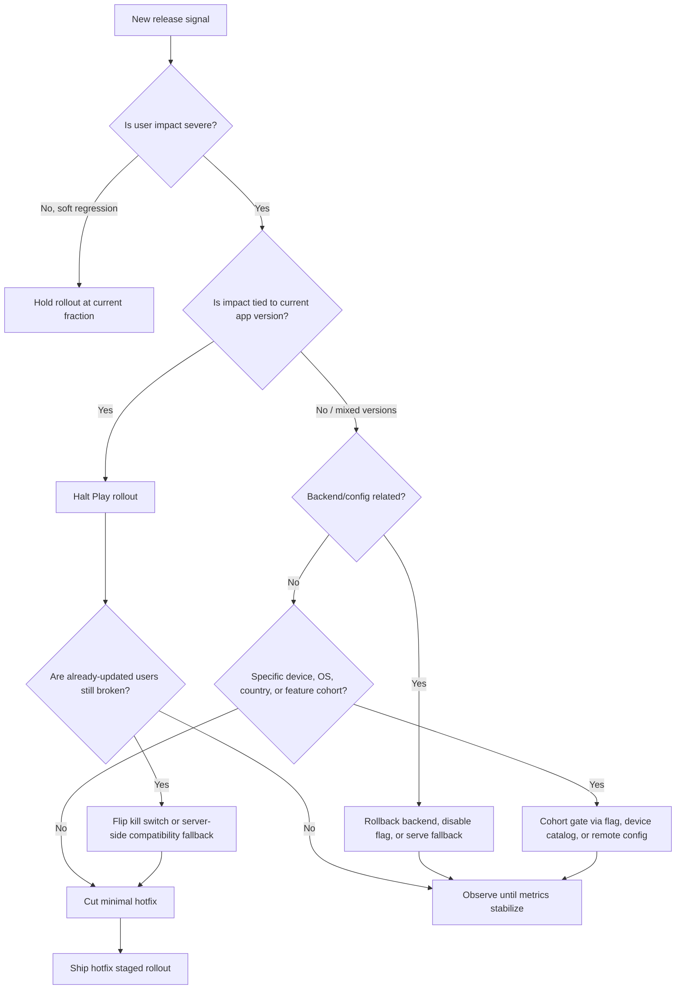

# Release Engineering: Release Strategy (Trains, Branches, Cadence)

> The org chart of releases: who can cut a release, how the branches are structured, when the cut happens, who triages hotfixes. The boring scaffolding that lets 100 engineers ship every week without coordinating a Friday war room.

---

## 1. The Release Train Model



The "train" leaves on a schedule. If your feature isn't on the train when it leaves, you wait for the next train. No "hold the release for my PR" drama.

```yaml
# .github/workflows/cut-release.yml (run weekly via cron or manual)
on:
  schedule:
    - cron: '0 9 * * 1'   # Monday 09:00 UTC
  workflow_dispatch: {}

jobs:
  cut:
    runs-on: ubuntu-latest
    steps:
      - uses: actions/checkout@v4
        with: { fetch-depth: 0 }

      - name: Determine next version
        id: ver
        run: |
          latest=$(git tag --sort=-v:refname | head -1 || echo v1.0.0)
          next=$(python scripts/bump_minor.py "$latest")
          echo "next=$next" >> $GITHUB_OUTPUT
          echo "branch=release/$next" >> $GITHUB_OUTPUT

      - name: Create release branch
        run: |
          git checkout -b "${{ steps.ver.outputs.branch }}"
          git push origin "${{ steps.ver.outputs.branch }}"

      - name: Open release tracking issue
        uses: actions/github-script@v7
        with:
          script: |
            github.rest.issues.create({
              owner: context.repo.owner,
              repo: context.repo.repo,
              title: `Release ${{ steps.ver.outputs.next }}`,
              labels: ['release'],
              body: `Branch: ${{ steps.ver.outputs.branch }}\nTrain ETA: production rollout by next Mon.\n\nReleng on-call should track here.`,
            })
```

---

## 2. Versioning

```kotlin
// app/build.gradle.kts
android {
    defaultConfig {
        versionCode = computeVersionCode()
        versionName = computeVersionName()
    }
}

fun computeVersionName(): String {
    val major = 2
    val minor = 0
    val patch = countCommitsSinceLastMinor()
    return "$major.$minor.$patch"
}

fun computeVersionCode(): Int {
    // major*10_000 + minor*1_000 + patch + small ABI offset
    // Monotonic across branches; never decreasing.
    return 20000 + 0 * 1000 + countCommitsSinceLastMinor()
}

fun countCommitsSinceLastMinor(): Int {
    val proc = ProcessBuilder("git", "rev-list", "--count", "HEAD")
        .redirectErrorStream(true).start()
    return proc.inputStream.bufferedReader().readText().trim().toInt()
}
```

Rules:
- **`versionCode` must monotonically increase.** Play rejects backwards moves.
- **`versionName` is the human-readable string** (semantic versioning works fine: `2.0.0`, `2.0.1`, `2.1.0`).
- **Hotfixes increment patch.** `2.0.0` → `2.0.1`.
- **Train releases increment minor.** `2.0.0` → `2.1.0`.
- **Major bumps are deliberate.** Breaking API contract, full rewrite, paid upgrade.

Pin both in `build.gradle.kts`; compute deterministically. Commit count from `main` gives you a reliable monotonic patch.

---

## 3. Branching



Rules:
- **`main` is always green.** Every PR builds, tests, and is approved.
- **`release/vX.Y` is cut from `main`.** Train leaves on schedule.
- **Cherry-picks only into `release/vX.Y`.** No new features land on a release branch after cut.
- **Hotfixes branch from `release/vX.Y`.** Merge back via PR; tag.
- **After release ships, merge release branch back to main** so any cherry-picked fixes propagate.

---

## 4. The "Cherry-Pick Only" Rule

```yaml
# .github/workflows/release-branch-protection.yml
on:
  pull_request:
    branches: ['release/**']

jobs:
  enforce-cherry-pick:
    runs-on: ubuntu-latest
    steps:
      - uses: actions/checkout@v4
        with: { fetch-depth: 0 }

      - name: Require label
        run: |
          labels='${{ toJson(github.event.pull_request.labels.*.name) }}'
          if ! echo "$labels" | jq -e 'contains(["release/cherry-pick"])'; then
            echo "ERROR: PRs to release/* must have label 'release/cherry-pick'"
            echo "       cut a hotfix branch and cherry-pick from main"
            exit 1
          fi

      - name: Require approval from releng
        uses: hmarr/auto-approve-action@v4
        if: contains(github.event.pull_request.labels.*.name, 'release/cherry-pick')
```

Combined with GitHub branch protection:
- Require status checks to pass.
- Require approval from CODEOWNERS (`release-management` team).
- No force-push, no deletion.
- Linear history only.

---

## 5. CODEOWNERS For Release Branches

```
# .github/CODEOWNERS

# Default
*                                @company/android-team

# Release branches
/.github/workflows/release.yml   @company/releng
/app/build.gradle.kts            @company/android-leads
release/**                       @company/releng @company/android-leads

# Signing config requires explicit security review
**/signingConfigs/**              @company/security
**/play-publisher**               @company/releng @company/security
```

PRs touching the release pipeline require sign-off. Reduces "engineer pushes 'fix' to main release config at 4 PM Friday."

---

## 6. Hotfix Flow



Hotfix releases skip alpha/beta because the bug is already in production. Faster rollout (10% → 50% → 100% within 24h) trades safety for speed.

---

## 7. Release Roles

| Role | Responsibility |
|---|---|
| **Train conductor** | Owns the weekly cadence; cuts the branch; runs the rollout |
| **Release reviewer** | Approves promotions between stages |
| **Releng on-call** | First responder to release-time incidents |
| **Hotfix author** | Engineer assigned to fix a production bug |
| **Hotfix reviewer** | Senior engineer who validates the fix is minimal and correct |
| **Security reviewer** | Required signoff for any signing/secret changes |

Document these in a runbook. Rotate "train conductor" weekly so no single person becomes a bottleneck.

---

## 8. Stop-The-Line Conditions

The release halts (no further promotion) if:

| Signal | Source |
|---|---|
| Crash-free users < threshold (e.g., 99.5%) | Firebase Crashlytics, Android Vitals |
| ANR rate > threshold (e.g., 0.47%) | Android Vitals |
| Active P0 incident | PagerDuty / Opsgenie |
| Compliance escalation (legal, security) | Manual flag in release tracking issue |
| API breaking change on backend | Coordinated stop with backend team |
| Holiday freeze in effect | Pre-declared in releng calendar |

Each one is wired into the auto-promote workflow as a gate (see `crash-rate-gating.md`).

---

## 9. Production Release Decision Tree

During a bad rollout, the Staff engineer's job is not to "fix the bug" first. It is to reduce user harm with the fastest reversible lever, then drive the root-cause fix.



### Lever selection

| Lever | Time to effect | Use when | Cost / limitation |
|---|---|---|---|
| Hold rollout | Minutes | Signal is concerning but not user-breaking | Does not help users already updated |
| Halt rollout | Minutes | Current version is clearly worse than baseline | Existing updated users stay affected |
| Kill switch | Seconds to minutes | Bad code path is remotely gateable | Requires prebuilt fallback path |
| Backend rollback | Minutes | Server deploy broke old/current clients | May affect web/iOS/backend consumers |
| Compatibility fallback | Minutes | New client response shape is broken | Requires old response shape still supported |
| Device/country gate | Hours | Regression is cohort-specific | Play/device targeting may lag |
| Hotfix | Hours to days | Bug is client code and cannot be remotely disabled | Adoption is slow; still needs staged rollout |
| Force update | Days and user-hostile | Security/legal or retired contract | Last resort; locks out users who cannot update |

### Severity guide

| Signal | First decision | Notes |
|---|---|---|
| Crash-free users below floor in new version | Halt + kill switch if possible | Page release owner |
| Checkout/login/onboarding broken | Halt + feature/backend mitigation | Treat as revenue/access outage |
| ANR spike on current rollout | Halt if user-perceived; hold if background-only | Slice by device tier and SDK/init path |
| Startup p95 regression | Hold rollout | Page only if app becomes unusable |
| Jank on critical purchase/feed flow | Hold or cohort-gate | Disable animation/experiment if available |
| Backend 5xx only for new app version | Halt rollout + backend fallback | Check handshake/capability gates |
| Privacy/security exposure | Disable path immediately | Coordinate legal/security comms |

### Communication contract

Every stop-the-line decision needs one incident note:

- **What changed:** app version, backend deploy, flag, dependency, or store rollout fraction.
- **Who is affected:** version, OS, OEM/device, country, account type, feature cohort.
- **Current lever:** hold, halt, kill switch, backend rollback, cohort gate, hotfix, or force update.
- **User impact:** crash, blocked flow, data loss risk, performance degradation, or compliance risk.
- **Next checkpoint:** exact time and metric that decides resume/hotfix/persist.

This turns release judgment into an auditable operating system, not a Slack argument.

---

## 10. Release Freeze Windows

```yaml
# .github/workflows/freeze-check.yml
on:
  pull_request:
    branches: ['main', 'release/**']

jobs:
  freeze:
    runs-on: ubuntu-latest
    steps:
      - name: Check freeze window
        run: |
          # Read freezes.json (committed in repo)
          today=$(date +%Y-%m-%d)
          in_freeze=$(jq -r --arg t "$today" \
            'map(select(.start <= $t and .end >= $t)) | length' freezes.json)
          if [ "$in_freeze" != "0" ]; then
            reason=$(jq -r --arg t "$today" \
              'map(select(.start <= $t and .end >= $t)) | first | .reason' freezes.json)
            echo "ERROR: in freeze window: $reason"
            echo "       (override with 'releng/freeze-override' label + releng approval)"
            exit 1
          fi
```

```json
// freezes.json
[
  { "start": "2026-11-23", "end": "2026-12-02", "reason": "Black Friday / Cyber Monday" },
  { "start": "2026-12-22", "end": "2027-01-05", "reason": "Holiday freeze" },
  { "start": "2026-03-14", "end": "2026-03-17", "reason": "March break — limited on-call coverage" }
]
```

Freeze windows protect high-stakes periods. PRs can be opened but not merged without explicit override.

---

## 11. Release-Notes Generation

```yaml
# .github/workflows/release.yml
- name: Generate release notes
  run: |
    last_tag=$(git tag --sort=-v:refname | head -2 | tail -1)
    notes=$(git log "$last_tag..HEAD" --pretty=format:'- %s (%an)' --no-merges)
    mkdir -p app/src/main/play/release-notes/en-US
    echo "$notes" | head -50 > app/src/main/play/release-notes/en-US/default.txt
    cat app/src/main/play/release-notes/en-US/default.txt
```

Triple-T's `publishListing` uploads these to Play Console. Manually edit before promotion if you need to be user-facing rather than commit-style.

Conventional commit messages (`feat:`, `fix:`, `chore:`) let you generate cleaner notes via tools like `conventional-changelog`.

---

## 12. Common Pitfalls

- **Hold-the-release-for-my-PR culture.** Train doesn't wait. Push back firmly; next train is a week away.
- **Cherry-picking new features into release branches.** Defeats the train model. New features wait.
- **No documented role rotation.** One person owns it forever; burnout + bus factor.
- **Hotfixes that "while we're at it" pile on changes.** Hotfix = minimal change for one bug. Anything else waits.
- **No freeze calendar.** Engineers ship destabilizing changes on the eve of Black Friday.
- **Tag the release before CI passes.** Tag triggers release workflow; failed CI mid-release is recoverable but messy.
- **Missing CODEOWNERS on release config.** Anyone can change the rollout fraction.
- **Backend incompatible with the new client.** Coordinate breaking server changes; staged rollout means N versions live.
- **Confusing halt with rollback.** Play halt stops future installs; it does not remove the bad version from devices that already updated.
- **Cutting a hotfix before mitigation.** If a kill switch or backend fallback can reduce harm now, do that before waiting for store adoption.
- **Release notes auto-generated from commit messages without curation.** Users see "fix: null check in FooBar" — unhelpful, possibly leaks internals.
- **No post-release review.** Each release should produce a 5-minute retrospective.

---

## 13. Further Reading

- [Google — Site Reliability Engineering, ch.27 (Release engineering)](https://sre.google/sre-book/release-engineering/) — principles.
- [Triple-T Gradle Play Publisher](https://github.com/Triple-T/gradle-play-publisher) — Play release automation.
- [GitHub Branch Protection rules](https://docs.github.com/en/repositories/configuring-branches-and-merges-in-your-repository/defining-the-mergeability-of-pull-requests) — enforcement at the platform.
- [Conventional Commits](https://www.conventionalcommits.org/) — for clean release notes.
- [In-app updates priority](https://developer.android.com/guide/playcore/in-app-updates) — how the priority flag is consumed.

---

> **In short:** weekly train cuts a release branch; cherry-picks only; CODEOWNERS for the pipeline; rotating roles; documented stop-the-line gates; freeze calendar in CI. Boring is good. Surprises cost users.
