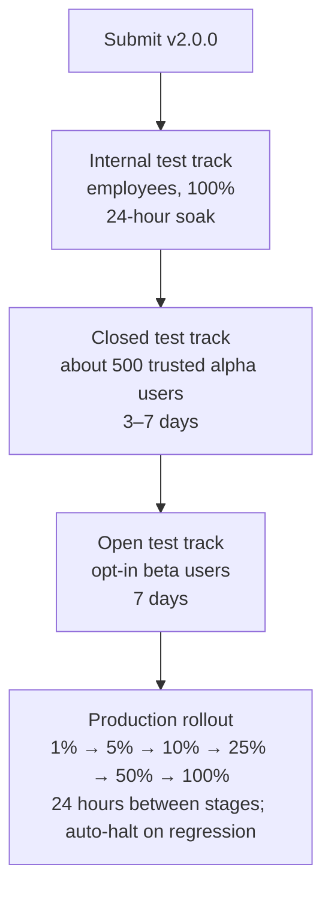

# Release Engineering: Staged Rollouts

> Choose staged exposure and promotion criteria for the release risk. Use Play's staged rollout API to grow the audience gradually, monitor crash/ANR rate per stage, and pull the release if numbers degrade.

---

## 1. The Stage Model



A safer cadence costs a week of latency but turns a "30% crash rate disaster" into "we saw it at 1% and rolled back."

---

## 2. Promoting Between Stages With Triple-T

```kotlin
// app/build.gradle.kts
plugins {
    id("com.github.triplet.play") version "4.1.1"
}

play {
    serviceAccountCredentials.set(file(System.getenv("PLAY_SERVICE_ACCOUNT")))
    track.set("internal")
    defaultToAppBundles.set(true)
    releaseStatus.set(ReleaseStatus.COMPLETED)
    updatePriority.set(2)
    artifactDir.set(file("build/outputs/bundle/release"))
}
```

```bash
# Upload to internal
./gradlew :app:publishReleaseBundle --track=internal

# Promote internal → alpha
./gradlew :app:promoteArtifact --from-track=internal --promote-track=alpha

# Promote alpha → beta
./gradlew :app:promoteArtifact --from-track=alpha --promote-track=beta

# Production at 1% rollout (staged)
./gradlew :app:promoteArtifact \
    --from-track=beta \
    --promote-track=production \
    --release-status=inProgress \
    --user-fraction=0.01
```

The Play API supports `0 < userFraction < 1` for in-progress/halted releases. Finish by setting `completed` and omitting the fraction; initial app publication cannot use a staged rollout. The cadence above is example policy, not a Play-mandated timing rule.

---

## 3. Direct Play Developer API (When You Need More)

For automation outside Triple-T's coverage, use the Play Developer Publishing API directly. JWT-based service account auth:

```python
# scripts/promote.py: update one already-inProgress release; no implicit resume.
from copy import deepcopy
import math

def promotion_body(current: dict, expected_codes: set[str], fraction: float,
                   *, replace_track_on_completion: bool = False) -> dict:
    if not expected_codes or not math.isfinite(fraction) or not 0 < fraction <= 1:
        raise ValueError("Explicit version codes and a finite fraction in (0,1] are required")
    releases = deepcopy(current.get("releases", []))
    targets = [r for r in releases if set(r.get("versionCodes", [])) == expected_codes]
    if len(targets) != 1:
        raise ValueError("Target release missing or ambiguous")
    target = targets[0]
    old_fraction = target.get("userFraction")
    if (target.get("status") != "inProgress" or
            not isinstance(old_fraction, (int, float)) or
            not math.isfinite(old_fraction) or not 0 < old_fraction < 1):
        raise ValueError("Expected an active staged rollout")
    if fraction < old_fraction:
        raise ValueError("A fraction decrease is not a rollback; halt explicitly")
    target["status"] = "completed" if fraction == 1 else "inProgress"
    if fraction == 1:
        if not replace_track_on_completion:
            raise ValueError("Completion requires explicit approval to replace this track")
        target.pop("userFraction", None)
        # Documented single-release completion; retire the other track entries.
        return {"releases": [target]}
    else:
        target["userFraction"] = fraction
    return {"releases": releases}
```

The publisher integration creates an edit, fetches the intended track, verifies the approved version-code set and current fraction, calls this transformer, updates that track and commits the edit. For fractional increases, preserve other releases and their metadata. Completion instead uses the [documented single-release request](https://developers.google.com/android-publisher/tracks#completing_a_staged_rollout): the caller must explicitly approve replacing the track with the target release. This example assumes one AAB release covers the supported devices; it is not a generic multi-APK retention policy. Review device coverage before retiring any other entries. It does not claim that two `completed` releases are accepted together; that behavior has not been tested against a real track. Serialize promotions per package/track; a concurrent console edit or commit failure requires a fresh read and renewed decision, not replaying a stale body. Reconcile an uncertain commit before retrying. Authentication, edit cleanup and the gate are integration work, not supplied by this pure transformer.


A deployment workflow must pass validated inputs through environment variables or structured API arguments, not interpolate arbitrary workflow input into shell source. If the publisher expects a credentials **file path**, materialize the secret JSON in a restricted temporary file, pass that path and remove it in an always-run cleanup. A raw JSON secret is not a file path. Prefer an appropriately scoped short-lived identity when the publisher supports it.


In the consuming deployment workflow, use a protected `production-promote` environment with configured required reviewers. Declaring an environment name alone does not configure approval rules.

---

## 4. Halting A Bad Release

```python
# scripts/halt.py
release['status'] = 'halted'
# userFraction stays where it was; no new users get the update
# Existing affected users keep the broken version (a Play limitation)
```

When you halt:
- New users on the previous fraction stop receiving the new version.
- Users who already updated stay on the new version.

For users already on the bad release, kill switches (see `kill-switches.md`) disable the offending feature. Halting is the supply-side fix; kill switches are the demand-side fix.

### Halt runbook

Halting a rollout is a mitigation, not an incident close.

1. Halt the Play production release.
2. Freeze further promotions in CI.
3. Flip any relevant kill switch or backend fallback for already-updated users.
4. Pin the release dashboard to the affected `versionCode`.
5. Write the incident note: impact, affected cohorts, lever used, next checkpoint.
6. Decide whether the recovery path is resume, hotfix, backend rollback, or force update.

Do not resume because the graph "looks better" after the halt. Resume only after the affected cohort is stable for the agreed window and the root cause is understood.

---

## 5. Automated Stage Promotion With Crash-Rate Gates

Use the [canonical crash gate](crash-rate-gating.md#4-the-auto-halt-workflow) and its multi-signal orchestration contract. The former example compared two unvalidated percentages and doubled exposure without checking window completeness, sample size, ANRs, active version or other guardrails.

A scheduled job should record evidence, evaluate **all** halt conditions before holds, and return hold on missing/stale/incompatible data. A promote-eligible result still needs approval policy, staffed response, expected version/fraction checks and mutation serialization. An emergency halt has its own incident policy. Do not infer safe promotion merely because crash-free percentage improved.

---

## 6. Per-Country & Per-Device Staging

A production release can restrict eligible countries and specify one user fraction for that release. It does not offer independent `NZ: 50%`, `AU: 20%`, `IN: 0%` percentages for one release. Country targeting is represented by the Publishing API's `countryTargeting`; verify supported transitions before changing the included set. Play does not allow removing countries after a staged rollout starts.

Device-catalog exclusions affect app/device availability, not arbitrary per-release canary percentages. Use them only after assessing existing users and support impact. Feature flags can select a runtime cohort but are a different exposure mechanism from Play binary distribution.

---


## 7. Update Priority And In-App Updates

```kotlin
play {
    updatePriority.set(2)        // 0 = silent, 5 = critical
}
```

Priority is metadata, not an automatic Play UX choice. This app-defined policy reads it and checks permitted update types:

```kotlin
class InAppUpdateChecker @Inject constructor(
    @ApplicationContext private val context: Context,
) {
    private val manager = AppUpdateManagerFactory.create(context)

    suspend fun check(): UpdateAction {
        val info = manager.appUpdateInfo.await()
        return when {
            info.updateAvailability() != UpdateAvailability.UPDATE_AVAILABLE -> UpdateAction.None
            info.updatePriority() >= 4 && info.isUpdateTypeAllowed(AppUpdateType.IMMEDIATE) -> UpdateAction.Immediate(info)
            info.updatePriority() >= 2 && info.isUpdateTypeAllowed(AppUpdateType.FLEXIBLE) -> UpdateAction.Flexible(info)
            else -> UpdateAction.None
        }
    }
}

sealed class UpdateAction {
    object None : UpdateAction()
    data class Flexible(val info: AppUpdateInfo) : UpdateAction()
    data class Immediate(val info: AppUpdateInfo) : UpdateAction()
}
```

| Priority | UX |
|---|---|
| 0-1 | This example does not request an in-app update |
| 2-3 | Request flexible flow only if allowed |
| 4-5 | Request immediate flow if allowed; handle cancellation/recovery |

Reserve 4-5 for security-critical releases. Most go at 2-3.

---

## 8. Staged Rollout Diagram (Audit Trail)

Maintain a simple status log in CI artifacts:

```json
{
  "version": "2.0.0",
  "versionCode": 12340,
  "stages": [
    {"track": "internal", "promotedAt": "2026-06-15T10:00:00Z", "fraction": 1.0, "crashFree": 99.8},
    {"track": "alpha",    "promotedAt": "2026-06-16T10:00:00Z", "fraction": 1.0, "crashFree": 99.7},
    {"track": "beta",     "promotedAt": "2026-06-19T10:00:00Z", "fraction": 1.0, "crashFree": 99.6},
    {"track": "production","promotedAt": "2026-06-26T14:00:00Z", "fraction": 0.01, "crashFree": 99.5},
    {"track": "production","promotedAt": "2026-06-27T14:00:00Z", "fraction": 0.05, "crashFree": 99.5},
    {"track": "production","promotedAt": "2026-06-28T14:00:00Z", "fraction": 0.10, "crashFree": 99.5}
  ]
}
```

Stored as a build artifact + appended to a release-history file. Post-mortems reference this when reconstructing "what we knew and when."

---

## 9. Common Pitfalls

- **Going from 1% → 100% in one step.** Defeats the purpose.
- **Skipping the alpha/beta tracks.** Production is not where you find bugs.
- **No country-specific monitoring.** A bug only in India is invisible if your dashboard aggregates globally.
- **Halting without kill-switching the feature.** Users on the bad version remain affected.
- **Promoting on weekends.** No one is watching. Promote in business hours.
- **No environment protection on the promote workflow.** Anyone with `write` can ship to production.
- **Trusting Play's "% adopted" without independent measurement.** Play's number lags by hours; your Crashlytics by minutes.
- **Forgetting `releaseStatus = inProgress`.** Default in some Triple-T configs is `completed`, which bypasses staging.
- **Mixed-version mayhem on the backend.** A staged rollout means N versions live simultaneously. Your API must support all of them.
- **Forgetting to clean up halted releases in Play Console.** Sticky halts confuse the next release.

---

## 10. Further Reading

- [In-app update availability and allowed flow types](https://developer.android.com/reference/com/google/android/play/core/appupdate/AppUpdateInfo).

- [Play staged-rollout eligibility and country rules](https://support.google.com/googleplay/android-developer/answer/6346149).

- [Publishing API release fields and bounds](https://developers.google.com/android-publisher/api-ref/rest/v3/edits.tracks).

- [Triple-T Gradle Play Publisher](https://github.com/Triple-T/gradle-play-publisher) — promotion + rollout commands.
- [Play Developer API — Edits and Releases](https://developers.google.com/android-publisher/api-ref/rest/v3/edits.tracks) — official.
- [In-App Updates API](https://developer.android.com/guide/playcore/in-app-updates) — flexible vs immediate.
- [Android Vitals](https://developer.android.com/topic/performance/vitals) — Play Console's crash & ANR metrics.
- [Staged rollout in Play Console](https://support.google.com/googleplay/android-developer/answer/6346149) — Play UX walkthrough.

---

> **In short:** internal → alpha → beta → 1/5/10/25/50/100% production with 24h between stages. Automate promotion via Play Developer API; gate each step on crash-free rate. Halt fast; kill-switch in parallel. Audit every promotion.
