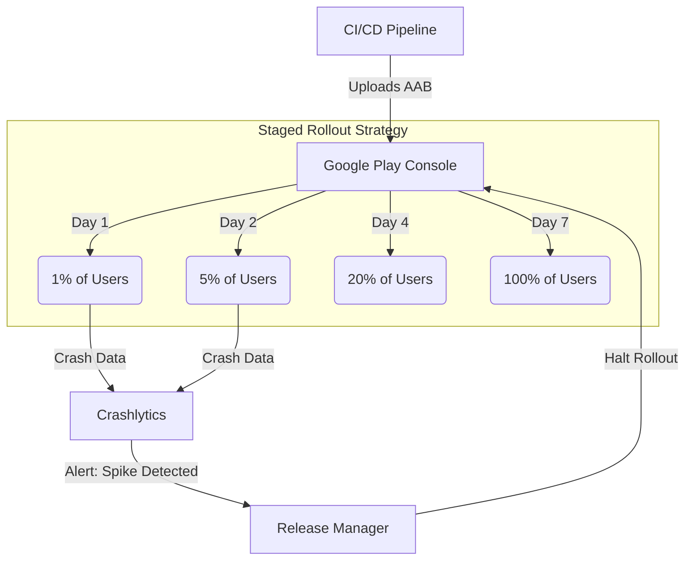

# Release Engineering: Staged Rollouts

## The Prompt

*"A Junior engineer presses the 'Publish' button on the Google Play Store, sending the new App Update (v2.0) to 10 million users instantly. The update contains a fatal crash on startup. 10 million users are locked out of their bank accounts. Design the Staged Rollout process that prevents this."*

## 1. Requirements & Clarification (RADIO Framework)

### Functional Requirements
- Distribute app updates gradually to a percentage of users.
- Halt distribution automatically if metrics degrade.
- Provide a mechanism to rollback or fix the issue.

### Non-Functional Requirements (NFRs)
- **Safety (Priority 0):** A fatal crash should never affect more than 1% of the active user base.
- **Monitoring:** The rollout process must be tightly coupled to the Telemetry SDK (Crash-Free Sessions).
- **Speed:** The rollout must not take 6 months. It must balance safety with feature delivery velocity.

## 2. High-Level Architecture (The Phased Release)

Mobile releases are fundamentally different from Backend deployments.
If you deploy a broken backend server, you rollback the Docker container in 3 seconds.
If you deploy a broken Mobile App, the broken binary is physically installed on the user's phone. You **cannot** delete it from their phone. You must submit a new version to Google, wait 2 days for review, and pray the user connects to Wi-Fi to download it.

We use **Staged Rollouts** to limit the blast radius.

## 3. The Core Flows (Deep Dive)

### Flow 1: The 1% Bake Period (The Canary)
*Interviewer:* "Why start at 1%? Why not 10%?"

**Staff Answer:**
"For an app with 10 million daily active users, 1% is 100,000 users. That is easily enough statistical volume to detect fatal crashes, API mismatches, or infinite loops within a few hours.
If we push a fatal crash to 1%, 100,000 users are angry, but our customer support center can handle it. If we push to 10%, 1 million users are locked out of their bank accounts, causing a national PR disaster and crashing our phone lines."

### Flow 2: Evaluating the Gate (Crash-Free Users vs Sessions)
*Interviewer:* "Before moving from 1% to 5%, what exact metric are you looking at to approve the promotion?"

**Staff Answer:**
"We evaluate **Crash-Free Users**, not Crash-Free Sessions.
- If 1 user opens the app 100 times and it crashes every time, that is 100 crashed sessions. It makes the 'Crash-Free Session' metric look like the app is completely broken globally.
- But it's only 1 user. Maybe their device is rooted, or they have a corrupted SQLite database from 2018.
By measuring 'Crash-Free Users' (which must remain > 99.9%), we see the true blast radius. If the metric is healthy after 24 hours, the Release Manager promotes the rollout to 5%."

### Flow 3: The Halt & Hotfix (The Rollback Myth)
*Interviewer:* "At 20%, the app starts crashing because a new database migration fails on Samsung devices. What is your immediate action, and how do you 'rollback'?"

**Staff Answer:**
"First, I immediately click **Halt Rollout** in the Play Store. The remaining 80% of users are now safe. They will remain on Version 1.0.
Second, I must acknowledge a painful reality: **There is no Rollback on Android.** Google Play does not allow you to un-publish v2.0 and force the 20% of users back to v1.0.
1. I must cut a **Hotfix branch** from the v2.0 release tag.
2. The team fixes the database migration.
3. We increment the `versionCode` to v2.0.1.
4. We build a new AAB and submit it to the Play Store.
5. We push v2.0.1 directly to 20% (to overwrite the broken users) or 100% (if we are completely confident in the fix)."

## 4. Failure Modes & Bottlenecks

### Bottleneck: Feature Flags vs App Updates
*Interviewer:* "A Staged Rollout takes 7 days to reach 100%. The Marketing team wants a new banner to appear for everyone on Black Friday. Your staged rollout won't finish in time. How do you solve this?"

**Staff Answer:**
"We decouple **Binary Release** from **Feature Release**.
1. We merge the new Black Friday banner code into the app.
2. We wrap it in a Feature Flag: `if (FlagEngine.isBlackFridayEnabled)`.
3. We start the Staged Rollout on November 1st. By November 10th, the app is on 100% of devices.
4. The banner is dormant (invisible) because the flag is off.
5. On Black Friday (Nov 24), the PM clicks a button in the Remote Config dashboard. The flag flips to `true` globally. 100% of users see the banner instantly.
App Updates are for delivering code safely over 7 days. Feature Flags are for delivering experiences instantly."

### Bottleneck: The API Contract Break
*Interviewer:* "The mobile app v2.0 is at 50% rollout. The Backend team deletes an old API endpoint (`/v1/login`) and replaces it with `/v2/login`. Suddenly, 50% of your users can't log in."

**Staff Answer:**
"The Backend team violated the **Forward Compatibility Rule**.
Because mobile rollouts are staged (and some users turn off auto-updates entirely), there are always multiple versions of the mobile app running simultaneously in the wild.
**The Fix:** The Backend must *never* delete or make breaking changes to an API endpoint while older mobile clients are still generating traffic. They must support both `/v1/` and `/v2/` simultaneously until the metrics show that traffic to `/v1/` has reached near zero (usually weeks or months later)."

## 5. Staff Engineer Thinking: Force Updating (The Nuclear Option)

A Staff Engineer knows that some users will refuse to update their app for years.
If the backend fundamentally changes its security model, the old apps become a massive security liability.
We must build a **Force Update Mechanism** into the architecture from Day 1.

1. The Android app hits a `GET /app-config` endpoint on startup.
2. The response contains `"min_required_version": 150`.
3. If the user's app is `versionCode 140`, the app intercepts this and immediately launches a full-screen, un-dismissible Activity.
4. The Activity says: "This version is no longer supported. Please update to continue." It provides a button linking directly to the Play Store `market://` URL.
5. This is the only way to surgically kill off ancient app versions that are polluting the backend.

## 6. Probing Questions (For Practice)

1.  Explain the fundamental difference between rolling back a backend microservice and attempting to "roll back" a mobile application.
2.  Walk through a standard 7-day Staged Rollout schedule (e.g., 1%, 5%, 20%, 100%). Why is 1% chosen as the initial Canary phase?
3.  Why is "Crash-Free Users" a vastly superior metric to "Crash-Free Sessions" when deciding whether to promote a staged rollout?
4.  Describe the immediate actions a Release Manager must take if a fatal crash is discovered when the rollout reaches 20%.
5.  How do you overwrite the broken app on the devices of the 20% of users who already downloaded it?
6.  Explain the concept of decoupling the "Binary Release" from the "Feature Release" using Feature Flags.
7.  Why does a Staged Rollout fundamentally break the assumption that the Backend and Frontend are perfectly synchronized?
8.  Describe the "Forward Compatibility Rule" for API development. Why must the backend support both `/v1/login` and `/v2/login` for months?
9.  What is a Force Update Mechanism, and why is it architecturally mandatory for long-term backend health and security?
10. If the Play Store takes 24 to 48 hours to review an app update, how does this impact the Mean Time To Recovery (MTTR) for a mobile hotfix compared to a web hotfix?

## Further Reading

- [`feature-flags-and-remote-config.md`](../mobile-system-design/feature-flags-and-remote-config.md) — How to bypass app store delays for feature releases.
- [`versioning-and-backward-compatibility.md`](../mobile-system-design/versioning-and-backward-compatibility.md) — How the backend manages the multiple active mobile versions.
- [`telemetry-sdk.md`](../mobile-system-design/telemetry-sdk.md) — How the crash metrics are gathered.
