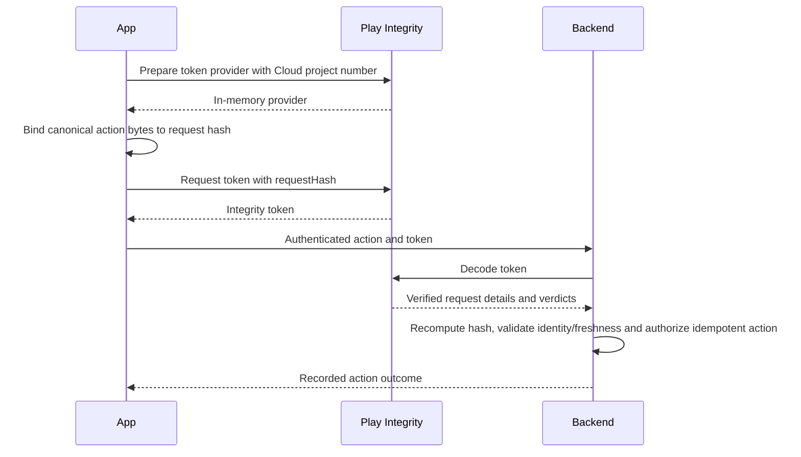
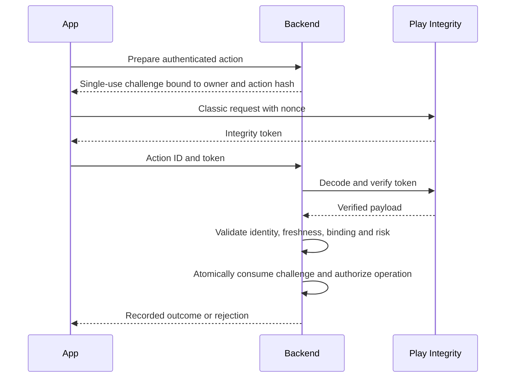

# Security: App and Device Attestation

## Threat Model

Attestation supplies evidence for a server risk decision. It does not prove that a human intended an action or that an authenticated account is honest. Keep authorization, anti-replay and business idempotency separate. A modified client can skip its own checks, so verification and enforcement belong on a trusted backend.

## Play Integrity: Standard and Classic

Use the current setup guide for the library dependency; it currently specifies `com.google.android.play:integrity:1.6.0`. Standard requests suit most integrations: prepare a provider, request a token with a `requestHash` bound to the action, then decode/verify it on the backend. Classic requests use a nonce and are intended for less frequent, high-value checks. They are not a paid “Premium” tier.

### Standard Request Walkthrough



Prepare before the protected action so warm-up is not repeatedly placed on its critical path. The server recomputes the hash from the received canonical action, rather than trusting a hash supplied by the client.

Validated against: [Standard API request sequence](https://developer.android.com/google/play/integrity/standard).

```kotlin
// Imports: IntegrityManagerFactory, StandardIntegrityManager and
// kotlinx.coroutines.tasks.await (the maintained Task adapter).
suspend fun prepareStandardProvider(context: Context, projectNumber: Long):
    StandardIntegrityManager.StandardIntegrityTokenProvider =
    IntegrityManagerFactory.createStandard(context).prepareIntegrityToken(
        StandardIntegrityManager.PrepareIntegrityTokenRequest.builder()
            .setCloudProjectNumber(projectNumber).build()
    ).await()

suspend fun standardToken(
    provider: StandardIntegrityManager.StandardIntegrityTokenProvider,
    canonicalAction: ByteArray,
): String {
    val digest = MessageDigest.getInstance("SHA-256").digest(canonicalAction)
    val requestHash = Base64.encodeToString(digest,
        Base64.URL_SAFE or Base64.NO_PADDING or Base64.NO_WRAP)
    return provider.request(
        StandardIntegrityManager.StandardIntegrityTokenRequest.builder()
            .setRequestHash(requestHash).build()
    ).await().token()
}
```

Canonical bytes must bind the authenticated action ID, owner/session, endpoint and parameters under a shared serialization contract. The token is not authorization by itself. Keep the provider under an explicit owner; recover documented expired-provider/API failures with bounded re-preparation, not an unlimited retry loop. Do not place raw sensitive parameters in `requestHash`.

### Classic Request Walkthrough

The next diagram describes a **classic** flow. The five-minute challenge lifetime is application policy, not a Play guarantee.



The server binds the verified evidence to one operation; a token does not replace the operation's authorization or deduplication contract.

Validated against: [classic requests](https://developer.android.com/google/play/integrity/classic) and [verdict interpretation](https://developer.android.com/google/play/integrity/verdicts).

The equivalent client call uses a server-issued single-use challenge:

```kotlin
suspend fun classicToken(context: Context, serverNonce: String): String =
    IntegrityManagerFactory.create(context).requestIntegrityToken(
        IntegrityTokenRequest.builder().setNonce(serverNonce).build()
    ).await().token()
```

The server stores the nonce's owner, action hash and expiry before issuing it. Standard and Classic use different request-detail fields and replay mechanisms; do not pass a Classic nonce to the Standard verifier or cache a token as a reusable grant.

## Which Evidence Fits the Action?

| Tool | Evidence | Appropriate use | Limit |
|---|---|---|---|
| Standard Integrity | Request-bound current app/device/account signals | Most online anti-abuse checkpoints | Requires server verification and a risk policy |
| Classic Integrity | Fresh assessment bound to a nonce | Selected infrequent sensitive checks | More latency; server replay discipline required |
| Key attestation | Properties and origin of an enrolled key | Device-key enrollment, later signed requests | Enrollment-time device state is not perpetual health |

| Action | Possible policy | Independent requirements |
|---|---|---|
| Public feed | No attestation unless abuse evidence justifies it | Rate limits and minimized data |
| Login | Risk-based Standard check | Account authentication and recovery |
| Transfer | Request-bound signal plus enrolled-key proof if justified | Server authorization, step-up and idempotency |
| Device enrollment | Fresh challenge and verified certificate path | Owner binding, revocation and recovery |

These are design choices, not instructions that every transfer must require StrongBox or that every missing verdict is fraud.

## Misuse to Reject

| Misuse | Failure |
|---|---|
| Client validates its own verdict | A modified app skips enforcement |
| Cache a good token for later actions | Binding/freshness no longer match; proxying risk increases |
| Treat strong integrity as StrongBox proof | Verdict tier is not the app key's security level |
| Trust a client-supplied certificate root | An attacker supplies its own trust anchor |
| Treat a signature as user intent | An authorized or compromised process may invoke a usable key |

## Server Verification Contract

Verify the request package, expected nonce (classic) or request hash (standard), and token age before using verdicts. Reject malformed or implausibly future timestamps under an explicit clock-skew policy. Check the recognized app, package, allowed signing certificate and supported version. Licensing is a separate signal when the distribution policy requires it. Missing verdict fields are not positive evidence.

A classic nonce record must belong to the authenticated owner and canonical action parameters, have an expiry, and be consumed **atomically**. A `get()` followed by `markConsumed()` permits two concurrent requests to pass. An app-defined transaction can perform:

```sql
UPDATE action_challenges
SET consumed = 1
WHERE id = :challengeId
  AND owner_id = :authenticatedOwner
  AND action_hash = :canonicalActionHash
  AND consumed = 0
  AND expires_at > :serverNow;
```

Require exactly one affected row and commit authorization/durable operation creation in the same transaction. On uncertain retries, return the operation's recorded outcome instead of performing it again. If the effect is external, use the [idempotency and reconciliation contract](../distributed-systems/idempotency.md); a local transaction cannot roll back a remote charge.

Standard requests include Play's replay protection, but the server still checks request binding and enforces one logical action. Do not reuse a cached verdict for an unrelated sensitive action. Treat technical API errors separately from an adverse verdict and define the product's fallback policy.

## Interpreting Device Labels

`MEETS_BASIC_INTEGRITY`, `MEETS_DEVICE_INTEGRITY` and `MEETS_STRONG_INTEGRITY` are version-dependent signals, not names for a Keystore security level. Strong integrity does **not** mean the application's key is in StrongBox. On Android 13+, strong integrity includes device integrity and security updates within the last year for relevant partitions; on Android 12 and lower its requirements differ and do not require that update recency. Optional labels and device attributes can be absent. Apply the current verdict documentation and an action-specific tiered policy rather than assuming all legitimate devices return every label.

The default quota is 10,000 total daily requests tied to the associated Cloud project, with separate accounting for token preparations/requests and decryptions as documented. Request an increase when needed; there is no documented purchase of a “Premium” mode here. Standard warm-up, standard verdict requests and classic requests have different latency behavior. Measure it; do not assign them one fixed latency range or cache security decisions indiscriminately to save quota.

## Keystore Key Attestation

A fresh server challenge in `setAttestationChallenge` binds enrollment to a newly attested key. Key attestation was introduced in Android 7.0; support and security level vary by device. StrongBox is optional and requesting it can fail. Use a declared TEE fallback or reject enrollment according to policy; never silently claim StrongBox after fallback.

### Client Enrollment Core

```kotlin
@RequiresApi(24)
fun createEnrollmentKey(alias: String, challenge: ByteArray, requireStrongBox: Boolean): KeyPair {
    require(challenge.isNotEmpty())
    val store = KeyStore.getInstance("AndroidKeyStore").apply { load(null) }
    check(!store.containsAlias(alias)) { "Use a fresh enrollment alias" }
    val spec = KeyGenParameterSpec.Builder(alias,
        KeyProperties.PURPOSE_SIGN or KeyProperties.PURPOSE_VERIFY)
        .setAlgorithmParameterSpec(ECGenParameterSpec("secp256r1"))
        .setDigests(KeyProperties.DIGEST_SHA256)
        .setAttestationChallenge(challenge)
    if (requireStrongBox) {
        check(Build.VERSION.SDK_INT >= 28) { "StrongBox requires API 28+" }
        spec.setIsStrongBoxBacked(true)
    }
    return KeyPairGenerator.getInstance(KeyProperties.KEY_ALGORITHM_EC, "AndroidKeyStore").run {
        initialize(spec.build())
        generateKeyPair()
    }
}

fun enrollmentChain(alias: String): List<ByteArray> =
    KeyStore.getInstance("AndroidKeyStore").apply { load(null) }
        .getCertificateChain(alias).map { it.encoded }
```

Use an account/enrollment-specific alias and serialize enrollment creation. Persist the pending challenge ID and upload its certificate chain to the authenticated registration endpoint. Commit the key binding only after server verification; recover or delete an abandoned pending alias deliberately. Requesting StrongBox is strict and can throw `StrongBoxUnavailableException`; retrying with TEE requires an explicit fallback policy and server verification of the actual level. Do not overwrite a registered alias to retry enrollment.

### Server Enrollment Verification

Do not write a short certificate loop and call it a complete verifier. Use a reviewed certificate/attestation library on the server and validate:

- A valid certificate path to independently trusted current roots, including validity and revocation checks. Never trust a root merely because the client supplied it.
- The challenge, authenticated owner and one-time enrollment record.
- The attestation and key security levels, required key origin, algorithm, purposes and authentication restrictions.
- Boot state **and** `deviceLocked` when required; “verified” alone is not the entire policy.
- The attestation application-ID package/version set and signing-certificate digest set, not only a package string.

The trust store must account for the Google root introduced for chains signed from February 2026, while handling documented older roots and revocation. Locate and parse the attestation extension according to the official chain rules; do not assume every chain has a fixed length or that the first certificate always holds every relevant extension.

Enrollment records the verified public key and its owner. Later signatures prove use of the corresponding private key, not that the device is still in its enrollment-time state or that its current process is uncompromised. Bind signed bytes to the operation, owner, endpoint and single-use server challenge. Define key revocation, re-enrollment and freshness policy; enrollment evidence is not a perpetual device-health guarantee.

## Testing

Test absent/malformed labels, wrong package/certificate/action/owner, expired and future evidence, concurrent replay, quota failure, and an uncertain response after operation creation. For keys, use valid, revoked, expired, wrong-root and malformed chains, plus both current and older supported roots. Verify unsupported-hardware and lost-key recovery on devices.

A local signature round trip only tests cryptography; it does not validate a certificate path, device policy or Play verdict. Mock policies need a separate integration test with the real service.

## Further Reading

- [Play Integrity setup and quota](https://developer.android.com/google/play/integrity/setup).
- [Standard requests](https://developer.android.com/google/play/integrity/standard).
- [Classic requests](https://developer.android.com/google/play/integrity/classic).
- [Verdict fields and version-dependent labels](https://developer.android.com/google/play/integrity/verdicts).
- [Hardware-backed key verification and roots](https://developer.android.com/privacy-and-security/security-key-attestation).
- [AOSP attestation schema](https://source.android.com/docs/security/features/keystore/attestation).
