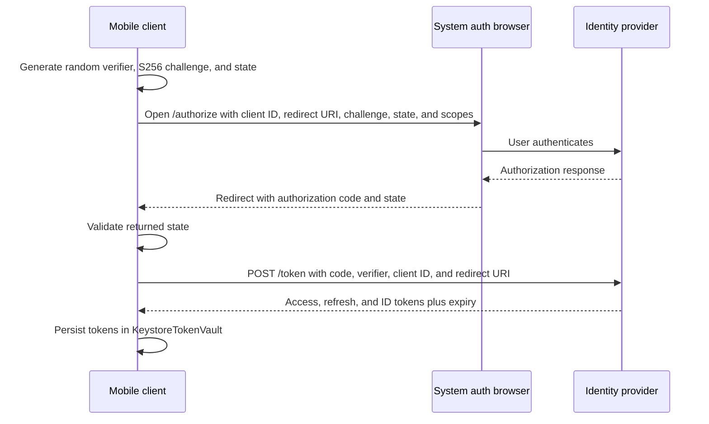

# Security: Authentication on Mobile (OAuth, PKCE, Tokens, Biometric Step-Up)

> The pragmatic flow for adding auth to an Android app: OAuth 2.0 Authorization Code + PKCE, access + rotating refresh, OkHttp `Authenticator` for silent refresh, biometric step-up for sensitive actions.

---

## 1. Why Mobile Auth Is Its Own Problem

Native HTTP clients can use cookies too, and browser-backed login uses the browser's own session. This chapter chooses bearer tokens for native API calls. Attach them only to the reviewed HTTPS resource origin; keep login and token refresh separate from resource requests. OAuth does not require every access token to be a JWT.

Three building blocks:
1. **OAuth Authorization Code + PKCE** to get tokens from your IdP.
2. **Two-token model** (short-lived access, longer-lived rotating refresh) for ongoing API calls.
3. **Biometric-bound Keystore key** for step-up when amount/risk demands it.

### Staff threat model

Mobile auth assumes the attacker can own the client. Design policy around server-side risk, not client-side trust.

| Threat | Mitigation | Limit |
|---|---|---|
| Stolen access token | Short TTL, audience/scope binding, revoke on anomaly | Token works until expiry |
| Stolen refresh token | Rotation with reuse detection | Requires backend token family tracking |
| Deep-link interception | Claimed HTTPS app links, PKCE, state validation | Custom schemes are weaker |
| Rooted/tampered device | Step-up, attestation, risk scoring | Cannot make a compromised client trustworthy |
| Replay of sensitive action | Server nonce, idempotency, device signing key | Needs server-side enforcement |
| Socially engineered session | Biometric step-up for high-risk actions | Biometrics prove local user presence, not intent |

The Staff-level rule: authentication proves account access; it does not prove device integrity, app integrity, or user intent. High-risk actions need additional signals.

---

## 2. OAuth 2.0 Authorization Code + PKCE (the Login)



Use a maintained native OAuth/OIDC client such as [AppAuth-Android](https://github.com/openid/AppAuth-Android) with a registered external-browser redirect and its documented completion/cancellation flow. A map of raw activity continuations is not a lifecycle-safe login implementation.

The application integration must:

1. Store one bounded pending attempt before launching the browser, with issuer, exact redirect URI, state and PKCE verifier; use S256. For OIDC, apply the library's ID-token/nonce validation too.
2. Validate scheme/host/path and pending-attempt state for **success and error** callbacks. Apply the same validation on cold `onCreate` and warm `onNewIntent`; an intent filter is not runtime authorization.
3. Consume a pending attempt at most once. Handle duplicate callbacks, cancellation, expiry and process recreation deliberately; never leave a suspended caller registered forever.
4. Exchange only with the configured issuer/token endpoint, then admit the result only if that login attempt is still current. An old callback must not replace a newer login or restore a cancelled one.
5. Prefer verified claimed HTTPS redirects when supported. A private-use scheme can be intercepted and still needs PKCE and exact response validation.

External user agents keep the app out of the user's password entry. Custom Tabs are one browser integration, not a guarantee that Chrome is installed or that all browsers share cookies. Avoid embedded WebView authentication as described by RFC 8252.

---

## 3. Two-Token Storage

```kotlin
data class Tokens(
    val access: String,
    val refresh: String,
    val accessExpiresAtMs: Long,
    val obtainedAtMs: Long,
) {
    override fun toString(): String = "Tokens([redacted])"
}

// App-defined storage contract. One vault per login session, including a
// re-login to the same account.
interface TokenVault {
    suspend fun load(): Tokens?
    suspend fun replaceIfCurrent(expected: Tokens, replacement: Tokens): Tokens?
    suspend fun invalidateIfCurrent(expected: Tokens): Boolean
    suspend fun invalidate(): Tokens? // Atomically ends this session and returns its last tokens.
}
```

Replacement and invalidation must share one atomic storage boundary: separate `load` and `save` calls cannot give that guarantee. Once invalidated, a vault returns no tokens and rejects every replacement, so a late refresh cannot restore a logged-out session or write into another account. Encryption does not serialize writers or establish session ownership.

Encryption primitives live in `secure-storage-on-android.md`. New vaults use a versioned ciphertext envelope backed by a direct Android Keystore key; legacy `EncryptedSharedPreferences` installations need an explicit migration. Persist access or refresh tokens only when product continuity requires it. A generated data-class `toString()` would expose credentials, so this example redacts it; do not log the properties either.

---

## 4. OkHttp `Authenticator` (Silent Refresh)

When the resource server answers 401, OkHttp calls the `Authenticator` and blocks that call until it returns a follow-up request, or `null` to give the 401 to the caller. Each login owns its vault, refresher and authenticated client; these objects are not process-wide singletons, and no callback reads a global current account. This follows the [session-bound design in Retrofit and OkHttp](../android/networking-and-security/retrofit-and-okhttp.md#production-example), using that chapter's HTTPS scheme/host/port check, [`sameOriginAs`](../android/networking-and-security/retrofit-and-okhttp.md#internal-mechanics).

```kotlin
class JwtAuthenticator(
    private val vault: TokenVault,
    private val refresher: TokenRefresher,
    private val apiOrigin: HttpUrl,
) : Authenticator {

    override fun authenticate(route: Route?, response: Response): Request? {
        val request = response.request
        if (!request.url.sameOriginAs(apiOrigin)) return null
        val failed = request.header("Authorization")?.removePrefix("Bearer ") ?: return null
        val challenges = generateSequence(response) { it.priorResponse }.count { it.code == 401 }
        if (challenges >= 2) return null    // already retried; give up
        // This example replays bodyless reads only; a write's 401 goes to its caller.
        if (request.method !in setOf("GET", "HEAD") || request.body != null) return null

        val refreshed = try {
            runBlocking { refresher.refreshNow(failed) }
        } catch (e: NotSignedIn) {
            return null                     // terminal rejection or ended session
        }
        if (runBlocking { vault.load() } != refreshed) return null
        return request.newBuilder()
            .header("Authorization", "Bearer ${refreshed.access}")
            .build()
    }
}

class JwtRequestInterceptor(
    private val refresher: TokenRefresher,
    private val apiOrigin: HttpUrl,
) : Interceptor {

    override fun intercept(chain: Interceptor.Chain): Response {
        val request = chain.request()
        if (!request.url.sameOriginAs(apiOrigin)) {
            throw IOException("Authenticated client used outside its API origin")
        }
        val token = runBlocking { refresher.freshAccessToken() }

        return chain.proceed(
            request.newBuilder()
                .header("Authorization", "Bearer $token")
                .build()
        )
    }
}
```

Public and IdP requests use separate clients, so there is no caller-supplied header that bypasses authentication. An ended session fails the call with `NotSignedIn` rather than sending it unauthenticated. Build this client with redirects disabled and a total call deadline.

A write can still fail with 401 when a token was revoked early. This example returns that response, because replaying a write needs a replayable body and a server contract, such as an idempotency key, that makes repetition safe.

`runBlocking` is the synchronous bridge into suspending code. Never call `execute()` on the main thread. Canceling an OkHttp call does not cancel arbitrary blocking coroutine work, so the refresh adapter needs its own timeout.

```kotlin
class NotSignedIn : IOException("Session ended")

// Dedicated token-endpoint adapter: bounded I/O, no automatic retry, no auth
// interceptor, no body logging. Null means ONLY a confirmed credential rejection
// (invalid_grant). Transport and temporary server failures throw IOException.
fun interface RefreshApi {
    suspend fun refreshOrNull(refreshToken: String): RefreshResponse?
}

data class RefreshResponse(
    val accessToken: String,
    val refreshToken: String?,      // OAuth permits omission: keep the old one then.
    val expiresInSec: Long,
)

class TokenRefresher(
    private val vault: TokenVault,
    private val idpApi: RefreshApi,
    private val clock: Clock,
    private val onSessionEnded: () -> Unit,
) {
    private val refreshMutex = Mutex()

    suspend fun freshAccessToken(): String {
        val current = vault.load() ?: throw NotSignedIn()
        if (current.accessExpiresAtMs - clock.now() > REFRESH_AHEAD_MS) return current.access
        return refreshNow(current.access).access
    }

    suspend fun refreshNow(failedAccess: String): Tokens {
        val result = refreshMutex.withLock {
            currentCoroutineContext().ensureActive()
            val current = vault.load() ?: throw NotSignedIn()
            // Another caller already refreshed while this one waited for the lock.
            if (current.access != failedAccess) return@withLock current
            // Once rotation starts, finish its bounded I/O and atomic commit.
            withContext(NonCancellable) {
                val resp = idpApi.refreshOrNull(current.refresh)
                if (resp == null) {
                    if (vault.invalidateIfCurrent(current)) onSessionEnded()
                    throw NotSignedIn()
                }
                val replacement = Tokens(
                    access = resp.accessToken,
                    refresh = resp.refreshToken ?: current.refresh,
                    accessExpiresAtMs = clock.now() + resp.expiresInSec * 1000,
                    obtainedAtMs = clock.now(),
                )
                vault.replaceIfCurrent(current, replacement) ?: throw NotSignedIn()
            }
        }
        currentCoroutineContext().ensureActive()
        return result
    }

    companion object { private const val REFRESH_AHEAD_MS = 60_000L }
}
```

Single-flight comes from the mutex and the re-read. The first caller refreshes, and waiters see that the vault no longer holds the token that failed, so they reuse the new pair without another `POST /token`. After a terminal rejection they find the session ended and stop.

Only a confirmed `invalid_grant` ends the session. [RFC 6749](https://www.rfc-editor.org/rfc/rfc6749) also returns 400 for other errors and can return 401 for `invalid_client`, so a status code alone is not evidence that this user's grant is dead. Transient failures throw `IOException` and keep the tokens. Later callers may retry under a bounded backoff policy, which also means queued calls can each attempt a refresh during an outage.

`NonCancellable` covers only the bounded refresh and commit. A caller can stop waiting for the mutex, but once it owns a rotation, cancellation waits for that section so the rotated pair is saved. There is no detached job. This protects neither process death nor a second process.

**Refresh token rotation.** An IdP [may issue a new refresh token](https://www.rfc-editor.org/rfc/rfc6749) with any refresh, and the client must then discard the old one. [RFC 9700](https://www.rfc-editor.org/rfc/rfc9700) requires authorization servers to detect replay for public clients through rotation or sender-constrained tokens. Under rotation, replaying an old token can cause the server to revoke the active one.

A rotation at the IdP cannot be made atomic with the local write. If the response is lost, or the process dies before the commit, the client may hold a token the server has retired. Recovery depends on the IdP's rotation policy and can require re-login.

---

## 5. Logout

```kotlin
suspend fun signOut(session: LoginSession, reason: SignOutReason) {
    val tokens = withContext(NonCancellable) {
        // Empty credentials do not mean cleanup or retirement has finished.
        val captured = session.vault.invalidate()
        sessionManager.retireIfCurrent(session, reason) // never unpublishes a newer login
        session.client.dispatcher.cancelAll()
        workManager.cancelAllWorkByTag("user-${session.id}")
        session.userData.clear()                       // bounded, idempotent, session-local
        captured
    }

    // Local logout completes first; network revocation remains cancellable.
    currentCoroutineContext().ensureActive()
    if (tokens == null) return

    try {
        revocationApi.revoke(tokens.refresh)          // dedicated IdP client, bounded
    } catch (e: IOException) {
        reportRevocationFailure(reason, e)            // the local session stays ended
    }
}
```

Sign-out invalidates the captured session before any network call, then cancels that session's calls and workers and clears only its namespaced data. An old operation must not run `db.clearAllTables()` or `notifications.cancelAll()` against a newer account. The session manager serializes this with login and account switch, and resets analytics identity only when the retiring session is still the current one. A request already sent can still finish after logout, so reject old-session results at UI and persistence boundaries.

Retirement happens before data cleanup, even if a terminal refresh rejection already emptied the vault. The local transition uses `withContext(NonCancellable)` so caller cancellation cannot interrupt it between invalidation and cleanup. These local operations must be bounded and idempotent; storage implementations dispatch their own blocking work appropriately. A cleanup I/O failure propagates after retirement, and calling `signOut` again still retries cleanup with an empty vault. Do not infer completion from token absence.

Cancellation is checked again before optional revocation. A canceled caller can therefore finish local logout without making the network request. If revocation must survive cancellation or process death, record a separate durable revocation task; this best-effort example does not provide that guarantee.

Revocation is best effort and cannot be proof of logout. [RFC 7009](https://www.rfc-editor.org/rfc/rfc7009) says a server supporting access-token revocation *should* also invalidate related access tokens, and a 503 means the token still exists. Reliable account-wide logout needs the IdP or backend's session-revocation contract.

---

## 6. Biometric Step-Up

The session token says "I am signed in." For a $1,000 transfer, you want the user to prove "I'm still here." Biometric step-up uses a Keystore-resident key that requires biometric auth on each use.

```kotlin
// Application contracts, not a complete BiometricPrompt wrapper.
suspend fun authorizeAction(
    activity: FragmentActivity,
    action: CanonicalAction,
    session: LoginSession,
): StepUpGrant? {
    val challenge = backend.requestStepUp(session.id, action)
    val signature = biometricKey.signWithBiometric(activity, challenge.bytes) ?: return null
    return backend.verifyStepUp(session.id, challenge.id, action, signature)
}
```

The server binds the challenge to the account, session and exact action parameters and atomically consumes it. A reusable grant, if policy allows one, has a server-enforced scope and expiry. A local timestamp cannot authorize a transfer; it is at most a prompt/UX hint. The effect endpoint must enforce the grant again and retain the action's idempotency identity.

BiometricPrompt must authorize the actual authentication-bound signing operation with its `CryptoObject`; a generic successful prompt followed by an unrestricted key operation is insufficient. Verified enrollment/key restrictions establish what a signature means. It proves use of that key under those restrictions, not the user's understanding of a transfer. Handle cancellation and key invalidation explicitly; the secure-storage chapter describes key policy, while the official guide supplies prompt integration.

---

## 7. Sign-In With Google / OneTap (Without Going Through Your IdP)

Credential Manager returns a Google sign-in credential; it does not replace a separate OAuth authorization flow for Google API scopes:

```kotlin
class GoogleSignInClient @Inject constructor(
    private val credentialManager: CredentialManager,
) {
    suspend fun signIn(activity: ComponentActivity): String? {
        val request = GetCredentialRequest.Builder()
            .addCredentialOption(
                GetGoogleIdOption.Builder()
                    .setServerClientId(BuildConfig.GOOGLE_SERVER_CLIENT_ID)
                    .setFilterByAuthorizedAccounts(true)
                    .build()
            )
            .build()

        val resp = credentialManager.getCredential(activity, request)
        val credential = resp.credential
        return when (credential) {
            is CustomCredential -> if (credential.type ==
                GoogleIdTokenCredential.TYPE_GOOGLE_ID_TOKEN_CREDENTIAL) {
                GoogleIdTokenCredential.createFrom(credential.data).idToken
            } else null
            else -> null
        }
    }
}
```

The Google ID token is an authentication assertion. The backend validates signature, issuer, audience, expiry and any configured nonce before mapping the subject to an account and issuing an app session. Handle parsing failures and `NoCredentialException`, including an explicit sign-up/account-selection path when filtering to previously authorized accounts yields none.

---

## 8. Common Pitfalls

- **`HttpLoggingInterceptor.Level.HEADERS` or `BODY` in production builds.** Leaks `Authorization` headers to logs/crash reports. Use a redacting interceptor that strips `Authorization`, `Cookie`, `Set-Cookie`.
- **Concurrent refresh storms.** Without single-flight, 8 concurrent requests = 8 refresh calls; IdP rejects 7 with "refresh token reused" if rotation is on. Use a `Mutex` and re-read the vault, so waiters reuse the rotated token.
- **Storing the user's password.** Don't. After login, the password is discarded; refresh token is the long-lived identity.
- **Plain `Bearer` over plain HTTP.** Network Security Config + `usesCleartextTraffic="false"`.
- **PKCE optional.** Spec says public clients (mobile, SPAs) MUST use PKCE. Some legacy IdPs let you skip. Don't.
- **Using `myapp://` for redirect without App Link verification.** Anyone can register that scheme. Use a verified HTTPS App Link (`https://example.com/auth/callback`) or accept the slightly weaker custom scheme only with PKCE in place.
- **Trusting `id_token` for authorization.** ID tokens are *authentication* artifacts; backends should reissue their own session tokens for *authorization*.
- **Not handling clock skew.** `accessExpiresAtMs` derived from device clock can be off by minutes. Treat it as advisory; let the server's 401 be the trigger.
- **No "force sign-out" path.** Compromised account = need to invalidate everywhere. Server should be able to revoke a refresh token; client should treat a confirmed `invalid_grant` as the end of that session, not every 400.
- **Biometric without `setInvalidatedByBiometricEnrollment`.** A thief enrolls their finger and the old key still works. With invalidation on, the key dies and forces re-auth.

---

## 9. Testing

The test fixtures below are application fakes: `testSession` publishes a fake current session, and its fake user-data store exposes `clearCompleted` plus a suspending `onClear` hook for controlling cleanup. `sessionManager.isCurrent` checks the captured session identity.

```kotlin
@Test
fun refresher_singleFlight_onlyOneRefresh() = runTest {
    val idp = FakeRefreshApi(latencyMs = 200)
    val refresher = TokenRefresher(FakeVault(testTokens()), idp, testClock) {}

    List(8) { async { refresher.refreshNow(testTokens().access) } }.awaitAll()

    assertEquals(1, idp.callCount)
}

@Test
fun refresher_terminalRejection_endsOnlyThisSession() = runTest {
    val vault = FakeVault(testTokens())
    val idp = FakeRefreshApi(result = null)
    val refresher = TokenRefresher(vault, idp, testClock) {}

    List(5) {
        async { assertFailsWith<NotSignedIn> { refresher.refreshNow(testTokens().access) } }
    }.awaitAll()

    assertEquals(1, idp.callCount)
    assertNull(vault.load())
}

@Test
fun refresher_transientFailure_keepsTokens() = runTest {
    val vault = FakeVault(testTokens())
    val idp = FakeRefreshApi(failure = IOException("timeout"))
    val refresher = TokenRefresher(vault, idp, testClock) {}

    assertFailsWith<IOException> { refresher.refreshNow(testTokens().access) }

    assertEquals(testTokens(), vault.load())
}

@Test
fun logoutDuringRefresh_cannotRestoreSession() = runTest {
    val vault = FakeVault(testTokens())
    val idp = FakeRefreshApi(onCall = { vault.invalidate() })
    val refresher = TokenRefresher(vault, idp, testClock) {}

    assertFailsWith<NotSignedIn> { refresher.refreshNow(testTokens().access) }

    assertNull(vault.load())
}

@Test
fun signOut_clearsThisSessionsState() = runTest {
    val session = testSession(tokens = testTokens())
    db.userDao().insert(testUser(sessionId = session.id))

    signOut(session, SignOutReason.USER_INITIATED)

    assertNull(session.vault.load())
    assertNull(db.userDao().get(sessionId = session.id))
    assertEquals(emptyList<Notification>(), notificationManager.active())
}

@Test
fun signOut_afterTerminalRejection_stillCleansAndRetires() = runTest {
    val session = testSession(tokens = testTokens())
    val idp = FakeRefreshApi(result = null)
    val refresher = TokenRefresher(session.vault, idp, testClock) {}
    assertFailsWith<NotSignedIn> { refresher.refreshNow(testTokens().access) }

    signOut(session, SignOutReason.USER_INITIATED)

    assertNull(session.vault.load())
    assertTrue(session.userData.clearCompleted)
    assertFalse(sessionManager.isCurrent(session))
}

@Test
fun signOut_canceledDuringCleanup_finishesLocallyAndCanRepeat() = runTest {
    val started = CompletableDeferred<Unit>()
    val release = CompletableDeferred<Unit>()
    val session = testSession(tokens = testTokens(), onClear = {
        started.complete(Unit)
        release.await()
    })
    val logout = launch { signOut(session, SignOutReason.USER_INITIATED) }
    started.await()
    logout.cancel()
    assertFalse(logout.isCompleted)
    release.complete(Unit)
    logout.join()

    assertTrue(logout.isCancelled)
    assertNull(session.vault.load())
    assertTrue(session.userData.clearCompleted)
    assertFalse(sessionManager.isCurrent(session))
    signOut(session, SignOutReason.USER_INITIATED) // Idempotent even with no tokens.
    assertTrue(session.userData.clearCompleted)
}
```

Also cover the `Authenticator` and interceptor with synthetic responses: a foreign origin, a second 401, a write, and a missing `Authorization` header must not produce a follow-up.

Integration: run against a real IdP sandbox; assert refresh rotation behavior; assert `revoke` succeeds.

---

## 10. Further Reading

- [Native OAuth and external user agents](https://www.rfc-editor.org/rfc/rfc8252).
- [Sign in with Google implementation](https://developer.android.com/identity/sign-in/credential-manager-siwg-implementation).
- [BiometricPrompt cryptographic operations](https://developer.android.com/identity/sign-in/biometric-auth).

- [RFC 8252 — OAuth 2.0 for Native Apps](https://www.rfc-editor.org/rfc/rfc8252) — canonical guidance.
- [RFC 7636 — PKCE](https://www.rfc-editor.org/rfc/rfc7636) — the spec.
- [AppAuth for Android](https://github.com/openid/AppAuth-Android) — reference OAuth library with PKCE.
- [Credential Manager](https://developer.android.com/training/sign-in/passkeys) — Google's unified sign-in API.
- [Android Developers — Biometric authentication](https://developer.android.com/training/sign-in/biometric-auth) — Class 3 prompts.
- [RFC 6749 — OAuth 2.0](https://www.rfc-editor.org/rfc/rfc6749) — §5.2 token errors and §6 refresh-token replacement.
- [RFC 9700 — OAuth 2.0 Security Best Current Practice](https://www.rfc-editor.org/rfc/rfc9700) — §4.14 refresh-token replay protection.
- [RFC 7009 — Token Revocation](https://www.rfc-editor.org/rfc/rfc7009) — revocation semantics and retry.
- [OkHttp `Authenticator`](https://github.com/square/okhttp/blob/master/okhttp/src/commonJvmAndroid/kotlin/okhttp3/Authenticator.kt) — challenge handling and limiting attempts.
- [OkHttp `Response`](https://github.com/square/okhttp/blob/master/okhttp/src/commonJvmAndroid/kotlin/okhttp3/Response.kt) — `priorResponse` chain.
- [Kotlin Mutex](https://kotlinlang.org/api/kotlinx.coroutines/kotlinx-coroutines-core/kotlinx.coroutines.sync/-mutex/lock.html), [NonCancellable](https://kotlinlang.org/api/kotlinx.coroutines/kotlinx-coroutines-core/kotlinx.coroutines/-non-cancellable/) and [ensureActive](https://kotlinlang.org/api/kotlinx.coroutines/kotlinx-coroutines-core/kotlinx.coroutines/ensure-active.html) — cancellable waiters, protected local completion and explicit cancellation checks.

---

> **In short:** Authorization Code + PKCE through Chrome Custom Tabs; two-token model with rotating refresh; single-flight refresh in OkHttp; Keystore-resident biometric-bound key for step-up. Never log the token. Always clear on sign-out.
