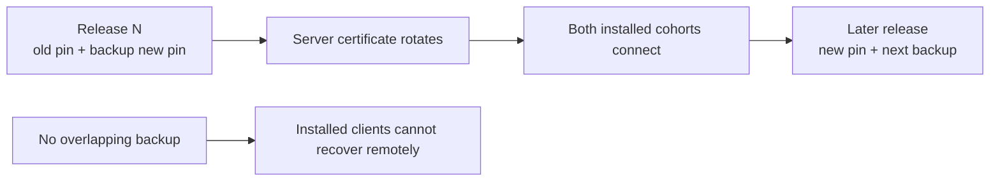

# Security: Certificate Pinning (Defeating Active MITM)

> How to make sure your app only talks to *your* servers, even when a hostile network or compromised CA issues a valid-looking certificate. Network Security Config + OkHttp `CertificatePinner` + a rotation discipline.

---

## 1. The Threat Model

TLS authenticates a server by checking its certificate chain against trusted CAs. A compromised trusted CA, or an explicitly trusted inspection CA, can make an attacker's certificate appear valid. Android apps targeting API 24 or higher [trust system CAs by default but not user-added CAs](https://developer.android.com/privacy-and-security/security-config#customize-trusted-cas); older targets and apps with custom trust settings can differ.

Pinning collapses the trust set from "any CA Android trusts" to "the specific certificate(s) we provisioned." Even with a perfectly forged cert, the connection fails.

To complement pinning, monitor **Certificate Transparency (CT) logs** for unexpected certificates submitted for your domains. Public-trust policies widely require CT logging for certificates accepted by major browsers, but CT is submission-based: an unlogged certificate is invisible to the monitor, so coverage is not exhaustive. Treat an alert about an unexpected logged certificate as an early investigation signal, not a guarantee that every rogue issuance will be detected.

---

## 2. What Exactly You Pin

You don't pin the *certificate* (it rotates periodically). You pin the **SHA-256 hash of the SubjectPublicKeyInfo (SPKI)**. SPKI is the public-key portion of the cert; it can survive certificate reissues if you reuse the same key pair.

```bash
# Extract SPKI hash from a live host
openssl s_client -servername api.example.com -connect api.example.com:443 < /dev/null \
  | openssl x509 -pubkey -noout \
  | openssl pkey -pubin -outform der \
  | openssl dgst -sha256 -binary \
  | openssl enc -base64

# Output:
# 7HIpactkIAq2Y49orFOOQKurWxmmSFZhBCoQYcRhJ3Y=
```

Pin this hash; not the cert's serial number, not the cert's full hash, not the issuer's CA. SPKI gives you the right balance: survives reissue-with-same-key, breaks if a new key pair is generated.

---

## 3. Network Security Config (Declarative, Manifest-Driven)

The declarative path, available since Android 7.0 (API 24), puts pins in XML. Verify that each networking stack in the app honors Network Security Config; a stack that uses its own TLS implementation may need its own pinning configuration. Android also [cautions against pinning for most apps](https://developer.android.com/privacy-and-security/security-ssl) because server changes can strand installed clients.

```xml
<!-- res/xml/network_security_config.xml -->
<?xml version="1.0" encoding="utf-8"?>
<network-security-config>

    <!-- Disallow cleartext in stacks that honor Network Security Config. -->
    <base-config cleartextTrafficPermitted="false">
        <trust-anchors>
            <certificates src="system" />
        </trust-anchors>
    </base-config>

    <!-- Production pins -->
    <domain-config>
        <domain includeSubdomains="true">api.example.com</domain>
        <!-- No expiration: this example keeps pinning active until an app update.
             Choose a managed expiration only if you accept the resulting loss of pinning. -->
        <pin-set>
            <pin digest="SHA-256">7HIpactkIAq2Y49orFOOQKurWxmmSFZhBCoQYcRhJ3Y=</pin>
            <!-- Backup pin: provisioned but not yet rotated to. -->
            <pin digest="SHA-256">fwza0LRMXouZHRC8Ei+4PyuldPDcf3UKgO/04cDM1oE=</pin>
        </pin-set>
    </domain-config>

    <!-- Debug-only: allow user-installed certs (for Charles/Proxyman) -->
    <debug-overrides>
        <trust-anchors>
            <certificates src="user" />
            <certificates src="system" />
        </trust-anchors>
    </debug-overrides>
</network-security-config>
```

```xml
<!-- AndroidManifest.xml -->
<application
    android:networkSecurityConfig="@xml/network_security_config"
    android:usesCleartextTraffic="false"
    ...>
```

### What Network Security Config gets you

- Applied by platform TLS components and networking libraries that use the app's Network Security Config. Check the actual behavior of OkHttp, Ktor/Retrofit engines, WebView, native code, and SDKs used by your app; do not assume coverage from the XML alone.
- `cleartextTrafficPermitted="false"` blocks cleartext in stacks that honor the app's policy. It is [best effort](https://developer.android.com/guide/topics/manifest/application-element.html#usesCleartextTraffic), not a universal block for raw sockets or every third-party SDK. Test the release app's network paths.
- `debug-overrides` only applies in `debuggable` builds, so Charles/Proxyman work in dev but never in production.
- An optional `expiration` date **disables pinning on that date**. This can preserve connectivity for clients that never update, but it also removes the extra authentication constraint. If you use it, alert and ship updated pins well before the date. See the [Network Security Config pin-set reference](https://developer.android.com/privacy-and-security/security-config#pin-set).

### What it does NOT do

- No runtime rotation. Pins are baked into the APK; changing them requires an app release.
- No conditional pinning by host header or path — only by domain.
- It cannot cover a network stack that ignores the app's Network Security Config; verify WebView and other stacks on the Android versions you support.

---

## 4. Programmatic Pinning with OkHttp (For Custom Stacks)

When you need runtime control (different pins per build flavor, kill switch, custom error handling), use OkHttp's `CertificatePinner`:

```kotlin
class PinnedOkHttpClientFactory @Inject constructor(
    private val pinConfig: PinConfig,    // injected; could come from remote config
    private val analytics: AnalyticsClient,
) {
    fun build(): OkHttpClient {
        val pinner = CertificatePinner.Builder().apply {
            for ((host, pins) in pinConfig.pins) {
                for (pin in pins) {
                    add(host, "sha256/$pin")
                }
            }
        }.build()

        return OkHttpClient.Builder()
            .certificatePinner(pinner)
            .addInterceptor(PinFailureInterceptor(analytics))
            .connectionSpecs(modernTlsOnly())
            .build()
    }

    private fun modernTlsOnly() = listOf(
        ConnectionSpec.Builder(ConnectionSpec.MODERN_TLS)
            .tlsVersions(TlsVersion.TLS_1_3, TlsVersion.TLS_1_2)
            .build()
    )
}

class PinFailureInterceptor(private val analytics: AnalyticsClient) : Interceptor {
    override fun intercept(chain: Interceptor.Chain): Response {
        return try {
            chain.proceed(chain.request())
        } catch (e: SSLPeerUnverifiedException) {
            // Pin failure! Telemetry MUST capture before re-throw.
            analytics.log("tls_pin_failure", mapOf(
                "host" to chain.request().url.host,
                "exception" to e.message.orEmpty().take(200),
            ))
            throw e
        }
    }
}
```

`CertificatePinner` augments — does not replace — the OS trust check. The cert must be valid AND match one of the pinned hashes.

---

## 5. Pin Rotation: The Two-Pin Rule



Pin rotation must overlap across installed app cohorts; a missing backup pin can turn routine certificate rotation into a persistent outage.

Certificates expire. If your only pin is today's public key and ops rotates to a different key tomorrow, installed clients can lose connectivity to that host; recovery may require an app update.

**Always pin at least two:**
- **Active pin** — what the server actually serves today.
- **Backup pin** — the *next* key pair, generated and kept offline by ops. When ops rotates, the app already trusts it.

```
Day -90:   Generate next year's key pair offline. Compute SPKI hash. Add as a *backup* pin in next release.
Day 0:     Release ships with [activePin, backupPin].
Day 365:   Ops rotates server to backupPin. Old activePin retires. Apps in the field accept seamlessly.
Day 366:   New release ships with [newActive=backupPin, newBackup=offlinePin].
```

If you ship only one pin, you've built a bricking mechanism. Treat the second pin as table stakes.

---

## 6. The Kill Switch (Pragmatic, Controversial)

Some teams maintain a server-side flag that disables pinning if an incident makes recovery impossible. Pattern:

```kotlin
val client = OkHttpClient.Builder().apply {
    if (flags.tlsPinningEnabled()) {
        certificatePinner(pinner)
    }
    // ... rest of config
}.build()
```

The flag itself must be fetched **without** going through the pinned stack — typically from a separate domain with OS-default trust. This trades a small attack surface (compromise the flag service to disable pinning everywhere) for incident-response capability.

The defensible middle ground:
- Flag exists but defaults to **enabled**.
- Flipping it requires multi-sig approval.
- Disabled state is time-bounded (auto-re-enable after 24h).
- Telemetry alerts when disabled.

If your security team forbids any kill switch, the rotation discipline becomes mandatory.

---

## 7. Pinning Other HTTP Stacks

### Ktor

```kotlin
val ktorClient = HttpClient(OkHttp) {
    engine {
        config {
            certificatePinner(pinner)        // same OkHttp pinner
        }
    }
}
```

### Cronet (Chromium net stack)

```kotlin
val builder = CronetEngine.Builder(context)
builder.addPublicKeyPins(
    "api.example.com",
    setOf(
        Base64.decode("7HIpactkIAq2Y49orFOOQKurWxmmSFZhBCoQYcRhJ3Y=", Base64.DEFAULT),
        Base64.decode("fwza0LRMXouZHRC8Ei+4PyuldPDcf3UKgO/04cDM1oE=", Base64.DEFAULT),
    ),
    /* includeSubdomains = */ true,
    GregorianCalendar(2030, Calendar.JANUARY, 1).time // replace with a managed release expiry
)
val engine = builder.build()
```

Cronet requires a `Date` expiration and a `Set<ByteArray>` of SHA-256 SPKI hashes; monitor that date before shipping. See [CronetEngine.Builder.addPublicKeyPins](https://developer.android.com/develop/connectivity/cronet/reference/org/chromium/net/CronetEngine.Builder#addPublicKeyPins(java.lang.String,%20java.util.Set%3Cbyte%5B%5D%3E,%20boolean,%20java.util.Date)).

### WebView

WebView behavior depends on Android and target SDK versions. Test that the app's Network Security Config applies to the hosts and content your WebView loads. Do not override `onReceivedSslError` to proceed past certificate failures; validate allowed URLs and keep sensitive content on HTTPS.

---

## 8. Pinning the Leaf vs Intermediate vs Root

| Pin target | Survives cert reissue? | Survives CA change? | Risk if compromised |
|---|---|---|---|
| **Leaf SPKI** | Only if the new cert reuses the same key pair | Yes, if the same key pair is recertified | Need rotation discipline |
| **Intermediate CA SPKI** | Yes, any new leaf signed by same intermediate | No (rare in practice) | An attacker with that intermediate's key can impersonate you |
| **Root CA SPKI** | Yes | No, if the new chain uses a different root | An attacker with root key can impersonate anyone using that root |

Prefer the current leaf SPKI and a separately held backup leaf key that your team controls. An intermediate SPKI pin can keep clients connected through an unexpected leaf-key change, but it also trusts any certificate issued under that intermediate; include one only when that broader trust fits your threat model.

```xml
<pin-set>
    <!-- Leaf SPKI (today's server cert) -->
    <pin digest="SHA-256">7HIpactkIAq2Y49orFOOQKurWxmmSFZhBCoQYcRhJ3Y=</pin>
    <!-- Next leaf SPKI (offline-held, will rotate to) -->
    <pin digest="SHA-256">fwza0LRMXouZHRC8Ei+4PyuldPDcf3UKgO/04cDM1oE=</pin>
    <!-- Intermediate SPKI (last-resort survival) -->
    <pin digest="SHA-256">JbQbUG5JMJUoI6brnx0x3vZF6jilxsapbXGVfjhN8Fg=</pin>
</pin-set>
```

---

## 9. Local Development & Proxying

Pinning breaks Charles, Proxyman, and `mitmproxy` because they present their own CA's cert.

```xml
<!-- Allow user-installed certs ONLY in debuggable builds -->
<debug-overrides>
    <trust-anchors>
        <certificates src="user" />
        <certificates src="system" />
    </trust-anchors>
</debug-overrides>
```

Verify the release build still pins:

```bash
# Build release APK
./gradlew assembleRelease

# Inspect the packaged config and verify the release manifest is not debuggable
aapt2 dump xmltree app/build/outputs/apk/release/app-release.apk \
    --file res/xml/network_security_config.xml
aapt2 dump xmltree app/build/outputs/apk/release/app-release.apk \
    --file AndroidManifest.xml
```

`<debug-overrides>` remains in the packaged XML, but Android [ignores it when `android:debuggable` is false](https://developer.android.com/privacy-and-security/security-config#debug-overrides). Confirm the release manifest is not debuggable. To test the pin itself, use a release build against an otherwise trusted certificate chain with a different SPKI; a user-CA proxy rejected by normal trust settings alone does not prove the pin is enforced.

---

## 10. Telemetry & Observability

Pin failures are silent killers — the user just sees "no internet." Instrument:

```kotlin
class PinFailureInterceptor(...) : Interceptor {
    override fun intercept(chain: Interceptor.Chain): Response = try {
        chain.proceed(chain.request())
    } catch (e: SSLPeerUnverifiedException) {
        // Capture host, observed SPKI hash, time, app version
        val sanInfo = extractObservedHash(e)
        analytics.log("tls_pin_failure", mapOf(
            "host" to chain.request().url.host,
            "observed_spki" to sanInfo,
            "app_version" to BuildConfig.VERSION_NAME,
            "android_api" to Build.VERSION.SDK_INT,
        ))
        throw e
    }
}
```

Dashboards to maintain:
- Pin failure rate per host per app version. Spike = ops rotated without your knowing OR an active MITM in some user's environment.
- For releases with an explicit pin expiry, days until pinning turns off. Alert at 90, 60, and 30 days; monitor rotation for releases without an expiry too.
- TLS handshake error breakdown (`SSLPeerUnverifiedException` vs `SSLHandshakeException` vs `CertificateException`).

---

## 11. Common Pitfalls

- **Only one pin.** A certificate or key rotation can cut installed clients off from the pinned host until they receive an updated app. Maintain an independently controlled backup pin.
- **Pinning the cert hash instead of SPKI.** A certificate hash changes on reissue even when the key pair stays the same. An SPKI pin survives reissue with the same key pair, but a new key pair needs a new pin.
- **Unmanaged `expiration`.** On that date, Network Security Config disables the pin set and falls back to normal certificate trust. Omitting the attribute keeps pins active indefinitely; choose this deliberately and maintain backup pins. If you set an expiry, track it per released app version and rotate beforehand.
- **Pinning third-party domains.** You don't control their cert rotation; they will break you.
- **Not testing release builds against pinning.** A debug-only trust anchor can bypass pins when its CA signs the connection; test pin rejection in a non-debuggable release build too.
- **Failing to handle `SSLPeerUnverifiedException` in the UI.** Show a meaningful "couldn't verify server — possibly a network issue" message, not just a generic network error.
- **Pin Network Security Config in shared library.** If your app and a library both ship a config, the manifest merge picks one — be explicit about which.
- **Cleartext exemptions for "debug" still in the release manifest.** `usesCleartextTraffic="true"` for `app-staging.example.com` accidentally shipped to prod.
- **Trusting `Build.VERSION.SDK_INT < 24` to skip pinning.** API 23 still in the wild on some emerging-markets devices; OkHttp's `CertificatePinner` works on all API levels.

---

## 12. Testing

```kotlin
@Test
fun release_certificatePinnerRejectsUnknownCert() {
    // Use MockWebServer with a self-signed cert
    val server = MockWebServer()
    val cert = HeldCertificate.Builder().build()
    val handshake = HandshakeCertificates.Builder()
        .heldCertificate(cert)
        .build()
    server.useHttps(handshake.sslSocketFactory(), false)
    server.start()

    val client = OkHttpClient.Builder()
        .certificatePinner(
            CertificatePinner.Builder()
                .add(server.hostName, "sha256/INTENTIONALLY_WRONG_PIN_XXXXXXXXXXXX=")
                .build()
        )
        .sslSocketFactory(handshake.sslSocketFactory(), handshake.trustManager)
        .build()

    val request = Request.Builder().url(server.url("/")).build()
    assertFailsWith<SSLPeerUnverifiedException> {
        client.newCall(request).execute()
    }
}
```

Integration test on a real device against staging with intentionally wrong pin — confirms `SSLPeerUnverifiedException` and confirms the interceptor logs.

---

## 13. Further Reading

- [Android Developers — Network Security Configuration](https://developer.android.com/training/articles/security-config) — official guide.
- [OkHttp CertificatePinner API](https://github.com/square/okhttp/blob/master/okhttp/src/commonJvmAndroid/kotlin/okhttp3/CertificatePinner.kt) — programmatic API.
- [OWASP — Certificate and Public Key Pinning](https://owasp.org/www-community/controls/Certificate_and_Public_Key_Pinning) — threat model and tradeoffs.
- [HPKP retrospective (Mozilla)](https://blog.mozilla.org/security/2018/10/09/) — why HTTP Public Key Pinning failed on the web (relevant context for mobile pinning).
- [Cronet PublicKeyPins API](https://developer.android.com/develop/connectivity/cronet) — for Cronet-based stacks.

---

> **In short:** pin SPKI hashes via Network Security Config (and OkHttp `CertificatePinner` if you need runtime control). Always ship a backup pin. Rotate yearly with overlap. Telemetry pin failures. Make sure debug-only overrides never reach production.
