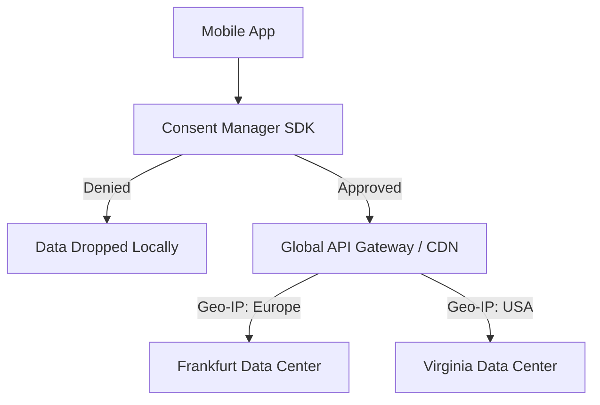

# Security & Privacy: GDPR, CCPA, and Data Residency

## The Prompt

*"Your company is expanding its mobile app into the European Union (EU). The app currently sends all analytics, crash reports, and user profile data to a centralized server in Virginia, USA. The legal team states this violates GDPR and Data Residency laws. Design a mobile architecture to achieve global compliance without maintaining completely separate codebases for every country."*

## 1. Requirements & Clarification (RADIO Framework)

### Functional Requirements
- The mobile app must respect regional privacy laws (GDPR in Europe, CCPA in California).
- Users must be able to explicitly consent to (or opt-out of) data collection.
- EU citizen data must physically reside on servers located within the EU (Data Residency).

### Non-Functional Requirements (NFRs)
- **Maintainability:** We cannot maintain a `eu.company.app` and a `us.company.app`. A single binary must handle global compliance.
- **Performance:** Routing decisions based on geography must not introduce noticeable latency to API calls.

## 2. High-Level Architecture (The Consent & Routing Pipeline)

A Junior engineer hardcodes API URLs and assumes "opt-out" means wrapping `Analytics.logEvent()` in an `if (userAgreed)` block, which inevitably leaks when a new engineer forgets the check.
A Staff engineer builds a **Centralized Consent Manager** and relies on **Geo-Routing at the Edge**.

## 3. The Core Flows (Deep Dive)

### Flow 1: The Consent Manager (Client-Side Enforcement)
*Interviewer:* "A developer adds a new third-party SDK for tracking marketing attribution. They forget to check the user's GDPR consent status. The company is fined. How do you architect the mobile app to make this mistake impossible?"

**Staff Answer:**
"We implement the **Facade Pattern** combined with a **Consent Manager**.
1. Developers are strictly forbidden from calling third-party SDKs directly (e.g., `FirebaseAnalytics.logEvent()`).
2. We create an internal `TelemetryService` interface.
3. The `ConsentManager` is initialized on app startup. It queries a backend endpoint (or local encrypted cache) to determine the user's jurisdiction (e.g., EU vs US) and their explicit consent boolean.
4. When a developer calls `TelemetryService.track(Event)`, the service queries the `ConsentManager`.
5. If `Consent == false`, the event is dropped silently on the client. It never touches the network.
6. The CI pipeline runs static analysis (Lint/Detekt) to fail the build if any direct imports of third-party analytics SDKs are detected outside of the `TelemetryService` implementation."

### Flow 2: Data Residency (Edge Routing)
*Interviewer:* "The user is in Germany and has consented to data collection. However, GDPR requires their data to be stored in the EU. Your primary database is in the USA. How does the mobile app know where to send the data?"

**Staff Answer:**
"The mobile app *should not* know. Hardcoding regional URLs (e.g., `eu.api.company.com`) into the mobile client is an anti-pattern because users travel, and IP addresses change.
1. The mobile app always points to a single, global Anycast IP or CDN (e.g., Cloudflare, AWS CloudFront) using `api.company.com`.
2. The CDN terminates the TLS connection at the Edge (closest to the user).
3. The CDN reads the user's physical Geo-IP or a JWT claim containing their home region.
4. The Edge Router explicitly forwards the HTTP request to the isolated Frankfurt Data Center.
The mobile app remains ignorant of topology; it relies on the infrastructure to enforce physical data residency."

### Flow 3: The "Right to be Forgotten" (Account Deletion)
*Interviewer:* "Under GDPR, a user can request their account be deleted. The mobile app has an 'offline mode' that caches their private messages in a local Room database. If they delete their account via the website, how do you ensure the data is scrubbed from the physical mobile device?"

**Staff Answer:**
"We must implement an **Asynchronous Wipe Protocol** tied to the auth session.
1. When the user clicks 'Delete Account' on the web, the backend revokes their OAuth Refresh Token.
2. The backend sends a Silent Push Notification (FCM Data payload) to all registered mobile devices for that user: `{"action": "WIPE_DATA"}`.
3. When the mobile app receives the push (or when the next API call fails with HTTP 401 Unauthorized), the `SessionManager` executes a localized wipe.
4. It calls `clearAllTables()` on the Room DB, wipes the `EncryptedSharedPreferences`, and calls `WorkManager.cancelAllWork()`.
5. It then navigates the user back to the Login screen."

## 4. Failure Modes & Bottlenecks

### Bottleneck: PII in Crash Reports
*Problem:* A developer logs an error: `Crashlytics.log("Failed to load user: " + user.email)`. Email is Personally Identifiable Information (PII). Sending PII to Crashlytics violates GDPR.
*Solution:* **Data Sanitization Interceptors**.
Before any string is sent to the Crashlytics SDK, it must pass through a Regex Sanitizer that actively masks emails, phone numbers, and credit cards (e.g., replacing `john@gmail.com` with `j***@g***.com`). Furthermore, the code review process must flag any concatenation of domain objects in logging statements.

### Bottleneck: Third-Party SDK Data Hoarding
*Problem:* You integrate a "free" analytics SDK. Even if you don't explicitly send it PII, the SDK silently reads the device's MAC address, Android ID, and installed apps list, and uploads it to their servers.
*Solution:* **Zero Trust SDK Integration**.
1. Never integrate an SDK without a legal review of its data collection policies.
2. Use Network Security Configuration to strictly monitor what domains the app is talking to during staging.
3. On modern Android (10+), MAC addresses and IMEI are heavily restricted, but you must ensure your app does not request `READ_PHONE_STATE` unless absolutely necessary, as it grants SDKs the power to harvest hardware identifiers.

## 5. Staff Engineer Thinking: Security as a Platform

A Staff Engineer recognizes that privacy cannot be enforced by hoping 100 developers read a Confluence document. Privacy must be enforced by the compiler, the CI pipeline, and the API gateway. If a developer *can* easily violate GDPR, the architecture is flawed. By wrapping third-party SDKs, utilizing Anycast routing, and automating data sanitization, the organization achieves compliance by default.

## Further Reading
- [`telemetry-sdk.md`](../mobile-system-design/telemetry-sdk.md) (How the Facade pattern hides Firebase).
- [`authentication.md`](../mobile-system-design/authentication.md) (How session revokes trigger local wipes).
