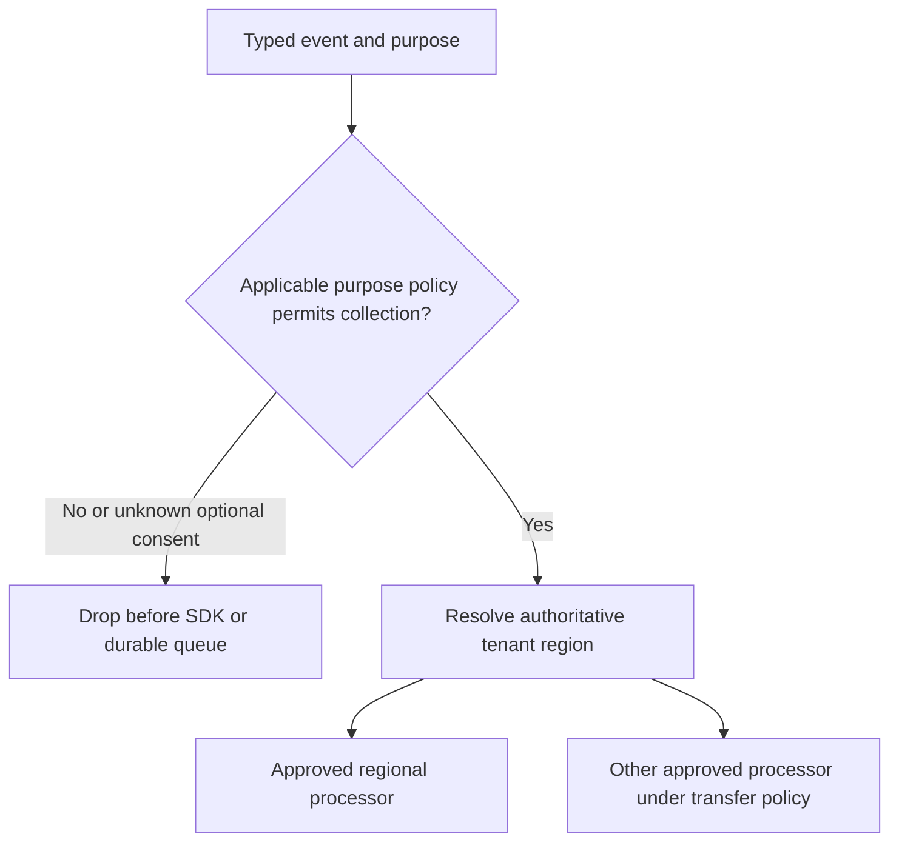

# Security and Privacy: GDPR, CCPA and Data Residency

## The Prompt

A mobile app sends analytics, crash reports and profile data to a US backend. It is expanding into Europe. Determine the applicable processing, transfer and residency requirements before designing regional routing; the destination alone does not establish that the deployment is unlawful.

GDPR is not a blanket rule that EU citizens' data must remain in the EU. Its territorial scope is not citizenship, consent is one of several lawful bases, and Chapter V provides conditions for international transfers. Erasure also has exceptions and retention obligations. CCPA/CPRA has distinct applicability, notice, deletion, sale/sharing opt-out and sensitive-information rules; do not reduce both regimes to one consent boolean. Product counsel supplies the applicable policy; engineering must make that policy enforceable and testable.

## Requirements to Resolve

For each data class, record purpose, lawful basis or other applicable permission, destination and processors, retention, subject-rights handling, and any contractual or sector-specific location restriction. Separate operational/security processing from optional marketing. The answer can differ by purpose even for the same user.

A user travelling through Germany does not necessarily change the account's residency contract. VPNs, roaming and mobile carrier routing make Geo-IP an unreliable legal-policy authority. Store an authoritative account/tenant region, resolve it server-side, and define migration and unauthenticated bootstrap behavior.

## Consent and Collection Pipeline

The collection decision and approved destination follow purpose/account policy, rather than inferring permission from physical IP location.

A facade and lint rule can prevent accidental direct analytics calls, but cannot make leakage impossible. SDK auto-initializers, automatic events, crash uploads, native code and transitive SDKs need separate review. Configure optional collection before startup, keep a versioned purpose-specific policy, and apply changes to queued events as well as new ones. Withdrawal stops processing that depends on that consent; it is not a universal deletion command for every legal-purpose record.

## Residency Is More Than Edge Routing

A global hostname can resolve to an appropriate region, but TLS termination, CDN logs, cache copies, backups, disaster recovery, support access and subprocessors can still cross boundaries. A regional hostname is also legitimate when it expresses an approved stable account region. Choose either from the complete data-flow contract, not from a rule that regional URLs are always wrong.

Enforce region/purpose at trusted ingress and downstream stores, including telemetry destinations. A client-supplied region claim is not authorization. Track approved processor locations and remote-access arrangements; verify any required transfer mechanism independently of encryption and consent. Geography, minimization, access control and retention are separate controls.

## Deletion and Offline Devices

Account deletion is a durable server workflow with completion tracking, processor requests and recorded lawful-retention exceptions. Revoke the account/session, reject future writes from retired sessions, and prevent a late offline outbox from recreating deleted server data.

A push may prompt local cleanup, but it can be delayed or lost and cannot erase an unreachable phone on demand. On resumption, the client checks session/account status, retires the captured session and clears only that account's tokens, local rows, files and scheduled work. Do not run global `clearAllTables()` or `cancelAllWork()` from an old-session callback after another account signs in. A generic 401 alone is not proof of account deletion; use the reviewed terminal-session/deletion contract.

For unusually sensitive offline data, consider authentication-bound encryption and a defined offline-access lifetime. Document the residual limit: a permanently offline or compromised device cannot be guaranteed to execute a remote wipe.

## Telemetry and SDK Review

Use typed allowlisted fields and minimization before serialization. Hashing or partially masking an identifier does not automatically anonymize it. Regex scrubbing is a secondary guard, not proof that arbitrary strings contain no personal data. Avoid free-form user content in crash breadcrumbs; retain approved operational context with controlled access and retention.

Network Security Configuration controls trust, pinning and cleartext policy for participating stacks; it is not a network monitor or general domain-egress firewall. Use approved traffic inspection, SDK documentation and release-device observations to discover actual collection. `READ_PHONE_STATE` alone does not grant ordinary modern apps unrestricted IMEI access; inspect each API's target/version and privileged-access rules rather than equating one permission with all identifiers.

## Data-Minimization Register

| Data class | Example | Required decision |
|---|---|---|
| Direct identifier | Email or phone | Necessary purpose, access and retention; normally exclude from telemetry |
| Linkable metadata | IP, device/session ID, location | Assess identifiability and purpose; pseudonymization is not anonymity |
| User content | Search, messages, health/financial fields | Specific product/legal review and deletion/recovery policy |
| Operational context | Version, OS, stack trace | Minimize fields; review rare/identifying combinations |
| Aggregate metric | Cohort crash rate or startup percentile | Ensure grouping and retention do not reveal individual activity |

Record an owner, processor/destination, retention period and subject-rights handling for every field. Collection being technically possible is not evidence of necessity or permission.

## Enforcement Points

| Layer | Control | Limit to test |
|---|---|---|
| API and schema | Allowlisted typed fields and purpose tags | Generic maps/free-form strings can bypass the schema |
| Client facade | Gate collection before SDK/queue creation | SDK auto-initialization and automatic events need separate controls |
| Build and review | Dependency inventory and banned direct calls | Lint does not prove native or transitive SDK behavior |
| Backend ingress/storage | Authenticate owner, enforce region/purpose/retention | Logs, backups and subprocessors must follow the same policy |
| Support and deletion | Scoped access, audit and durable deletion workflow | Offline/compromised devices may never execute a remote wipe |

## Review Checklist

- Is every collected field necessary for a recorded purpose?
- Does optional collection stay off before an applicable choice, including SDK startup?
- Is the region authoritative and stable across travel and account switch?
- Do logs, backups and processor access satisfy the same policy as primary storage?
- Can deletion and consent changes handle queued uploads and old-session callbacks?
- Are processor inventories and user-facing declarations consistent with observed behavior?

These controls support compliance; a wrapper, CDN or sanitizer does not confer compliance automatically.

## Further Reading

- [GDPR text, Articles 3, 6, 17 and Chapter V](https://eur-lex.europa.eu/eli/reg/2016/679/oj/eng).
- [EDPB international-transfer guidance](https://www.edpb.europa.eu/sme/be-compliant/international-data-transfers_en).
- [California Attorney General: CCPA rights and applicability](https://oag.ca.gov/privacy/ccpa).
- [Android Network Security Configuration](https://developer.android.com/privacy-and-security/security-config).
- [Android non-resettable identifier restrictions](https://developer.android.com/about/versions/10/privacy/changes#non-resettable-device-ids).
- [Telemetry purpose and governance matrix](../observability/telemetry-taxonomy.md).
- [Session-safe local cleanup](auth-on-mobile.md#5-logout).
