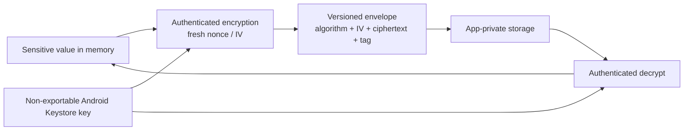

# Secure Storage on Android

> Canonical owner for Android secret-at-rest decisions. Android Keystore protects cryptographic key material; it is not a general-purpose secret database. Store only what the product truly needs, keep server credentials off the client, and choose encryption from a written threat model.

## Current Platform Position

AndroidX Security Crypto 1.1.0 deprecated `EncryptedSharedPreferences`, `EncryptedFile`, `MasterKey`, and the rest of that artifact's crypto API in favor of platform storage APIs and direct use of Android Keystore. Existing installations do not become insecure merely because an API is deprecated, but new architecture should not present those wrappers as the default.

This distinction matters throughout this repository:

- **Legacy application:** keep an existing `EncryptedSharedPreferences` vault working, exclude it from backup, and plan an observable migration.
- **New application:** generate a non-exportable key with `AndroidKeyStore`; encrypt only when the threat model requires encryption at rest; store the resulting IV and ciphertext in an ordinary private file, DataStore, SharedPreferences, or database.
- **High-value service secret:** do not store it on the device. Put it behind a backend and issue short-lived, scoped client credentials.

## Threat Model

Separate threats before choosing a mechanism:

| Threat | App-private storage | Keystore-backed encryption | Server control |
|---|---|---|---|
| Another normal app reads the file | Protected by Android UID sandbox | Protected | Protected |
| Backup or copied data file leaks | Depends on backup rules | Ciphertext remains protected while the key is unavailable | Protected |
| Rooted/compromised OS uses the app's key | Weak | The attacker may invoke a usable key even when it is non-exportable | Revoke or reject server-side |
| App process is compromised after decryption | Weak | Weak; plaintext exists in the process | Short TTL and step-up limit impact |
| APK contains a vendor/server secret | Exposed | Exposed before Keystore enrollment | Keep the secret on the server |

Keystore makes key extraction more difficult and can bind a key to TEE or StrongBox hardware. It does not make extraction or misuse “physically impossible,” and hardware backing is not guaranteed for every device, algorithm, or configuration. Inspect `KeyInfo.securityLevel` on supported API levels when policy depends on the result.

## Storage Decision

| Data | Recommended treatment |
|---|---|
| Theme, locale, onboarding state | Plain private DataStore |
| Short-lived access token | Prefer memory; persist only if required for product continuity |
| Refresh token | Private storage plus short rotation/reuse controls; add Keystore-backed encryption when the threat model justifies it |
| Device signing key | Generate directly in Android Keystore; keep key material non-exportable |
| Offline user content | Room/files; encrypt selectively or use a reviewed database-encryption product |
| Third-party billing secret or signing private key | Never ship it in the APK; proxy or sign server-side |
| Biometric-gated high-risk action | Authentication-bound Keystore key plus server-side authorization |

Encryption is not a substitute for minimization, token expiry, revocation, backup policy, log redaction, or server authorization.

## Direct Keystore Envelope



Keystore protects key material, not arbitrary data storage: ciphertext lives in private storage with versioned metadata for decryption, rotation, migration, or safe rejection.

The platform primitive is a non-exportable key. The application stores the ciphertext and IV, not the key bytes.

```kotlin
data class EncryptedBlob(
    val iv: ByteArray,
    val ciphertext: ByteArray,
)

class AndroidKeystoreAead(
    private val alias: String = "token_vault_key",
) {
    private val keyStore = KeyStore.getInstance("AndroidKeyStore").apply { load(null) }

    private fun getOrCreateKey(): SecretKey {
        (keyStore.getKey(alias, null) as? SecretKey)?.let { return it }

        return KeyGenerator.getInstance(
            KeyProperties.KEY_ALGORITHM_AES,
            "AndroidKeyStore",
        ).run {
            init(
                KeyGenParameterSpec.Builder(
                    alias,
                    KeyProperties.PURPOSE_ENCRYPT or KeyProperties.PURPOSE_DECRYPT,
                )
                    .setBlockModes(KeyProperties.BLOCK_MODE_GCM)
                    .setEncryptionPaddings(KeyProperties.ENCRYPTION_PADDING_NONE)
                    .setKeySize(256)
                    .build(),
            )
            generateKey()
        }
    }

    fun encrypt(plaintext: ByteArray, associatedData: ByteArray? = null): EncryptedBlob {
        val cipher = Cipher.getInstance("AES/GCM/NoPadding")
        cipher.init(Cipher.ENCRYPT_MODE, getOrCreateKey())
        associatedData?.let(cipher::updateAAD)
        return EncryptedBlob(cipher.iv, cipher.doFinal(plaintext))
    }

    fun decrypt(blob: EncryptedBlob, associatedData: ByteArray? = null): ByteArray {
        val cipher = Cipher.getInstance("AES/GCM/NoPadding")
        cipher.init(Cipher.DECRYPT_MODE, getOrCreateKey(), GCMParameterSpec(128, blob.iv))
        associatedData?.let(cipher::updateAAD)
        return cipher.doFinal(blob.ciphertext)
    }
}
```

Production code must define a versioned binary format for `iv + ciphertext`, use associated data to bind ciphertext to its user/account/purpose, serialize access to first-use key creation, and convert authentication failures into a deliberate re-authentication path. Do not reuse an IV with the same GCM key.

## StrongBox and Hardware Backing

`setIsStrongBoxBacked(true)` is a request, not a transparent fallback. Key generation can throw `StrongBoxUnavailableException`; the application must decide whether to retry without StrongBox, disable the feature, or block enrollment. That decision belongs to product security policy.

For API 29 and newer, inspect `KeyInfo.securityLevel`:

```kotlin
fun securityLevel(alias: String): Int {
    val store = KeyStore.getInstance("AndroidKeyStore").apply { load(null) }
    val key = store.getKey(alias, null) as SecretKey
    val factory = SecretKeyFactory.getInstance(key.algorithm, "AndroidKeyStore")
    val info = factory.getKeySpec(key, KeyInfo::class.java) as KeyInfo
    return info.securityLevel
}
```

`SECURITY_LEVEL_STRONGBOX` and `SECURITY_LEVEL_TRUSTED_ENVIRONMENT` indicate secure-hardware backing. Software backing can still provide non-exportability through the system process, but it does not meet the same assurance level.

## Authentication-Bound Keys

For a high-risk operation, bind a key to recent or per-use user authentication with `setUserAuthenticationRequired(true)` and `setUserAuthenticationParameters(...)`. Design recovery before enabling invalidation:

- biometric enrollment can invalidate a configured key;
- removing the secure lock screen can invalidate keys;
- authentication state can expire;
- device restore does not restore the old Keystore key;
- StrongBox can be unavailable or temporarily fail.

Catch `KeyPermanentlyInvalidatedException`, delete ciphertext that can no longer be opened, create a new key, and require account re-authentication. Never trap the user in an infinite biometric prompt.

## Backup and Device Transfer

Keystore keys are device-bound while application files may participate in cloud backup or device transfer. Restoring ciphertext without its key produces permanent decryption failures. Exclude encrypted vault files and keyset metadata through both legacy `fullBackupContent` rules and Android 12+ `dataExtractionRules`, then test backup and restore on real devices.

Disabling all backup is not automatically the right answer: user-created content may deserve backup while tokens and encrypted key material do not. Classify files individually.

## Migration from EncryptedSharedPreferences

Treat migration as a data migration, not a dependency substitution:

1. Ship code that can read the legacy vault and write the new versioned ciphertext format.
2. On successful read, write and verify the new record before deleting the old one.
3. Record only non-sensitive migration outcomes: migrated, legacy-corrupt, key-invalidated, or re-auth-required.
4. Keep rollback compatibility for the release window; avoid alternating writers.
5. Remove AndroidX Security Crypto only after telemetry shows the legacy population is negligible.

Do not silently fall back to plaintext when migration or decryption fails.

## Failure Modes and Observability

| Failure | Response | Safe telemetry |
|---|---|---|
| Key permanently invalidated | Wipe dependent ciphertext and re-authenticate | Exception class, key generation, app version |
| AEAD authentication failure | Treat as corruption/tampering; never return partial plaintext | Format version and outcome only |
| StrongBox unavailable | Apply documented fallback policy | Requested and actual security level |
| Restored ciphertext lacks key | Clear vault and re-authenticate | Restore-detected outcome |
| Token appears in logs | Incident response and token revocation | Never log the token itself |

Never send aliases, ciphertext, IVs, plaintext lengths for sensitive records, or key material to analytics unless a security review explicitly approves it.

## Probing Questions

1. What guarantee does Android Keystore provide that an encrypted preferences file alone cannot?
2. Why can a rooted attacker sometimes use a non-exportable key even if they cannot extract its bytes?
3. When is plain app-private storage a reasonable choice for an access token?
4. How do you distinguish TEE, StrongBox, and software-backed keys at runtime?
5. Why must ciphertext backup policy be coordinated with Keystore key lifecycle?
6. Design a rollback-safe migration from `EncryptedSharedPreferences` to a versioned Keystore-backed envelope.
7. What data belongs in associated authenticated data for a token record?
8. Which failures require silent retry, and which require user re-authentication?

## Answer Key

1. Keystore keeps key material non-exportable and can enforce use restrictions outside the app process; an encrypted file merely stores ciphertext.
2. Non-exportability prevents copying key bytes, not invoking an authorized key through a compromised process or OS.
3. When the UID sandbox and short token lifetime satisfy the threat model, backups are controlled, and extra encryption would not reduce the dominant risk.
4. Retrieve `KeyInfo` and inspect `securityLevel` on API 29+; never infer backing from device model.
5. Ciphertext can be restored while its device-bound key cannot, creating an unrecoverable record unless the app clears it and re-authenticates.
6. Dual-read, single-write to the new format; verify before deleting legacy data; instrument outcomes; keep rollback compatibility for a bounded window.
7. Stable context that must not be swapped—such as account ID, record purpose, and schema version—but no secret that must later be recovered from the ciphertext.
8. Transient provider failures may be retried with limits; invalidated/missing keys and authentication failures require an explicit recovery or re-authentication path.

## Further Reading

- [Android Keystore system](https://developer.android.com/privacy-and-security/keystore) — guarantees, security levels, and key authorizations.
- [AndroidX Security releases](https://developer.android.com/jetpack/androidx/releases/security) — Security Crypto deprecation record.
- [EncryptedSharedPreferences API](https://developer.android.com/reference/androidx/security/crypto/EncryptedSharedPreferences) — legacy API and backup warning.
- [Key attestation](https://developer.android.com/privacy-and-security/security-key-attestation) — server verification for hardware-backed asymmetric keys.
- [Google Tink](https://developers.google.com/tink) — optional reviewed cryptographic library; validate current Android integration separately.
- [`key-management.md`](key-management.md) — server/client secret classification and signing-key custody.
